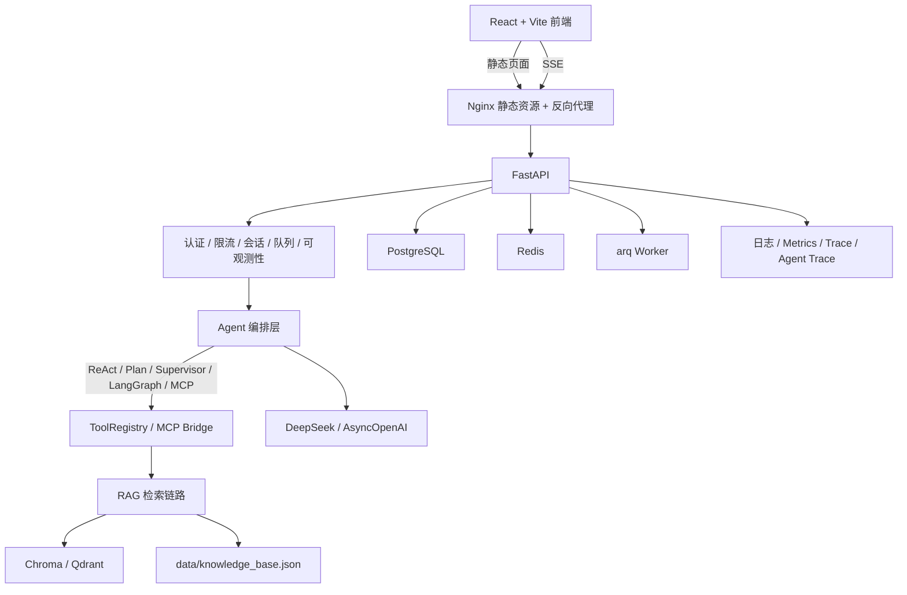

# 01 项目全景与链路地图

> 本文架构图表示模块能力地图，不代表所有请求都经过所有模块。实际默认路径及边界见
> [10_源码事实核对](10_源码事实核对与项目边界.md)：Query Rewrite 不在默认聊天链路，
> 队列仅承接部分任务，graph stream 与 start/resume 持久化路径也需分别理解。

## 1. 一句话定位

这是一个从 Day 1 到 Day 70 逐步完成的 AI 求职分析 Agent：

```text
解析岗位 JD -> 从知识库检索相关主题 -> 生成岗位分析、技能差距和学习建议 -> 由 Agent 决定调用哪些工具 -> 通过多 Agent、MCP、安全与生产化能力变成一个可部署服务。
```

面试时先讲业务目标，再讲学习目标。业务目标是“求职分析”，学习目标是“AI Agent 应用工程师的完整工程能力”。

## 2. 总架构图

这张图是最重要的一张图。建议背到能默画。



对应的入口是 [app/main.py](/Users/zhitong/Desktop/ai-agent/ai-job-agent/app/main.py)，lifespan 在 [app/main.py](/Users/zhitong/Desktop/ai-agent/ai-job-agent/app/main.py) 创建了异步 LLM client、信号量、PostgreSQL 连接池、Redis、arq queue 和 session store。

## 3. 代码分层地图

| 层 | 关键文件 | 职责 |
|---|---|---|
| API 入口 | [app/main.py](/Users/zhitong/Desktop/ai-agent/ai-job-agent/app/main.py) | 路由、lifespan、认证依赖、SSE 接口 |
| 数据模型 | [app/models.py](/Users/zhitong/Desktop/ai-agent/ai-job-agent/app/models.py) | JD、分析、聊天、ReAct、Plan、Supervisor、GraphRunStatus |
| 配置 | [app/config.py](/Users/zhitong/Desktop/ai-agent/ai-job-agent/app/config.py) | Pydantic Settings，环境变量和校验 |
| LLM 与结构化输出 | [app/llm.py](/Users/zhitong/Desktop/ai-agent/ai-job-agent/app/llm.py)、[app/async_llm.py](/Users/zhitong/Desktop/ai-agent/ai-job-agent/app/async_llm.py)、[app/structured_output.py](/Users/zhitong/Desktop/ai-agent/ai-job-agent/app/structured_output.py) | OpenAI/DeepSeek 调用、重试、结构化解析 |
| Prompt | [app/prompts.py](/Users/zhitong/Desktop/ai-agent/ai-job-agent/app/prompts.py) | 业务 Prompt 集中管理 |
| RAG | [app/chunking.py](/Users/zhitong/Desktop/ai-agent/ai-job-agent/app/chunking.py)、[app/rag.py](/Users/zhitong/Desktop/ai-agent/ai-job-agent/app/rag.py)、[app/vector_store.py](/Users/zhitong/Desktop/ai-agent/ai-job-agent/app/vector_store.py) | 切分、混合检索、重排、向量库 |
| Agent | [app/react.py](/Users/zhitong/Desktop/ai-agent/ai-job-agent/app/react.py)、[app/tools.py](/Users/zhitong/Desktop/ai-agent/ai-job-agent/app/tools.py) | ReAct 循环、工具注册表 |
| 多 Agent | [app/plan_execute.py](/Users/zhitong/Desktop/ai-agent/ai-job-agent/app/plan_execute.py)、[app/supervisor.py](/Users/zhitong/Desktop/ai-agent/ai-job-agent/app/supervisor.py)、[app/supervisor_graph.py](/Users/zhitong/Desktop/ai-agent/ai-job-agent/app/supervisor_graph.py) | Plan、Supervisor、LangGraph |
| MCP | [app/mcp_server.py](/Users/zhitong/Desktop/ai-agent/ai-job-agent/app/mcp_server.py)、[app/mcp_client.py](/Users/zhitong/Desktop/ai-agent/ai-job-agent/app/mcp_client.py)、[app/mcp_agent_bridge.py](/Users/zhitong/Desktop/ai-agent/ai-job-agent/app/mcp_agent_bridge.py) | Server、Client、Bridge |
| 安全 | [app/prompt_guard.py](/Users/zhitong/Desktop/ai-agent/ai-job-agent/app/prompt_guard.py)、[app/tool_policy.py](/Users/zhitong/Desktop/ai-agent/ai-job-agent/app/tool_policy.py)、[app/sensitive_data.py](/Users/zhitong/Desktop/ai-agent/ai-job-agent/app/sensitive_data.py)、[app/red_team.py](/Users/zhitong/Desktop/ai-agent/ai-job-agent/app/red_team.py) | 输入护栏、权限、脱敏、红队 |
| 后端生产 | [app/postgres.py](/Users/zhitong/Desktop/ai-agent/ai-job-agent/app/postgres.py)、[app/redis_*](/Users/zhitong/Desktop/ai-agent/ai-job-agent/app/redis_session_cache.py)、[app/queue.py](/Users/zhitong/Desktop/ai-agent/ai-job-agent/app/queue.py)、[app/auth_*](/Users/zhitong/Desktop/ai-agent/ai-job-agent/app/auth_security.py) | 连接池、缓存、队列、认证 |
| 可观测 | [app/http_observability.py](/Users/zhitong/Desktop/ai-agent/ai-job-agent/app/http_observability.py)、[app/observability.py](/Users/zhitong/Desktop/ai-agent/ai-job-agent/app/observability.py)、[app/cost_tracker.py](/Users/zhitong/Desktop/ai-agent/ai-job-agent/app/cost_tracker.py) | 日志、Trace、指标、成本 |
| 部署 | [Dockerfile](/Users/zhitong/Desktop/ai-agent/ai-job-agent/Dockerfile)、[docker-compose.yml](/Users/zhitong/Desktop/ai-agent/ai-job-agent/docker-compose.yml)、`.github/workflows/*.yml` | 容器与 CI/CD |

## 4. 四个核心闭环

面试前先背下这四句：

### RAG 闭环

```text
切分 -> Embedding -> 向量库 -> 查询改写 -> 混合检索 -> 重排 -> 上下文注入 -> 生成 -> 引用来源
```

### Agent 闭环

```text
理解目标 -> 决策工具 -> 执行工具 -> 观察结果 -> 更新上下文 -> 再次决策
```

### 多 Agent 闭环

```text
Supervisor 路由 -> Worker 执行 -> Handoff -> LangGraph checkpoint -> 中断/恢复
```

### 生产闭环

```text
提交代码 -> CI -> 构建镜像 -> GHCR -> 服务器 pull -> Compose 启动 -> Nginx 公网访问
```

## 5. 主要 API 与链路归属

| API | 链路 | 对应实现 |
|---|---|---|
| `POST /jd/parse` | 结构化输出 | [app/main.py](/Users/zhitong/Desktop/ai-agent/ai-job-agent/app/main.py) -> [app/async_agent.py](/Users/zhitong/Desktop/ai-agent/ai-job-agent/app/async_agent.py) |
| `POST /jd/analyze` | RAG + Function Calling | [app/main.py](/Users/zhitong/Desktop/ai-agent/ai-job-agent/app/main.py) -> [app/async_agent.py](/Users/zhitong/Desktop/ai-agent/ai-job-agent/app/async_agent.py) |
| `POST /chat`、`/chat/stream` | RAG + 会话记忆 + 流式 | [app/main.py](/Users/zhitong/Desktop/ai-agent/ai-job-agent/app/main.py) -> [app/async_agent.py](/Users/zhitong/Desktop/ai-agent/ai-job-agent/app/async_agent.py) |
| `POST /agent/stream` | ReAct + 审批 + Trace | [app/main.py](/Users/zhitong/Desktop/ai-agent/ai-job-agent/app/main.py) -> [app/react.py](/Users/zhitong/Desktop/ai-agent/ai-job-agent/app/react.py) |
| `POST /agent/plan/stream` | Plan-and-Execute | [app/main.py](/Users/zhitong/Desktop/ai-agent/ai-job-agent/app/main.py) -> [app/plan_execute.py](/Users/zhitong/Desktop/ai-agent/ai-job-agent/app/plan_execute.py) |
| `POST /agent/supervisor/stream` | Supervisor + Handoff | [app/main.py](/Users/zhitong/Desktop/ai-agent/ai-job-agent/app/main.py) -> [app/supervisor.py](/Users/zhitong/Desktop/ai-agent/ai-job-agent/app/supervisor.py) |
| `POST /agent/graph/start` | LangGraph checkpoint | [app/main.py](/Users/zhitong/Desktop/ai-agent/ai-job-agent/app/main.py) -> [app/supervisor_graph.py](/Users/zhitong/Desktop/ai-agent/ai-job-agent/app/supervisor_graph.py) |
| `POST /agent/mcp/stream` | MCP + ReAct | [app/main.py](/Users/zhitong/Desktop/ai-agent/ai-job-agent/app/main.py) -> [app/mcp_agent.py](/Users/zhitong/Desktop/ai-agent/ai-job-agent/app/mcp_agent.py) |

## 6. 70 天按闭环归并

### 第 1 周到第 2 周：从 Python 到基础 RAG

- Day 1 到 Day 7：Python、FastAPI、Pydantic、DeepSeek、Function Calling、基础 RAG、多步 JD 分析。
- Day 8 到 Day 14：文本切分、BM25、混合检索、Chroma、会话记忆、引用来源、检索评估。

对应链路：02 RAG 的前半段。

### 第 3 周到第 4 周：ReAct Agent 与流式交付

- Day 15 到 Day 21：ReAct、ToolRegistry、多 tool_calls、重试、审批、输入护栏、AgentState。
- Day 22 到 Day 28：SSE、前后端流式、Agent 评估、本地 Trace、Docker Compose MVP。

对应链路：03 Agent 核心链路。

### 第 5 周到第 7 周：Prompt、RAG 工程化、多 Agent

- Day 29 到 Day 35：上下文预算、Prompt 管理、结构化输出、模型注册表、Prompt 评估。
- Day 36 到 Day 42：chunk 元数据、Embedding 注册表、Qdrant、重排、Query Rewriting、RAG 评估。
- Day 43 到 Day 49：Plan-and-Execute、Supervisor、Handoff、LangGraph、checkpoint、共享记忆、幂等、租户。

对应链路：02 RAG 后半段 + 04 多 Agent。

### 第 8 周：MCP 与安全

- Day 50 到 Day 56：MCP Server、Client、Bridge、权限、护栏、脱敏、红队。

对应链路：05 MCP + 06 安全。

### 第 9 周到第 10 周：生产化与部署

- Day 57 到 Day 63：异步、PostgreSQL、Redis、arq、JWT、压测、稳定性。
- Day 64 到 Day 70：Docker、Compose、配置、日志、Metrics、OTel、成本、CI/CD。

对应链路：07 后端生产 + 08 可观测与部署。

## 7. 如何用这张地图

1. 每次复习前先默画总架构图。
2. 选一条链路，打开对应文档，先讲图再读代码。
3. 每读一个文件，问自己：它在上游接收什么，向下游输出什么，异常时怎么办。
4. 最后回到 `09_面试口述与追问清单.md`，做输出复述。
