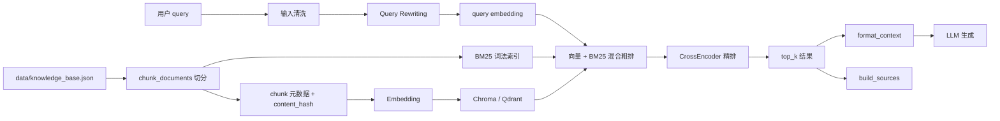

# 02 RAG 链路：从文档到有来源的回答

## 1. 一句话定义

RAG 不是把知识库塞给模型，而是：

```text
先检索相关资料，再把检索结果注入 Prompt，让模型基于资料生成回答，并返回来源。
```

它解决两个问题：模型知识过期或私有知识不可见，以及模型容易编造。

## 2. 完整流程图

下面是能力组合图。默认聊天 API 直接调用 retriever，没有接入 Query Rewriting；
向量入库、不同 retriever 版本和过滤边界见 [10](10_源码事实核对与项目边界.md)，不能把图中的每步都说成默认执行。



## 3. 节点与文件映射

| 节点 | 知识点 | 关键文件与位置 | 对应天数 |
|---|---|---|---|
| 文档加载 | JSON 知识库结构 | [app/rag.py](/Users/zhitong/Desktop/ai-agent/ai-job-agent/app/rag.py) | Day 5 |
| 文本切分 | fixed / semantic / paragraph | [app/chunking.py](/Users/zhitong/Desktop/ai-agent/ai-job-agent/app/chunking.py)、[app/chunking.py](/Users/zhitong/Desktop/ai-agent/ai-job-agent/app/chunking.py)、[app/chunking.py](/Users/zhitong/Desktop/ai-agent/ai-job-agent/app/chunking.py) | Day 8、Day 36 |
| token 估算 | tiktoken cl100k_base | [app/chunking.py](/Users/zhitong/Desktop/ai-agent/ai-job-agent/app/chunking.py) | Day 29、Day 36 |
| 内容指纹 | SHA1 | [app/chunking.py](/Users/zhitong/Desktop/ai-agent/ai-job-agent/app/chunking.py) | Day 36 |
| Embedding 选型 | EmbeddingProfile、场景选择 | [app/embedding_registry.py](/Users/zhitong/Desktop/ai-agent/ai-job-agent/app/embedding_registry.py) | Day 37 |
| 远程 Embedding | 低内存部署 | [app/remote_embedding.py](/Users/zhitong/Desktop/ai-agent/ai-job-agent/app/remote_embedding.py) | Day 64 |
| 向量库适配 | Chroma / Qdrant Protocol | [app/vector_store.py](/Users/zhitong/Desktop/ai-agent/ai-job-agent/app/vector_store.py) | Day 10、Day 38 |
| BM25 | 中文 tokenize、词频、IDF | [app/bm25.py](/Users/zhitong/Desktop/ai-agent/ai-job-agent/app/bm25.py) | Day 9 |
| 混合检索 | 归一化 + alpha 加权 | [app/rag.py](/Users/zhitong/Desktop/ai-agent/ai-job-agent/app/rag.py) | Day 9、Day 39 |
| 重排 | CrossEncoder | [app/rag.py](/Users/zhitong/Desktop/ai-agent/ai-job-agent/app/rag.py) | Day 9、Day 39 |
| Query Rewriting | 多查询、降级 | [app/query_rewriter.py](/Users/zhitong/Desktop/ai-agent/ai-job-agent/app/query_rewriter.py) | Day 40、Day 42 |
| 上下文格式化 | `[chunk_id] title: text` | [app/agent.py](/Users/zhitong/Desktop/ai-agent/ai-job-agent/app/agent.py) | Day 6、Day 12 |
| 检索评估 | Recall、Precision、MRR、NDCG | [app/evaluate.py](/Users/zhitong/Desktop/ai-agent/ai-job-agent/app/evaluate.py)、[app/rag_evaluate.py](/Users/zhitong/Desktop/ai-agent/ai-job-agent/app/rag_evaluate.py) | Day 13、Day 41 |

## 4. 节点深入讲解

### 4.1 文本切分

三种策略：

```text
fixed：固定字符长度 + overlap，速度快，但可能切断句子。
semantic：先按空行、句号/感叹号/问号/分号切分，再合并短片段。
paragraph：按行/段落切分，长段落再交给 semantic 或 fixed。
```

`chunk_documents` 为每个 chunk 生成：

```text
chunk_id、doc_id、title、text、chunk_index、source_uri、
source_type、section、language、char_count、token_count、
content_hash、chunking_version、prev_chunk_id、next_chunk_id
```

见 [app/chunking.py](/Users/zhitong/Desktop/ai-agent/ai-job-agent/app/chunking.py)。

面试关键点：

- `overlap` 让跨 chunk 的语义保持连续。
- `content_hash` 为增量更新和失效判断打基础。
- `prev_chunk_id` / `next_chunk_id` 支持邻接扩展，将来可以做父子 chunk 或上下文扩展。

### 4.2 Embedding

Embedding 模型和生成模型不同：

```text
生成模型：输出自然语言。
Embedding 模型：把文本映射到固定维度的向量，让语义相近的文本距离更近。
```

项目通过 [app/embedding_registry.py](/Users/zhitong/Desktop/ai-agent/ai-job-agent/app/embedding_registry.py) 维护模型 Profile：

```text
dimension、max_sequence_length、supports_chinese、
normalize_embeddings、latency、quality_tier
```

场景选择会按中文、序列长度、延迟、质量等条件过滤，然后选择最优模型。`load_embedding_model` 在 `embedding_provider=remote` 时返回 `RemoteEmbeddingModel`，否则本地加载 `SentenceTransformer`，见 [app/embedding_registry.py](/Users/zhitong/Desktop/ai-agent/ai-job-agent/app/embedding_registry.py)。

### 4.3 向量库适配

`VectorStore` 是 `Protocol`，不是基类。它定义 `upsert / load_embeddings / has_chunks / query`，见 [app/vector_store.py](/Users/zhitong/Desktop/ai-agent/ai-job-agent/app/vector_store.py)。

Chroma 使用余弦距离：

```python
metadata={"hnsw:space": "cosine"}
```

Qdrant 使用 `Distance.COSINE`。两者都返回余弦相似度分数，和“向量归一化后点积”一致。

为什么支持两种向量库：

- Chroma：本地持久化，简单，适合 MVP。
- Qdrant：独立服务，支持过滤、扩展和更复杂的生产需求。
- 适配层让 RAG 主逻辑不依赖具体向量库。

### 4.4 BM25 与混合检索

BM25 是词法检索：

```text
关键词精确匹配 -> TF 词频 -> IDF 稀有词权重 -> 文档长度归一化
```

本项目中文 tokenize 不是直接 `split()`，而是把连续中文拆成单字和二元组，见 [app/bm25.py](/Users/zhitong/Desktop/ai-agent/ai-job-agent/app/bm25.py)。

混合检索在 [app/rag.py](/Users/zhitong/Desktop/ai-agent/ai-job-agent/app/rag.py)：

1. 向量库召回 `candidate_top_k` 个候选。
2. BM25 召回 `candidate_top_k` 个候选。
3. 取并集。
4. 分别归一化向量分和 BM25 分。
5. `alpha * vector_norm + (1-alpha) * bm25_norm`。
6. 按合并分排序，送入重排或直接取 top_k。

为什么先归一化再相加：两个分数的量纲和范围不同，直接相加会让一个检索器主导。

### 4.5 重排

粗排用双塔或稀疏检索快速缩小候选集，精排用 CrossEncoder 判断 query 和 chunk 是否真正相关：

```text
HybridRerankRetriever 粗排 -> reranker(query, candidates, top_k)
```

实现见 [app/rag.py](/Users/zhitong/Desktop/ai-agent/ai-job-agent/app/rag.py)。模型是 `BAAI/bge-reranker-base`。

### 4.6 Query Rewriting

用户口语 query 不一定适合检索。`rewrite_query` 使用 Function Calling 输出：

```text
rewritten_query：主查询
sub_queries：最多 3 个补充查询
reason：改写原因
```

`multi_query_retrieve` 对主查询和子查询分别检索，再合并去重取最高分，见 [app/query_rewriter.py](/Users/zhitong/Desktop/ai-agent/ai-job-agent/app/query_rewriter.py)。

改写失败时 `rewrite_query_safe` 降级为原始 query，不阻塞主流程。

### 4.7 上下文注入与引用来源

`format_context` 把检索结果拼成：

```text
[chunk_id] title: text (score=0.xxx)
```

Prompt 要求模型在相关句子末尾标注 `[chunk_id]`，见 [app/prompts.py](/Users/zhitong/Desktop/ai-agent/ai-job-agent/app/prompts.py)。

`build_sources` 构造 `Source` 列表返回给前端，见 [app/agent.py](/Users/zhitong/Desktop/ai-agent/ai-job-agent/app/agent.py)。

## 5. 工具与依赖

| 依赖 | 作用 | 使用位置 |
|---|---|---|
| `sentence-transformers` | 本地加载 BGE Embedding 和 CrossEncoder | [app/embedding_registry.py](/Users/zhitong/Desktop/ai-agent/ai-job-agent/app/embedding_registry.py)、[app/rag.py](/Users/zhitong/Desktop/ai-agent/ai-job-agent/app/rag.py) |
| `chromadb` | 本地持久化向量库 | [app/vector_store.py](/Users/zhitong/Desktop/ai-agent/ai-job-agent/app/vector_store.py) |
| `qdrant-client` | 独立向量库客户端 | [app/vector_store.py](/Users/zhitong/Desktop/ai-agent/ai-job-agent/app/vector_store.py) |
| `numpy` | 向量矩阵运算、排序、归一化 | [app/rag.py](/Users/zhitong/Desktop/ai-agent/ai-job-agent/app/rag.py) |
| `tiktoken` | token 估算 | [app/chunking.py](/Users/zhitong/Desktop/ai-agent/ai-job-agent/app/chunking.py) |
| `openai` | 远程 Embedding 的 OpenAI 兼容接口 | [app/remote_embedding.py](/Users/zhitong/Desktop/ai-agent/ai-job-agent/app/remote_embedding.py) |

## 6. 评估指标

### 检索指标

```text
Recall@K：相关 chunk 里被检索到多少。
Precision@K：检索结果里有多少是相关。
MRR：第一个相关结果的排位倒数。
NDCG@K：既看是否相关，也看排序位置。
```

实现：

- [app/evaluate.py](/Users/zhitong/Desktop/ai-agent/ai-job-agent/app/evaluate.py) `recall_at_k`
- [app/evaluate.py](/Users/zhitong/Desktop/ai-agent/ai-job-agent/app/evaluate.py) `precision_at_k`
- [app/evaluate.py](/Users/zhitong/Desktop/ai-agent/ai-job-agent/app/evaluate.py) `mrr`
- [app/rag_evaluate.py](/Users/zhitong/Desktop/ai-agent/ai-job-agent/app/rag_evaluate.py) `ndcg_at_k`

### 生成指标

```text
answer_keyword_coverage：答案是否包含必须关键词。
citation_coverage：答案标注的 [chunk_id] 是否来自真实 sources。
```

注意 `citation_coverage` 是引用一致性的代理指标，不是完整语义忠实度，面试时可以主动说明。

## 7. 面试口述模板

```text
我的 RAG 链路是：

文档先做语义切分，生成 chunk 元数据和内容指纹。
然后 Embedding，写入 Chroma 或 Qdrant。
默认聊天根据 scene 检索，当前没有接入查询改写；查询改写是独立实验能力。
然后同时走向量检索和 BM25，归一化后加权合并。
候选集再用 CrossEncoder 精排。
最后把 top_k 结果和 [chunk_id] 注入 Prompt，让模型生成并标注来源。
非流式聊天返回结构化 sources，当前流式聊天没有相同的 sources 事件。

我用 Recall@K、Precision@K、MRR、NDCG 评估检索，
用 citation_coverage 和关键词覆盖作为代理指标；
当前 rag_eval_cli 默认使用参考答案，真生成质量需接 answer_fn 后再评测。
查询改写模块有失败降级，但不能说它已经保证默认聊天链路稳定。
```

## 8. 面试追问预案

### 问：向量检索和 BM25 各有什么短板？

```text
向量检索对同义词、语义相似更好，但遇到人名、型号、编号、精确术语可能漏掉。
BM25 对精确词匹配更稳定，但不懂语义，用户换一种说法就可能漏掉。
所以混合检索通过归一化加权互补。
```

### 问：为什么需要重排？

```text
混合粗排要快速从大量候选里缩小范围，不能每个都做昂贵精排。
CrossEncoder 会把 query 和候选拼接后一起编码，交互更深，排序质量更高，但代价更大。
所以粗排控规模，精排控质量。
```

### 问：切分大小怎么选？

```text
太小会丢失上下文，太大会让检索粒度粗、噪声多。
本项目语义切分默认 120 字符，重叠 24，保留语义片段；同时用 prev/next_chunk_id 留了邻接扩展空间。
```

### 问：远程 Embedding 什么时候用？

```text
低内存服务器没有足够 CPU/内存加载本地模型，或者希望降低本地依赖时，用远程 Embedding。
代价是外部 API 延迟、费用和网络依赖。
```
