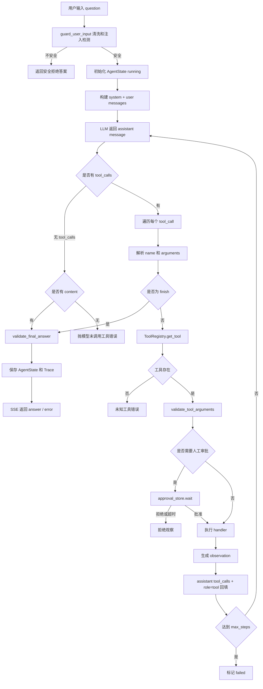

# 03 Agent 核心链路：ReAct、工具、审批与状态

## 1. 一句话定义

Agent 和普通 LLM 应用的区别是：LLM 只负责推理和“建议”调用哪个工具，真正执行由代码完成，执行结果作为观察回填，循环继续。

```text
Reason -> Act -> Observe -> Reason -> ... -> Finish
```

## 2. 完整流程图



## 3. 节点与文件映射

| 节点 | 知识点 | 关键文件与位置 | 对应天数 |
|---|---|---|---|
| 模型调用与重试 | `_call_model`，异常分类重试 | [app/react.py:128](/Users/zhitong/Desktop/AI-Agent/app/react.py:128) | Day 18 |
| ReAct 同步循环 | `run_react_loop` | [app/react.py:150](/Users/zhitong/Desktop/AI-Agent/app/react.py:150) | Day 15 |
| ReAct 流式循环 | `stream_react_loop` | [app/react.py:288](/Users/zhitong/Desktop/AI-Agent/app/react.py:288) | Day 25 |
| Tool 数据结构 | name/description/parameters/handler/approval | [app/tools.py:31](/Users/zhitong/Desktop/AI-Agent/app/tools.py:31) | Day 16 |
| ToolRegistry | 注册、查找、转 OpenAI schema | [app/tools.py:41](/Users/zhitong/Desktop/AI-Agent/app/tools.py:41) | Day 16 |
| finish 工具 | 自动追加最终答案 schema | [app/tools.py:14](/Users/zhitong/Desktop/AI-Agent/app/tools.py:14) | Day 15 |
| 默认工具 | search/list/apply_job | [app/tools.py:122](/Users/zhitong/Desktop/AI-Agent/app/tools.py:122) | Day 16、Day 17、Day 19 |
| 工具执行 | 审批、异常转 observation | [app/tool_executor.py:12](/Users/zhitong/Desktop/AI-Agent/app/tool_executor.py:12) | Day 43 |
| 人工审批 | `queue.Queue` 跨请求传递 | [app/approval.py:4](/Users/zhitong/Desktop/AI-Agent/app/approval.py:4) | Day 19 |
| Agent 状态 | running/finished/failed + JSON checkpoint | [app/agent_state.py:9](/Users/zhitong/Desktop/AI-Agent/app/agent_state.py:9) | Day 21 |
| 输入护栏 | `guard_user_input` | [app/prompt_guard.py:62](/Users/zhitong/Desktop/AI-Agent/app/prompt_guard.py:62) | Day 54 |
| 最终答案校验 | `validate_final_answer` | [app/guards.py:17](/Users/zhitong/Desktop/AI-Agent/app/guards.py:17) | Day 20 |
| SSE 事件 | `sse_event` | [app/streaming.py:6](/Users/zhitong/Desktop/AI-Agent/app/streaming.py:6) | Day 22 |

## 4. 核心实现讲解

### 4.1 模型只建议，代码真执行

LLM 返回的是 `message.tool_calls`，不是已经执行的结果。代码做三件事：

```text
解析 name 和 arguments
从 registry 找到真实 Python handler
执行 handler，生成 observation
```

见 [app/react.py:202](/Users/zhitong/Desktop/AI-Agent/app/react.py:202)。

关键边界：

- `finish` 被特殊处理，不会去 registry 查找。
- 未知工具抛错。
- 参数解析失败会被转成“工具参数校验失败”观察，而不是直接崩掉。

### 4.2 Function Calling 的消息对齐

一次 assistant 消息可以有多个 `tool_calls`。回填时必须：

```text
assistant.content = None
assistant.tool_calls = [每个 tool_call 的 payload]
后面跟多个 role=tool 消息，且 tool_call_id 和 assistant.tool_calls[].id 对齐
```

实现见 [app/react.py:248](/Users/zhitong/Desktop/AI-Agent/app/react.py:248) 和 [app/react.py:259](/Users/zhitong/Desktop/AI-Agent/app/react.py:259)。

面试重点：这是 OpenAI Function Calling 协议的关键，如果 `tool_call_id` 不匹配，下一次调用会失败或无法关联观察结果。

### 4.3 ToolRegistry 的价值

没有 registry 时，新增工具要改 ReAct 循环里的 `if tool_name == ...`。有了 registry：

```text
新增工具 = 注册 Tool
ReAct 只做 name -> registry.get_tool(name) -> handler
```

[app/tools.py:60](/Users/zhitong/Desktop/AI-Agent/app/tools.py:60) 的 `to_openai_tools()` 把业务工具和自动追加的 `finish` 一起交给模型。

### 4.4 Human-in-the-loop

`apply_job` 的 `requires_approval=True`。流式循环在真正执行前先发 `approval` 事件，然后调用：

```python
approve_tool_call(tool_name, arguments)
```

在 API 层，这个回调是 [app/main.py:434](/Users/zhitong/Desktop/AI-Agent/app/main.py:434)：

```python
def approve_tool_call(tool_name, arguments):
    return approval_store.wait(request_id)
```

`ApprovalStore` 用 `queue.Queue` 在一个请求的 SSE 生成器和 `/agent/approve` 的另一个请求之间传递用户选择，超时 120 秒返回 False，避免永久卡住，见 [app/approval.py:14](/Users/zhitong/Desktop/AI-Agent/app/approval.py:14)。

### 4.5 防死循环

三层防线：

```text
max_steps 限制外层循环次数。
finish 工具明确结束。
异常转 observation，让模型继续或最终结束。
```

`run_react_loop` 超过步数时抛出 `ReAct 循环超过最大步数`，状态标记 failed，见 [app/react.py:273](/Users/zhitong/Desktop/AI-Agent/app/react.py:273)。

### 4.6 AgentState 与 checkpoint

`AgentState` 有：

```text
question
status: running / finished / failed
steps: list[ReactStep]
final_answer
```

保存/加载 JSON checkpoint 见 [app/agent_state.py:26](/Users/zhitong/Desktop/AI-Agent/app/agent_state.py:26)。它记录问题、步骤轨迹和最终状态，为审计和恢复打基础。

### 4.7 SSE 事件

Agent 流式接口使用：

```text
chunk、step、approval、answer、error、done、trace
```

`stream_react_loop` 在每个工具执行后发 `step`，在需要审批时发 `approval`，最终发 `answer` 或 `error`，见 [app/react.py:365](/Users/zhitong/Desktop/AI-Agent/app/react.py:365)。

## 5. 工具与依赖

| 依赖 | 作用 |
|---|---|
| `openai` | DeepSeek 兼容接口，同步和异步 client |
| `asyncio` | 信号量控制并发、异步流 |
| `queue` | 审批结果跨请求传递 |
| `pydantic` | `ReactStep`、`ReactResult` 结构化输出 |

## 6. 面试口述模板

```text
我的 Agent 主链路是 ReAct。

请求进来先做输入护栏，然后初始化 AgentState。
模型看到 system prompt 和用户问题，返回 tool_calls。
代码解析工具名和参数，从 ToolRegistry 找到真实函数。
执行前做参数校验，危险工具走审批队列。
执行结果包装成 role=tool 回填，再把 assistant tool_calls 一起放回上下文。
模型继续推理，直到调用 finish。

我用 max_steps、finish 工具和异常转 observation 防止死循环，
用 AgentState 记录步骤和最终状态，用 SSE 把 step、approval、answer 推给前端。
```

## 7. 面试追问预案

### 问：ReAct 的 Reason、Act、Observe 分别由谁完成？

```text
Reason 由 LLM 完成。
Act 的“建议”由 LLM 完成，但“真正执行”由 Python ToolRegistry 完成。
Observe 是工具返回结果，通过 role=tool 回填给模型。
```

### 问：为什么工具异常不让整个 Agent 崩溃？

```text
工具异常如果直接抛出，前面所有步骤都会丢失，用户只看到失败。
把异常变成 observation 回填，模型可以根据失败信息换一种工具或参数，更接近真实 Agent 行为。
```

### 问：为什么 `apply_job` 要审批？

```text
它是写操作，可能影响外部系统。模型可以被提示注入诱导，所以高风险动作不能由模型自动决定。
我用 requires_approval 标记，SSE 通知前端，后端用 queue 等待 /agent/approve 的结果，超时默认拒绝。
```

### 问：流式回答为什么最后才保存完整答案？

```text
如果边流式输出边保存，会把 chunk 碎片写进会话，下一轮历史就是残缺的。
所以先收集 reply_parts，完整拼接后再 save_turn。
```

### 问：Agent 模式和无工具聊天模式有什么不同？

```text
聊天模式直接生成文本，也可以做 RAG 注入。
Agent 模式会传 tools，允许模型输出 tool_calls，并循环执行工具。
所以 Agent 是多步、有状态、可操作外部工具的。
```
