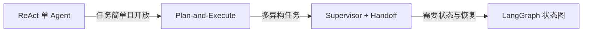
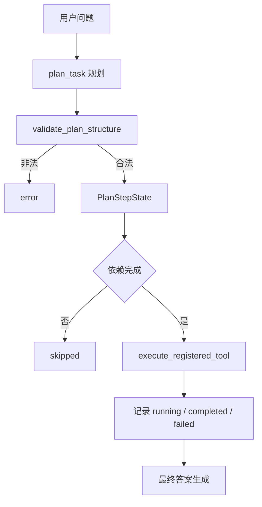
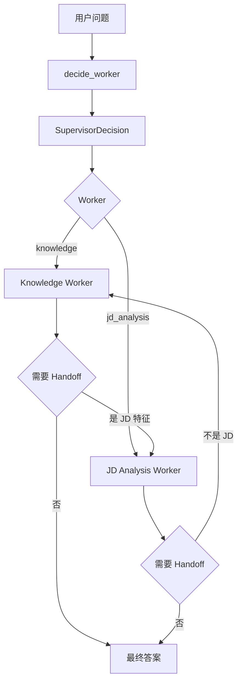
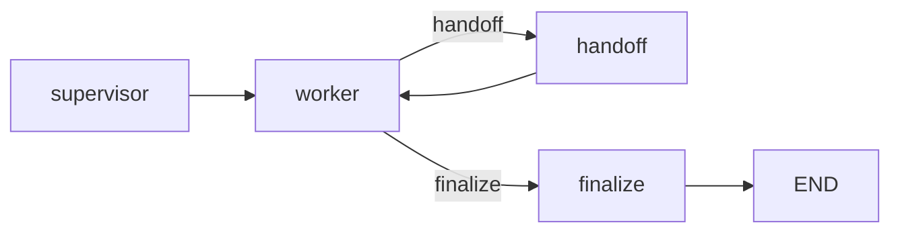

# 04 多 Agent 与 LangGraph：Plan、Supervisor、Handoff、Checkpoint

## 1. 为什么需要多 Agent

单个 ReAct 足够处理“查知识库回答问题”。但当系统有多种异构任务时，把路由、规划和执行混在一个 prompt 里会越来越脆弱：

```text
谁来选择任务 -> Supervisor
拿到任务怎么拆 -> Plan-and-Execute
当前 Worker 不适合怎么办 -> Handoff
怎么恢复、审计、隔离 -> LangGraph checkpoint
```

演进顺序：

```text
固定步骤 JD 分析
-> ReAct
-> ToolRegistry
-> Human-in-the-loop
-> Plan-and-Execute
-> Supervisor
-> Handoff
-> LangGraph
-> Checkpoint / Resume
-> Shared Memory
-> 租户隔离 / 幂等 / 超时
```

## 2. 三种控制流关系



更准确地说：

```text
Supervisor 是“路由与协调层”。
Plan-and-Execute 是“单个 Worker 内部的执行策略”。
LangGraph 是“状态图和持久化基础设施”。
```

## 3. Plan-and-Execute 流程图



核心文件：

- 规划：[app/plan_execute.py:58](/Users/zhitong/Desktop/AI-Agent/app/plan_execute.py:58)
- 计划校验：[app/plan_execute.py:82](/Users/zhitong/Desktop/AI-Agent/app/plan_execute.py:82)
- 执行器：[app/plan_execute.py:178](/Users/zhitong/Desktop/AI-Agent/app/plan_execute.py:178)
- 流式入口：[app/plan_execute.py:276](/Users/zhitong/Desktop/AI-Agent/app/plan_execute.py:276)

### 关键设计

`PlanStep` 是模型输出，`PlanStepState` 是运行状态：

```text
模型只能输出 id/goal/tool/input/depends_on
status/observation 由执行器维护
```

这样模型不能伪造 `status=completed`，也不会污染工具 Schema。定义见 [app/models.py:55](/Users/zhitong/Desktop/AI-Agent/app/models.py:55)。

计划校验会检查：

```text
目标非空、步骤数、步骤 ID 唯一、工具存在、是否允许执行、依赖顺序
```

依赖未完成时步骤置为 `skipped`，不会继续执行。

## 4. Supervisor 与 Handoff 流程图



核心文件：

- Supervisor 路由：[app/supervisor.py:29](/Users/zhitong/Desktop/AI-Agent/app/supervisor.py:29)
- Worker 注册表：[app/workers.py:29](/Users/zhitong/Desktop/AI-Agent/app/workers.py:29)
- Handoff 决策转换：[app/supervisor.py:79](/Users/zhitong/Desktop/AI-Agent/app/supervisor.py:79)
- 主循环：[app/supervisor.py:100](/Users/zhitong/Desktop/AI-Agent/app/supervisor.py:100)

### 关键设计

Supervisor 只输出结构化 `SupervisorDecision`：

```text
worker、goal、context、reason
```

Worker 返回 `WorkerResult`：

```text
status: completed / failed / handoff
answer / error / handoff
```

`MAX_HANDOFFS` 默认 3，防止两个 Worker 来回交接导致死循环，见 [app/supervisor.py:68](/Users/zhitong/Desktop/AI-Agent/app/supervisor.py:68)。

`decision_from_handoff` 会把上一轮的 context、worker 输出、handoff 的补充 context 拼起来，让下一个 Worker 有完整上下文，见 [app/supervisor.py:79](/Users/zhitong/Desktop/AI-Agent/app/supervisor.py:79)。

## 5. LangGraph 状态图



核心文件：[app/supervisor_graph.py:170](/Users/zhitong/Desktop/AI-Agent/app/supervisor_graph.py:170)。

### 状态结构

```python
class SupervisorGraphState(TypedDict, total=False):
    question: str
    current_decision: dict
    worker_result: dict
    handoffs: list[dict]
    handoff_count: int
    result: dict
```

`total=False` 表示字段逐步出现，符合图执行过程中状态增量更新的特点，见 [app/supervisor_graph.py:44](/Users/zhitong/Desktop/AI-Agent/app/supervisor_graph.py:44)。

### 四个节点

```text
supervisor_node：读 question，调用 decide_worker，写 current_decision。
worker_node：从 current_decision 找 Worker，执行并写 worker_result。
handoff_node：生成 next_decision，追加 handoff，handoff_count 加 1。
finalize_node：根据 worker_result 生成最终 SupervisorResult。
```

节点定义在 [app/supervisor_graph.py:53](/Users/zhitong/Desktop/AI-Agent/app/supervisor_graph.py:53)。

### 条件分支

`build_should_handoff` 判断：

```text
worker_result.status == "handoff"
and worker_result.handoff is not None
and handoff_count < max_handoffs
```

满足则去 `handoff`，否则去 `finalize`，见 [app/supervisor_graph.py:154](/Users/zhitong/Desktop/AI-Agent/app/supervisor_graph.py:154)。

### Checkpoint 与 thread_id

```python
def _run_config(run_id):
    return {"configurable": {"thread_id": run_id}}
```

LangGraph 用 `thread_id` 标识一个运行实例。Checkpointer 是 `langgraph-checkpoint-sqlite`，保存到 `data/langgraph_checkpoints.sqlite`，见 [app/supervisor_graph.py:29](/Users/zhitong/Desktop/AI-Agent/app/supervisor_graph.py:29)。

`interrupt_before=["finalize"]` 会在 finalize 前暂停，便于查询和人工恢复，见 [app/main.py:595](/Users/zhitong/Desktop/AI-Agent/app/main.py:595)。

## 6. 生产能力：幂等、租户、超时、共享记忆

### 幂等

`start_graph_run` 先根据 `request_id + tenant_id` 查 idempotency namespace：

```text
已有 run_id -> 直接返回原 run
没有 -> 创建 run_id 并保存映射
```

见 [app/supervisor_graph.py:370](/Users/zhitong/Desktop/AI-Agent/app/supervisor_graph.py:370)。这能处理网络超时重试、用户重复点击、消息重复投递。

### 租户隔离

```text
run namespace: tenant:{tenant_id}:run:{run_id}
idempotency namespace: tenant:{tenant_id}:idempotency
```

即使不同租户使用相同 `run_id`，namespace 前缀不同，也不会互相读写，见 [app/supervisor_graph.py:562](/Users/zhitong/Desktop/AI-Agent/app/supervisor_graph.py:562)。

### 超时

`_invoke_with_timeout` 把同步 `graph.invoke` 放进 `ThreadPoolExecutor(max_workers=1)`，用 `future.result(timeout)` 限时，见 [app/supervisor_graph.py:534](/Users/zhitong/Desktop/AI-Agent/app/supervisor_graph.py:534)。

面试时要主动说明：这是为了讲清超时原理，单机演示可用；高并发生产应复用线程池或改用任务队列，避免每个调用都建线程池。

### 共享记忆

`SharedMemoryStore` 用 SQLite 表 `agent_memory` 保存：

```text
memory_id、namespace、key、value JSON、created_at、updated_at
```

提供 `set / get / list_namespace / delete`，并用 `UNIQUE(namespace, key)` 防止同 key 重复，见 [app/shared_memory.py:15](/Users/zhitong/Desktop/AI-Agent/app/shared_memory.py:15)。

## 7. 工具与依赖

| 依赖 | 作用 |
|---|---|
| `langgraph` | StateGraph、节点、条件边、checkpoint |
| `langgraph-checkpoint-sqlite` | SQLite 状态持久化 |
| `concurrent.futures` | 图执行超时 |
| `sqlite3` | 共享记忆与 checkpoint 存储 |
| `pydantic` | SupervisorDecision、WorkerResult、GraphRunStatus |

## 8. 面试口述模板

```text
我的多 Agent 分两层。

Supervisor 只负责把问题路由给 knowledge 或 jd_analysis Worker。
Worker 内部，knowledge 用 Plan-and-Execute 拆解任务；
如果 Worker 发现自己不适合，例如 knowledge 收到 JD，就 Handoff 给 jd_analysis。
LangGraph 把 Supervisor、Worker、Handoff、finalize 组织成状态图，
用 SQLite checkpoint 持久化，支持中断、恢复和状态查询。

生产化上我加了 request_id 幂等、tenant namespace 租户隔离、线程池超时和共享记忆。
```

## 9. 面试追问预案

### 问：ReAct 和 Plan-and-Execute 怎么选？

```text
ReAct 每步动态决策，适合开放问题、工具少、需要根据中间观察调整。
Plan-and-Execute 先集中规划，适合步骤明确、有依赖、需要审计和恢复的任务。
它们不是替代关系，可以组合：Supervisor 选 Worker，Worker 内部用 Plan。
```

### 问：Supervisor 和 Plan-and-Execute 是什么关系？

```text
Supervisor 解决“交给谁”，Plan-and-Execute 解决“拿到后怎么拆”。
两者处于不同层次。
```

### 问：Handoff 为什么需要上限？

```text
如果两个 Worker 对同一输入都判断对方更合适，就会无限交接。
MAX_HANDOFFS 限制最多交接次数，超限返回失败。
```

### 问：LangGraph 相对手写 if/else 有什么价值？

```text
显式图结构更清晰；checkpoint 能持久化中间状态；支持 interrupt 和 resume；
还能查询 next_nodes 和 interrupts；便于加超时、幂等、租户等生产能力。
```

### 问：你的 checkpoint 存在哪里？

```text
项目里用 SQLite，通过 thread_id=run_id 标识。适合单机演示。
生产可以换 PostgresSaver 或 RedisSaver，并接入分布式锁和队列。
```
