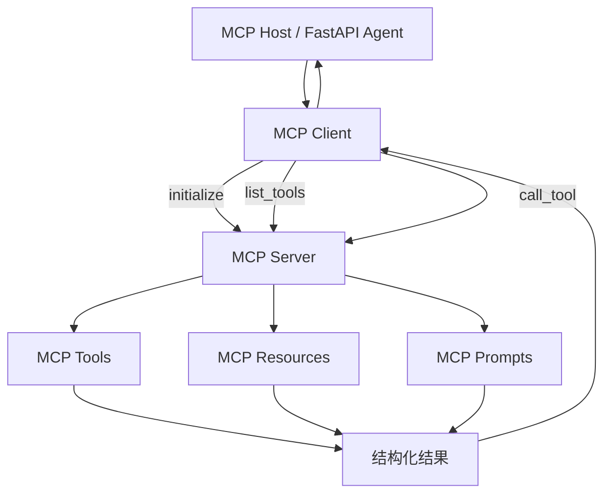

# 05 MCP 链路：模型上下文协议与工具互联

## 1. 一句话定义

MCP 是 Model Context Protocol，解决“模型或 Agent 如何标准化连接外部工具、资源和数据源”的问题。

它不是 Agent 框架。用类比记忆：

```text
MCP = USB-C 协议
MCP Server = 外设
MCP Client / Host = 电脑或 Agent
Tool / Resource / Prompt = 外设提供的能力
```

## 2. 四者关系

```text
Agent 层：ReAct / Plan-and-Execute / LangGraph
工具注册层：ToolRegistry / MCP Tool Registry
模型调用层：Function Calling
外部能力连接层：MCP Client / MCP Server
```

| 概念 | 解决的问题 | 层次 |
|---|---|---|
| ReAct | Agent 怎么循环推理和执行 | Agent 编排 |
| Tool | 一个可执行能力是什么 | 工具抽象 |
| Function Calling | 模型如何表达工具调用 | 模型协议 |
| MCP | 外部工具如何被标准化连接 | 工具互联协议 |

## 3. 完整流程图



## 4. 节点与文件映射

| 节点 | 知识点 | 关键文件与位置 | 对应天数 |
|---|---|---|---|
| MCP Server 配置 | transport、host、port、日志 | [app/mcp_server.py:20](/Users/zhitong/Desktop/AI-Agent/app/mcp_server.py:20) | Day 50、Day 51 |
| Server 构建 | 注册 Tool / Resource / Prompt | [app/mcp_server.py:90](/Users/zhitong/Desktop/AI-Agent/app/mcp_server.py:90) | Day 50、Day 51 |
| 知识库工具实现 | search/list/get_document | [app/mcp_tools.py:65](/Users/zhitong/Desktop/AI-Agent/app/mcp_tools.py:65) | Day 51 |
| Client 连接 | stdio_client + ClientSession | [app/mcp_client.py:30](/Users/zhitong/Desktop/AI-Agent/app/mcp_client.py:30) | Day 50 |
| 工具发现 | list_tools | [app/mcp_client.py:30](/Users/zhitong/Desktop/AI-Agent/app/mcp_client.py:30) | Day 52 |
| 工具调用 | call_tool、错误处理 | [app/mcp_client.py:55](/Users/zhitong/Desktop/AI-Agent/app/mcp_client.py:55) | Day 52 |
| Schema 转换 | MCP input_schema -> OpenAI Function | [app/mcp_client.py:92](/Users/zhitong/Desktop/AI-Agent/app/mcp_client.py:92) | Day 52 |
| Agent Bridge | 动态注册、护栏、权限、脱敏 | [app/mcp_agent_bridge.py:59](/Users/zhitong/Desktop/AI-Agent/app/mcp_agent_bridge.py:59) | Day 52、Day 53 |
| MCP Agent | 复用 ReAct 循环 | [app/mcp_agent.py:40](/Users/zhitong/Desktop/AI-Agent/app/mcp_agent.py:40) | Day 52 |

## 5. 核心实现讲解

### 5.1 MCP Server 提供什么

项目注册三类能力：

```text
Tool:
  search_knowledge
  list_knowledge_titles
  get_knowledge_document

Resource:
  knowledge://titles
  knowledge://docs/{title}

Prompt:
  analyze_jd
```

见 [app/mcp_server.py:102](/Users/zhitong/Desktop/AI-Agent/app/mcp_server.py:102)。

Tool 用于执行动作，Resource 用于读取数据，Prompt 用于生成给模型的模板。三者区分是 MCP 的关键。

### 5.2 Transport

支持：

```text
stdio
sse
streamable-http
```

配置从环境变量读取，非法值直接报错，见 [app/mcp_server.py:31](/Users/zhitong/Desktop/AI-Agent/app/mcp_server.py:31)。

项目中 Client 默认用 stdio 启动子进程：

```python
python -m app.mcp_server
```

这是最简单、适合本地的 transport。生产多服务场景通常会用 streamable HTTP。

### 5.3 Client 交互顺序

```text
stdio_client 建立流
-> ClientSession
-> initialize
-> list_tools 或 call_tool
-> 超时控制
```

见 [app/mcp_client.py:37](/Users/zhitong/Desktop/AI-Agent/app/mcp_client.py:37)。

`call_mcp_tool` 会检查 `result.is_error`，并把 text content 拼成错误，见 [app/mcp_client.py:72](/Users/zhitong/Desktop/AI-Agent/app/mcp_client.py:72)。

### 5.4 Agent Bridge

`build_mcp_tool_registry` 把 MCP 工具转成本地 `Tool`：

```text
读取 input_schema
-> 检查权限策略
-> 注册 handler
-> handler 内做参数护栏、权限检查、调用、脱敏
```

见 [app/mcp_agent_bridge.py:59](/Users/zhitong/Desktop/AI-Agent/app/mcp_agent_bridge.py:59)。

`_build_remote_handler` 是安全关键：

1. `guard_tool_arguments` 清洗参数。
2. `permission_policy.check` 判断是否允许。
3. `executor(tool_name, arguments)` 调用远程 Server。
4. `mask_value` 对结果脱敏。

见 [app/mcp_agent_bridge.py:23](/Users/zhitong/Desktop/AI-Agent/app/mcp_agent_bridge.py:23)。

## 6. MCP 与 Function Calling 的关系

```text
Function Calling：模型返回“我要调用什么工具、参数是什么”。
MCP：Client 如何连接 Server、发现工具、传输调用和结果。
```

一个在模型侧，一个在工具系统侧。项目里的 `mcp_tools_to_openai_schema` 把 MCP schema 转成模型能理解的 Function schema，见 [app/mcp_client.py:92](/Users/zhitong/Desktop/AI-Agent/app/mcp_client.py:92)。

## 7. 工具与依赖

| 依赖 | 作用 |
|---|---|
| `mcp[cli]` | MCP SDK，提供 Server、ClientSession、stdio_client |
| `asyncio` | stdio 流和超时 |
| `json` | 工具结果序列化 |

## 8. 面试口述模板

```text
我把 MCP 定位为工具互联协议，不是 Agent 框架。

我的 MCP Server 暴露知识库的 Tool、Resource 和 Prompt，
支持 stdio、SSE、streamable HTTP。
MCP Client 启动 stdio 子进程，完成 initialize、list_tools、call_tool。
Agent Bridge 动态发现工具，把 input_schema 转成 OpenAI Function Schema，
再在调用前做参数护栏和权限策略，调用后做敏感信息脱敏。

这样 ReAct 负责“怎么思考和执行”，MCP 负责“怎么连接外部能力”，两者互补。
```

## 9. 面试追问预案

### 问：MCP 是 Agent 框架吗？

```text
不是。Agent 框架负责循环、状态、规划、协作；MCP 只负责客户端和服务端如何发现和调用外部能力。
LangGraph 是 Agent 编排框架，MCP 是连接协议。
```

### 问：Tool、Resource、Prompt 有什么区别？

```text
Tool 是可执行动作，例如 search_knowledge。
Resource 是可读取的数据，例如 knowledge://docs/{title}。
Prompt 是可复用的提示模板，例如 analyze_jd。
```

### 问：为什么 MCP 工具结果要脱敏？

```text
外部工具返回的内容是不可信数据，可能包含邮箱、手机号、密钥，也可能包含注入指令。
进入上下文、日志和 Trace 前都要按内容处理并脱敏，不能当系统指令执行。
```

### 问：stdio 和 HTTP transport 怎么选？

```text
stdio 简单，适合本地同机、单进程或 CLI 场景。
HTTP/streamable HTTP 适合跨服务、多实例、远程接入。
本项目为了教学和本地演示默认 stdio，生产会使用 streamable HTTP。
```
