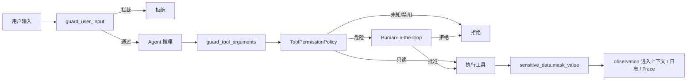

# 06 安全链路：输入护栏、工具权限、脱敏与红队

> 本文讲模型输入与工具策略；还需单独落实对象级授权、审批归属、存储隔离。
> 当前聊天/审批/trace/checkpoint 的边界见 [10](10_源码事实核对与项目边界.md)。
> Regex/脱敏不能代替最小权限与沙箱，模型输出符合 schema 也不表示动作安全。
> 2026-10-16 源码校核：下面是分层设计模型，并非每个入口都已逐层接入。普通 ReAct、MCP bridge 的实际差异、审批生命周期与 trace 归属题目见 [20 D5 操作指南](20_D5安全链路与Trace归属.md)。

## 1. 安全目标

Agent 比普通 API 更危险，因为它可能读取外部数据并执行写操作。安全链路的目标是：

```text
用户输入不能劫持系统指令。
工具参数不能被注入。
危险工具必须审批。
外部数据不能污染日志和 Trace。
用具体红队/正常用例验证已覆盖的行为，并记录未覆盖范围。
```

## 2. 完整流程图

此图表达分层设计。当前普通 ReAct 用 `guards.validate_tool_arguments`，通用 `guard_tool_arguments` 和 `ToolPermissionPolicy` 主要接在 MCP bridge/红队 helper 中；不能直接把图当作所有接口的当前执行顺序。



## 3. 节点与文件映射

| 节点 | 知识点 | 关键文件与位置 | 对应天数 |
|---|---|---|---|
| 输入清洗 | 控制字符、空输入、长度 | [app/prompt_guard.py](/Users/zhitong/Desktop/AI-Agent/ai-job-agent/app/prompt_guard.py) | Day 54 |
| 注入检测 | 关键词 + 正则模式 | [app/prompt_guard.py](/Users/zhitong/Desktop/AI-Agent/ai-job-agent/app/prompt_guard.py) | Day 54 |
| 输入护栏 | 组合清洗、长度、注入 | [app/prompt_guard.py](/Users/zhitong/Desktop/AI-Agent/ai-job-agent/app/prompt_guard.py) | Day 54 |
| 工具参数清洗 | 递归处理 string/dict/list/primitive | [app/prompt_guard.py](/Users/zhitong/Desktop/AI-Agent/ai-job-agent/app/prompt_guard.py) | Day 54 |
| 最终答案校验 | 非空、注入拦截 | [app/guards.py](/Users/zhitong/Desktop/AI-Agent/ai-job-agent/app/guards.py) | Day 20 |
| 工具权限策略 | read/write/dangerous | [app/tool_policy.py](/Users/zhitong/Desktop/AI-Agent/ai-job-agent/app/tool_policy.py) | Day 53 |
| 默认权限 | search/list/get 只读，apply 审批 | [app/tool_policy.py](/Users/zhitong/Desktop/AI-Agent/ai-job-agent/app/tool_policy.py) | Day 53 |
| 敏感数据脱敏 | email/phone/id/api_key | [app/sensitive_data.py](/Users/zhitong/Desktop/AI-Agent/ai-job-agent/app/sensitive_data.py) | Day 55 |
| 审计日志 | 内存审计 + JSONL | [app/sensitive_data.py](/Users/zhitong/Desktop/AI-Agent/ai-job-agent/app/sensitive_data.py) | Day 55 |
| 红队测试 | 用例、报告、通过率 | [app/red_team.py](/Users/zhitong/Desktop/AI-Agent/ai-job-agent/app/red_team.py) | Day 56 |

## 4. 核心实现讲解

### 4.1 输入护栏

`guard_user_input` 做四件事：

```text
类型检查
控制字符清洗
空输入检查
长度限制
注入关键词和模式检测
```

见 [app/prompt_guard.py](/Users/zhitong/Desktop/AI-Agent/ai-job-agent/app/prompt_guard.py)。

清洗的控制字符是 ASCII 0 到 31，但保留换行和 tab，见 [app/prompt_guard.py](/Users/zhitong/Desktop/AI-Agent/ai-job-agent/app/prompt_guard.py)。

注入检测有两层：

```text
关键词：ignore previous instructions、忽略之前指令、system prompt 等。
正则：system:、role: system、[system]、<|im_start|> 等。
```

### 4.2 工具参数护栏

工具参数可能是嵌套结构，不能只检查顶层字符串。`_sanitize_value` 递归处理：

```text
str -> guard_user_input
dict -> 递归处理 value；当前嵌套 key 未走顶层 key 校验
list -> 递归处理每个元素
None/int/float/bool -> 保留
其他类型 -> 拒绝
```

见 [app/prompt_guard.py](/Users/zhitong/Desktop/AI-Agent/ai-job-agent/app/prompt_guard.py)。

顶层 key 在 `guard_tool_arguments` 中检查；`_sanitize_value` 遇到嵌套 dict 时仅递归 value。当前也没有据此证明全量 schema、嵌套键或所有工具入口都已校验，具体对照题见 D5 的 1.3。

### 4.3 工具权限

`ToolPermissionPolicy` 的核心是风险分级：

```text
read：只读，默认允许。
write：可能修改状态，需谨慎。
dangerous：影响外部系统，必须审批。
```

默认规则见 [app/tool_policy.py](/Users/zhitong/Desktop/AI-Agent/ai-job-agent/app/tool_policy.py)。

未知工具默认拒绝，避免模型被诱导调用未注册工具。

当前 `check` 主要使用工具名对应规则的 allowed/requires_approval；risk 标签、scopes/arguments 形参存在，不等于用户级资源权限已经实现。

### 4.4 敏感数据脱敏

识别并替换：

```text
email
phone
id_card
api_key / secret / token
```

`mask_text` 使用正则替换为 `[REDACTED_XXX]`，见 [app/sensitive_data.py](/Users/zhitong/Desktop/AI-Agent/ai-job-agent/app/sensitive_data.py)。

`mask_value` 递归处理字符串、字典、列表，见 [app/sensitive_data.py](/Users/zhitong/Desktop/AI-Agent/ai-job-agent/app/sensitive_data.py)。

在 Agent 可观测性中，`trace_stream` 也会对 question 和 event data 脱敏，见 [app/observability.py](/Users/zhitong/Desktop/AI-Agent/ai-job-agent/app/observability.py)。

注意它处理的是 Trace/Span 副本，随后仍 yield 原始 raw_event；不能据此声称前端/所有模型输入都已脱敏。`mask_value` 当前递归处理值，没有仅凭 token 等字典键名就遮盖整个值的通用规则。脱敏也不能代替 trace 读取授权。

### 4.5 红队测试

红队用例覆盖：

```text
直接提示注入
角色伪装
工具参数注入
未知工具
危险工具审批
控制字符清洗
```

默认用例见 [app/red_team.py](/Users/zhitong/Desktop/AI-Agent/ai-job-agent/app/red_team.py)。

每个用例判断：

```text
实际 blocked 是否等于预期 blocked
预期 reason 是否出现
预期 requires_approval 是否一致
```

最终输出总用例数、通过数、通过率、失败列表，见 [app/red_team.py](/Users/zhitong/Desktop/AI-Agent/ai-job-agent/app/red_team.py)。

默认六例直接调用 helper，不经过真实 Agent/LLM/HTTP 全链路；通过率表示这些指定断言符合预期，不代表所有注入被阻止。危险工具用例也可能以“未 blocked 但 requires_approval=True”作为通过条件。

## 5. 工具与依赖

| 依赖 | 作用 |
|---|---|
| `re` | 注入模式、敏感数据正则 |
| `json` | 审计日志 JSONL |
| `dataclasses` | 安全决策、红队用例结构 |

## 6. 面试口述模板

```text
我的安全链路分四层。

第一层是输入护栏，清洗控制字符、限制长度、检测注入关键词和角色伪装。
第二层是工具参数校验：本地 ReAct 使用业务 guards，MCP bridge 另接通用递归护栏；它们目前并不完全等价。
第三层是工具策略与审批：MCP 按允许列表注册工具，危险工具通过审批控制；D4 已把主 ReAct 的审批绑定到用户和具体调用。
第四层是脱敏与记录：Trace/Span 副本及 MCP 返回结果有部分脱敏，审计类有 JSONL 导出；不能据此声称所有入口都已完整脱敏或持久审计。

目前默认红队直接测试六个 helper 场景，输出指定断言的通过率。真实 Agent 链路、Trace 对象归属等还要分开验证。
```

## 7. 面试追问预案

### 问：提示注入有哪些类型？

```text
直接注入：用户直接说“忽略之前指令”。
间接注入：外部文档或工具结果里夹带指令。
角色伪装：用 system: 或 role: system 试图改变角色。
```

### 问：关键词检测够吗？

```text
不够。关键词容易绕过，所以我也做正则模式、控制字符清洗、参数递归清洗，并把外部数据当作不可信内容。
真正生产还需要语义级检测、模型级护栏、输出约束和持续红队回归。
```

### 问：为什么危险工具用审批而不是完全禁止？

```text
业务上有时确实需要执行写操作，完全禁止会失去能力。
审批把最终决定权交给人，既保留能力，又避免模型被诱导自动执行。
```

### 问：脱敏在哪个位置做？

```text
工具结果在进入上下文、日志和 Trace 前做。
Agent Trace 的 question 和事件数据也在 trace_stream 中脱敏。
这样即使日志被导出，也不会直接泄露敏感信息。
```
