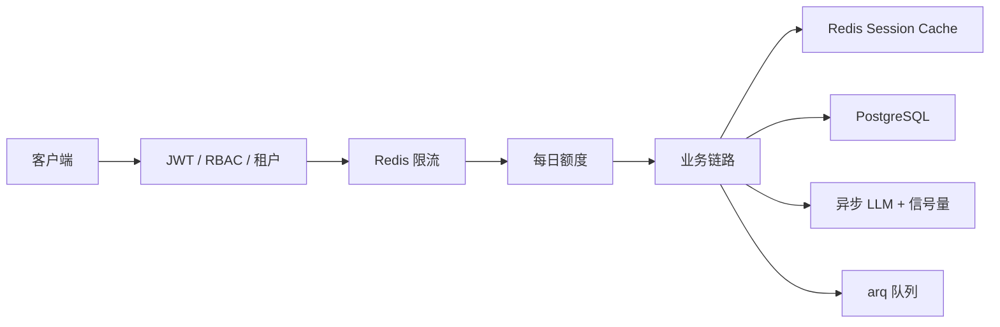

# 07 后端生产链路：异步、数据库、Redis、队列、认证与稳定性

## 1. 目标

把 Agent Demo 变成多用户可运行服务，需要解决：

```text
请求不阻塞 -> 异步化
会话不丢失 -> PostgreSQL
高频读不压数据库 -> Redis 缓存
耗时任务不占 API -> arq 队列
用户身份与权限 -> JWT / RBAC
资源不被滥用 -> 限流与额度
依赖故障不拖垮系统 -> 重试、熔断、降级、超时、背压
```

## 2. 请求经过的中间层



## 3. 节点与文件映射

| 节点 | 知识点 | 关键文件与位置 | 对应天数 |
|---|---|---|---|
| FastAPI 生命周期 | 创建/关闭资源 | [app/main.py](/Users/zhitong/Desktop/ai-agent/ai-job-agent/app/main.py) | Day 57 |
| 异步 LLM | AsyncOpenAI + 信号量 | [app/async_llm.py](/Users/zhitong/Desktop/ai-agent/ai-job-agent/app/async_llm.py) | Day 57 |
| 异步业务 | `asyncio.to_thread` 包裹同步检索 | [app/async_agent.py](/Users/zhitong/Desktop/ai-agent/ai-job-agent/app/async_agent.py) | Day 57 |
| PostgreSQL 连接池 | AsyncConnectionPool | [app/postgres.py](/Users/zhitong/Desktop/ai-agent/ai-job-agent/app/postgres.py) | Day 58 |
| 会话持久化 | user+assistant 事务 | [app/postgres_session_store.py](/Users/zhitong/Desktop/ai-agent/ai-job-agent/app/postgres_session_store.py) | Day 58 |
| Redis 缓存 | Cache Aside + TTL | [app/redis_session_cache.py](/Users/zhitong/Desktop/ai-agent/ai-job-agent/app/redis_session_cache.py) | Day 59 |
| Redis 限流 | Lua 原子 INCR + EXPIRE | [app/redis_rate_limiter.py](/Users/zhitong/Desktop/ai-agent/ai-job-agent/app/redis_rate_limiter.py) | Day 59 |
| 任务状态 | JobStore Hash + TTL | [app/job_store.py](/Users/zhitong/Desktop/ai-agent/ai-job-agent/app/job_store.py) | Day 60 |
| arq 队列 | create_pool、任务定义、Worker | [app/queue.py](/Users/zhitong/Desktop/ai-agent/ai-job-agent/app/queue.py)、[app/tasks.py](/Users/zhitong/Desktop/ai-agent/ai-job-agent/app/tasks.py)、[app/worker.py](/Users/zhitong/Desktop/ai-agent/ai-job-agent/app/worker.py) | Day 60 |
| 密码哈希 | pwdlib Argon2 | [app/auth_security.py](/Users/zhitong/Desktop/ai-agent/ai-job-agent/app/auth_security.py) | Day 61 |
| JWT | sub/roles/tenant_id/iat/exp | [app/auth_security.py](/Users/zhitong/Desktop/ai-agent/ai-job-agent/app/auth_security.py) | Day 61 |
| 认证依赖 | HTTPBearer + decode | [app/auth_dependencies.py](/Users/zhitong/Desktop/ai-agent/ai-job-agent/app/auth_dependencies.py) | Day 61 |
| RBAC | require_roles | [app/auth_dependencies.py](/Users/zhitong/Desktop/ai-agent/ai-job-agent/app/auth_dependencies.py) | Day 61 |
| 额度 | Redis 每日问题与 token | [app/quota.py](/Users/zhitong/Desktop/ai-agent/ai-job-agent/app/quota.py) | 追加 |
| 稳定性 | 重试、熔断、超时、降级、背压 | [app/resilience.py](/Users/zhitong/Desktop/ai-agent/ai-job-agent/app/resilience.py) | Day 63 |
| 上下文预算 | 消息分组裁剪 | [app/context.py](/Users/zhitong/Desktop/ai-agent/ai-job-agent/app/context.py) | Day 29 |

## 4. 核心实现讲解

### 4.1 异步化

LLM 和数据库都是 I/O 密集，异步可以并发等待多个外部请求，而不是一个请求阻塞整个线程。

`create_llm_semaphore` 创建 `asyncio.Semaphore`，限制同时调用 LLM 的数量，见 [app/async_llm.py](/Users/zhitong/Desktop/ai-agent/ai-job-agent/app/async_llm.py)。

`async_agent._retrieve` 用 `asyncio.to_thread` 把同步向量检索放进线程池，避免阻塞事件循环，见 [app/async_agent.py](/Users/zhitong/Desktop/ai-agent/ai-job-agent/app/async_agent.py)。

### 4.2 PostgreSQL 连接池

每次新建数据库连接成本很高。`AsyncConnectionPool` 维护一组可复用连接：

```text
min_size=1
max_size=10
open=False -> 显式 open
```

见 [app/postgres.py](/Users/zhitong/Desktop/ai-agent/ai-job-agent/app/postgres.py)。

### 4.3 会话持久化

`PostgresSessionStore.append_turn` 在一个事务里同时写入 user 和 assistant：

```text
成功 -> commit
失败 -> rollback
```

这样不会出现“只有问题没有回答”的半成品，见 [app/postgres_session_store.py](/Users/zhitong/Desktop/ai-agent/ai-job-agent/app/postgres_session_store.py)。

### 4.4 Redis 会话缓存

读路径：

```text
先读 Redis
命中 -> 返回
未命中 -> 读 PostgreSQL -> 回填 Redis
```

写路径：

```text
先写 PostgreSQL -> 删除 Redis key -> 下一轮回源缓存
```

实现见 [app/redis_session_cache.py](/Users/zhitong/Desktop/ai-agent/ai-job-agent/app/redis_session_cache.py)。

这是 Cache Aside 的变体：写数据库后失效缓存，降低不一致风险，不能保证强一致。
并发读可能取到旧 DB 快照后在删除之后回填旧缓存；还存在删除失败，需 TTL、版本或更严格机制权衡。

### 4.5 Redis 限流

固定窗口限流用 Lua 脚本保证原子性：

```lua
INCR key
if current == 1 then EXPIRE key window end
```

单次 Redis 往返完成“计数 + 首次设置过期”，见 [app/redis_rate_limiter.py](/Users/zhitong/Desktop/ai-agent/ai-job-agent/app/redis_rate_limiter.py)。

### 4.6 arq 任务队列

`POST /jobs/analyze` 的流程：

```text
创建 job_id
-> JobStore 写 queued
-> arq enqueue_job
-> 立即返回 202
```

见 [app/main.py](/Users/zhitong/Desktop/ai-agent/ai-job-agent/app/main.py)。

Worker 领取任务：

```text
mark_running
-> analyze_job_async
-> complete 或 fail
```

见 [app/tasks.py](/Users/zhitong/Desktop/ai-agent/ai-job-agent/app/tasks.py)。

客户端通过 `GET /jobs/{job_id}` 轮询状态，见 [app/main.py](/Users/zhitong/Desktop/ai-agent/ai-job-agent/app/main.py)。

### 4.7 认证与授权

注册时密码用 `pwdlib` 的 Argon2 推荐配置哈希，见 [app/auth_security.py](/Users/zhitong/Desktop/ai-agent/ai-job-agent/app/auth_security.py)。

JWT payload：

```text
sub、roles、tenant_id、iat、exp
```

认证是“你是谁”，授权是“你能做什么”。`get_current_user` 验证 token，`require_roles` 做 RBAC，见 [app/auth_dependencies.py](/Users/zhitong/Desktop/ai-agent/ai-job-agent/app/auth_dependencies.py) 和 [app/auth_dependencies.py](/Users/zhitong/Desktop/ai-agent/ai-job-agent/app/auth_dependencies.py)。

### 4.8 多租户隔离

项目是字段级/namespace 级隔离：

```text
JWT 带 tenant_id
任务 payload 带 tenant_id
查询任务时校验归属
共享记忆和 LangGraph 用 tenant namespace
```

`get_job_status` 会检查 payload 的 `tenant_id` 是否等于当前用户，见 [app/main.py](/Users/zhitong/Desktop/ai-agent/ai-job-agent/app/main.py)。

这只是部分路径。聊天存储未绑定 user/tenant，审批未核对归属，checkpoint key 未包含 tenant；
同租户任务是否还需用户归属也要按权限设计，不能泛称全系统已经隔离，详见 [10](10_源码事实核对与项目边界.md)。

### 4.9 稳定性组件

`app/resilience.py` 提供：

```text
async_retry：指数退避 + jitter
CircuitBreaker：CLOSED / OPEN / HALF_OPEN
with_timeout：超时
run_with_fallback：降级
BackpressureGate：信号量背压
```

熔断状态机见 [app/resilience.py](/Users/zhitong/Desktop/ai-agent/ai-job-agent/app/resilience.py)。

区分：

```text
重试：瞬时错误再试。
熔断：依赖持续失败时快速失败。
降级：主路径失败返回兜底。
背压：限制并发，避免自己过载。
```

### 4.10 上下文预算

`ContextBudget` 用 `tiktoken` 估算 token，保留 `reserved_output_tokens`，按消息组裁剪最旧历史，见 [app/context.py](/Users/zhitong/Desktop/ai-agent/ai-job-agent/app/context.py)。

`group_messages` 理解对话结构：system 单独成组，user 开启一组，tool 跟随当前组，assistant 根据是否有 tool_calls 或是否在 tool 结果后处理，见 [app/context.py](/Users/zhitong/Desktop/ai-agent/ai-job-agent/app/context.py)。

这样裁剪时不会把“assistant tool_calls 和对应 tool result”拆开，保持 Function Calling 协议完整。

## 5. 工具与依赖

| 依赖 | 作用 |
|---|---|
| `psycopg[binary,pool]` | PostgreSQL 异步连接池 |
| `redis` | 缓存、限流、队列、任务状态 |
| `arq` | Redis 任务队列 |
| `pwdlib[argon2]` | 密码哈希 |
| `pyjwt` | JWT 签发和解析 |
| `tiktoken` | 上下文 token 估算 |

## 6. 面试口述模板

```text
生产化我按请求路径逐步补齐。

入口有 JWT 认证、RBAC、租户校验、Redis 限流和每日额度。
业务层使用异步 LLM，信号量限制并发；同步向量检索放到线程池。
这主要是异步聊天路径；同步 ReAct/图仍存在，信号量当前未覆盖整个活跃流。
会话历史写 PostgreSQL，Redis 做会话缓存，写库后失效缓存。
长任务走 arq 队列，API 返回 202，Worker 异步更新任务状态。
稳定性上有重试、熔断、超时、降级和背压。
相关组件的定义与是否接入某 API 要分别核对；队列并未承接所有长 Agent 任务。
上下文过长时按消息组裁剪，保留 system 和最近消息，并预留输出 token。
```

## 7. 面试追问预案

### 问：为什么不是每个请求新建数据库连接？

```text
连接建立涉及 TCP、认证、服务端资源分配，高并发下成本很高。
连接池复用连接，限制最大连接数，提高吞吐并保护数据库。
```

### 问：Redis 和 PostgreSQL 为什么同时存在？

```text
PostgreSQL 负责强一致、持久化和事务，例如用户、会话消息。
Redis 负责高速缓存、限流、任务状态和队列。
两者解决不同问题，真实系统通常组合使用。
```

### 问：为什么长任务用队列？

```text
API 如果等长任务完成，会占用连接和请求资源，用户也长时间无响应。
队列让 API 快速返回 202，Worker 独立处理，状态可查询，Worker 可扩展。
```

### 问：JWT 怎么退出登录或吊销？

```text
当前项目只有 access token，没有 refresh token 和吊销列表，这是已知边界。
生产可增加 refresh token、短期 access token、Redis 黑名单或服务端 session 吊销。
```

### 问：为什么异步不一定更快？

```text
异步提升的是 I/O 密集场景下的吞吐，不是单个 CPU 任务的速度。
如果 async 函数里放阻塞计算或同步数据库操作，会阻塞事件循环，反而更差。
```
