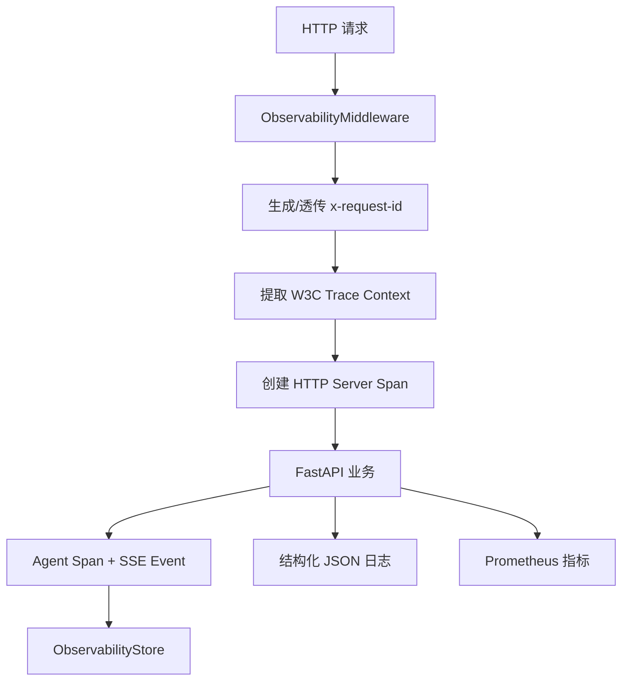
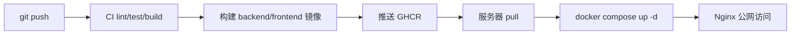

# 08 可观测性与部署链路：日志、指标、Trace、成本、容器、CI/CD

## 1. 可观测性目标

线上服务不能只靠“能跑”。可观测性回答：

```text
日志：单次请求发生了什么。
指标：系统整体趋势和告警。
Trace：一次请求跨服务、跨 Agent 步骤的完整路径。
```

## 2. 一次请求的可观测链路



## 3. 节点与文件映射

| 节点 | 知识点 | 关键文件与位置 | 对应天数 |
|---|---|---|---|
| Request ID | ContextVar | [app/request_context.py:1](/Users/zhitong/Desktop/AI-Agent/app/request_context.py:1) | Day 67 |
| 结构化日志 | JSON Formatter | [app/logging_config.py:12](/Users/zhitong/Desktop/AI-Agent/app/logging_config.py:12) | Day 67 |
| Prometheus 指标 | Counter / Gauge / Histogram | [app/metrics.py:10](/Users/zhitong/Desktop/AI-Agent/app/metrics.py:10) | Day 67 |
| HTTP 中间件 | ASGI + W3C + 指标 | [app/http_observability.py:17](/Users/zhitong/Desktop/AI-Agent/app/http_observability.py:17) | Day 67、Day 68 |
| OTel Provider | Console / OTLP | [app/tracing.py:18](/Users/zhitong/Desktop/AI-Agent/app/tracing.py:18) | Day 68 |
| Agent Trace | TraceEvent、AgentTrace | [app/observability.py:20](/Users/zhitong/Desktop/AI-Agent/app/observability.py:20) | Day 27 |
| SSE 转 Trace | trace_stream | [app/observability.py:102](/Users/zhitong/Desktop/AI-Agent/app/observability.py:102) | Day 27、Day 68 |
| LLM 成本 | Token、单价、预算 | [app/cost_tracker.py:28](/Users/zhitong/Desktop/AI-Agent/app/cost_tracker.py:28) | Day 69 |
| 模型注册表 | 任务选型、成本估算 | [app/model_registry.py:119](/Users/zhitong/Desktop/AI-Agent/app/model_registry.py:119) | Day 33、Day 69 |
| Docker 后端 | 多阶段、非 root | [Dockerfile](/Users/zhitong/Desktop/AI-Agent/Dockerfile) | Day 28、Day 64 |
| Compose | 服务、健康检查、Volume | [docker-compose.yml](/Users/zhitong/Desktop/AI-Agent/docker-compose.yml) | Day 28、Day 65 |
| CI | lint、test、build | `.github/workflows/ci.yml` | Day 70 |
| Release | 构建并推 GHCR | `.github/workflows/release.yml` | Day 70 |
| Deploy | SSH 部署 | `.github/workflows/deploy.yml` | Day 70 |

## 4. 核心实现讲解

### 4.1 Request ID 与 ContextVar

每个请求需要唯一 ID，才能把同一次请求的所有日志关联起来。

`request_id_var` 是 `contextvars.ContextVar`，在不同协程间保持当前请求上下文，见 [app/request_context.py:1](/Users/zhitong/Desktop/AI-Agent/app/request_context.py:1)。

中间件从 `x-request-id` 透传已有 ID，否则生成 UUID；响应时写回 `x-request-id`，见 [app/http_observability.py:41](/Users/zhitong/Desktop/AI-Agent/app/http_observability.py:41)。

### 4.2 结构化 JSON 日志

`JsonFormatter` 输出：

```text
timestamp、level、logger、message、request_id、trace_id、span_id
可选 method、request_path、status_code、duration_ms、exception
```

见 [app/logging_config.py:12](/Users/zhitong/Desktop/AI-Agent/app/logging_config.py:12)。

结构化日志比纯文本容易检索和聚合。

### 4.3 Prometheus 指标

三类：

```text
Counter：HTTP 请求总数。
Histogram：请求耗时分布。
Gauge：当前 in-flight 请求数。
```

见 [app/metrics.py:10](/Users/zhitong/Desktop/AI-Agent/app/metrics.py:10)。

`/metrics` 暴露 Prometheus 文本，见 [app/main.py:155](/Users/zhitong/Desktop/AI-Agent/app/main.py:155)。

### 4.4 OpenTelemetry Trace

`configure_tracing` 创建 `TracerProvider`，配置 OTLP 或 Console exporter，并防止重复配置，见 [app/tracing.py:18](/Users/zhitong/Desktop/AI-Agent/app/tracing.py:18)。

HTTP 中间件：

```text
提取 W3C Trace Context
创建 SERVER span
记录异常和状态码
响应头注入 trace context
```

见 [app/http_observability.py:87](/Users/zhitong/Desktop/AI-Agent/app/http_observability.py:87)。

### 4.5 Agent Trace

`trace_stream` 接收 Agent SSE 流：

```text
先发 event: trace
解析 step / approval / answer / error / done
写入 ObservabilityStore
同时写入 OTel Span Event
数据统一脱敏
```

见 [app/observability.py:102](/Users/zhitong/Desktop/AI-Agent/app/observability.py:102)。

`ObservabilityStore` 目前是内存 dict，适合演示；生产可替换为 Langfuse、Phoenix 或数据库。

### 4.6 LLM 成本追踪

`CostTracker.record`：

```text
根据模型注册表单价估算 cost
检查预算
累计 token 和成本
更新 Prometheus Counter 和 Histogram
```

见 [app/cost_tracker.py:81](/Users/zhitong/Desktop/AI-Agent/app/cost_tracker.py:81)。

成本公式在 [app/model_registry.py:162](/Users/zhitong/Desktop/AI-Agent/app/model_registry.py:162)：

```text
input_tokens * input_cost_per_million / 1_000_000
+ output_tokens * output_cost_per_million / 1_000_000
```

### 4.7 模型降级

`chat_completion_with_retry_async` 外层遍历模型，内层对每个模型重试：

```text
指数退避 + jitter
超时
备用模型列表
信号量
非流式成本记账
```

见 [app/async_llm.py:37](/Users/zhitong/Desktop/AI-Agent/app/async_llm.py:37)。

## 5. 部署链路

### 5.1 容器与 Compose

后端 `Dockerfile`：

```text
builder 安装依赖
runtime 复制 .venv、代码、迁移、知识库
创建非 root 用户
健康检查
```

Compose 服务包括：

```text
postgres、redis、qdrant(profile)、backend、worker、frontend
```

PostgreSQL 和 Redis 用 named volume，backend 启动前跑迁移，worker 独立跑 arq，frontend 由 Nginx 反代。

### 5.2 CI/CD 闭环



Workflow 文件：

- [.github/workflows/ci.yml](/Users/zhitong/Desktop/AI-Agent/.github/workflows/ci.yml)
- [.github/workflows/release.yml](/Users/zhitong/Desktop/AI-Agent/.github/workflows/release.yml)
- [.github/workflows/deploy.yml](/Users/zhitong/Desktop/AI-Agent/.github/workflows/deploy.yml)

### 5.3 部署形态

`docker-compose.yml` 是完整开发形态，含 Qdrant profile。

`docker-compose.2gb.yml` 是低内存服务器形态，使用远程 Embedding，关闭 Rerank，只保留 postgres、redis、backend、frontend。

## 6. 工具与依赖

| 依赖 | 作用 |
|---|---|
| `prometheus-client` | 暴露 Counter/Gauge/Histogram |
| `opentelemetry-api/sdk/exporter-otlp-proto-http` | Trace、Span、W3C |
| `tiktoken` | token 估算 |
| `uvicorn[standard]` | ASGI 服务 |
| Docker、Docker Compose、GitHub Actions | 容器与 CI/CD |

## 7. 面试口述模板

```text
可观测性我做了四层。

第一层是结构化 JSON 日志，带 request_id、trace_id、span_id。
第二层是 Prometheus 指标，记录请求量、耗时和 in-flight。
第三层是 OpenTelemetry Trace，HTTP 请求提取 W3C 上下文，Agent SSE 转成 Span Event。
第四层是 Agent Trace 和 LLM 成本追踪，方便回溯工具步骤和估算费用。

部署上用 Docker 多阶段构建、Compose 编排、named volume 持久化，
CI 做 lint/test/build，Release 推 GHCR，Deploy 用 SSH 拉取并 Compose 启动。
```

## 8. 面试追问预案

### 问：日志、指标、Trace 有什么区别？

```text
日志记录离散事件，回答单次请求发生了什么。
指标是聚合数值，回答整体趋势和是否要告警。
Trace 记录跨服务和跨步骤的完整调用路径，回答一次请求经历了什么。
```

### 问：Request ID 为什么用 ContextVar？

```text
同一请求可能经历多个协程，ContextVar 可以在协程上下文中保存当前 request_id，
避免把 ID 通过每个函数参数层层传递。
```

### 问：如何估算 LLM 成本？

```text
记录模型、输入 token、输出 token，用注册表里的每百万 token 单价计算。
异步 LLM 调用后自动记账，CostTracker 同时更新 Prometheus 指标并检查预算。
```

### 问：Docker 多阶段构建解决什么？

```text
build 阶段安装依赖和构建产物，runtime 阶段只复制运行需要的内容，
减少镜像体积和攻击面，不把编译工具带进生产。
```

### 问：CI/CD 完整链路是什么？

```text
push 触发 CI 做 lint、test、Compose 校验和镜像构建。
Release 把 backend/frontend 镜像推送到 GHCR。
Deploy 用 SSH 登录服务器，git pull、docker compose pull、up -d。
Nginx 暴露到公网。
```
