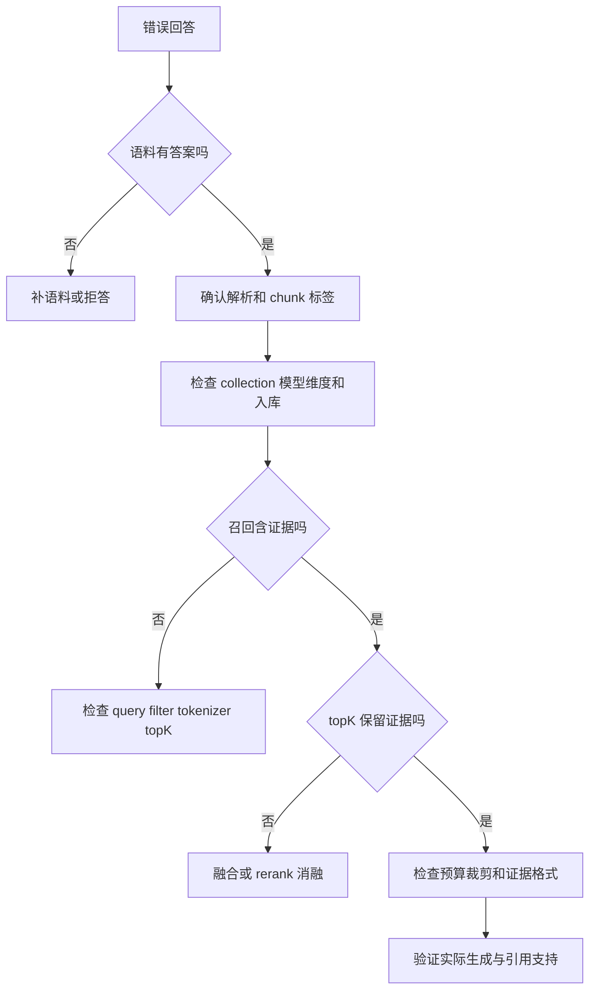

# 11 RAG 原理、排障与消融复习

配合 02 使用。目标是能定位检索问题并做对照，而不是背检索器名称。

## 1. 45 分钟闭卷路线

10 分钟画入库与查询两条链路；10 分钟讲 chunk/向量/BM25/融合；10 分钟手算指标；
10 分钟排查失败 query；5 分钟提出一个实验并解释代价。答错的点只回查对应 docs。

| 知识 | 要能解释 | 源码 / 历史笔记 | 闭卷题 |
|---|---|---|---|
| Chunk | 字符窗口与 token 窗口不同；overlap、语义边界、结构元数据 | `chunking.py`，day8/day36 | 120 字符在中文/代码中有何局限？ |
| Embedding | 余弦、归一化、模型与维度一致；更换模型要重新索引 | `embedding_registry.py`、`vector_store.py`，day37/38 | 维度相同为什么仍不能混用两个模型？ |
| HNSW | ANN 以 recall/延迟/内存权衡；不要把本地全量点积称 ANN | `RAGRetriever`、`PersistentHybridRetriever`、`HybridRerankRetriever` | 10 万 chunk 与 100 chunk 如何选路径？ |
| BM25 | TF 饱和、IDF、长度归一化；中文单字/二元组是简化 tokenizer | `bm25.py`，day9 | API 名、错误码、版本号为什么适合词法检索？ |
| Fusion | min-max + alpha 对样本范围敏感，RRF 使用排名免分值标定 | `rag.py`，day39 | 所有分相等时 `_normalize` 返回 0 有什么影响？ |
| Rerank | 双塔用于高吞吐召回；CrossEncoder 成本更高但联合交互更强 | `rerank`，day39 | 何时 rerank 让体验更差？ |
| Rewrite | 可改善表达，也可能语义漂移；保留原 query 作对照 | `query_rewriter.py`，day40/42 | 默认聊天有没有调用？如何验证？ |
| Generation | retrieval success ≠ grounded answer；需拒答与引用支持验证 | `prompts.py`、`async_agent.py` | 有来源列表但回答编造，怎么发现？ |

RRF 示例：`score(d) = Σ 1 / (c + rank_i(d))`，c 是配置常数，文档未被某分支召回则该项为 0。
不能脱离固定评测说某种 fusion 一定更优。

## 2. 手算指标

标签相关集合 `{a,c}`，返回 `[b,a,d]`，K=3：Recall=1/2，Precision=1/3，RR=1/2。
二元 NDCG：DCG=`1/log2(3)`，IDCG=`1 + 1/log2(3)`；约 0.387。
MRR 是多 query 的 RR 平均。无答案样本需单独统计拒答，不能因 relevant=[] 的约定混入召回均值解释。

`answer_keyword_coverage` 只能检查字面关键词。`citation_coverage` 的分母是引用出现数，
不是所有需要证据的论断数，不覆盖未引用的幻觉。面试必须主动说明指标名称的局限。

## 3. 排障树

首先核对 `get_retriever → build_retriever` 的实际配置，不能把 day9 的旧全量点积实现当当前路径。
入库需验证：从空 collection 开始，doc_count/chunk_count、模型维度、实际 upsert 数量，再做已知关键词查询。
metadata filter 必须应用于全部候选分支，过滤应在数据访问阶段落实，不能生成后才遮挡结果。

## 4. 两小时实验任务

1. 从真实业务问题选 20–30 条：精确术语、同义表达、多约束、无答案、冲突/过期、注入；记录 chunk 标签。
2. 固定 10–15 条调参集，剩余 holdout；不要反复查看 holdout 修改参数。两个集合避免近义重复。
3. 比较 Vector、BM25、Hybrid、Hybrid+Rerank。旧检索器可作 baseline，但说明入库/计算路径的不同。
4. 只改变一个变量：chunk size、overlap、top_k、candidate_top_k、alpha、rewrite 或 rerank。
5. 报 Recall/MRR/NDCG、延迟、实际生成的引用支持与拒答。延迟记录 embedding、检索、重排、生成分段。

实验表：

| commit/配置 | 数据版本/样本数 | Recall@3 | MRR | NDCG@3 | 检索 P95 | 生成支持率 | 备注 |
|---|---|---|---|---|---|---|---|
| baseline | 待记录 | 待测 | 待测 | 待测 | 待测 | 待测 | 不填估计数字 |
| 单变量方案 | 同一集合 | 待测 | 待测 | 待测 | 待测 | 待测 | 同模型、同标签 |

不要把少量自建用例推断为线上准确率。全部用例、原始输出、配置和失败记录一并保存，见 12。

## 5. 追问预案

- **为什么 RAG 而不是微调？** 私有/时效知识更新、来源和可撤销性适合检索；微调更适合行为/格式等目标，两者可组合，需评测与成本判断。
- **长上下文能替代检索吗？** 小语料可直接塞入作 baseline，大语料需考虑 token、时延、权限和有效上下文，不以窗口大小作结论。
- **多租户怎么做？** trusted identity → ACL → vector/BM25 同步过滤 → context/citation 不串租户；仅 tenant metadata 存在不够。
- **重排有效如何证明？** 固定候选集与 holdout，比较排名和最终任务效果，再看增加的 P95 与费用。
- **为什么缓存无效？** 区分 query embedding、结果、回答缓存；key 包括 tenant/ACL、模型、索引版本、参数，防止跨用户与过期数据复用。
