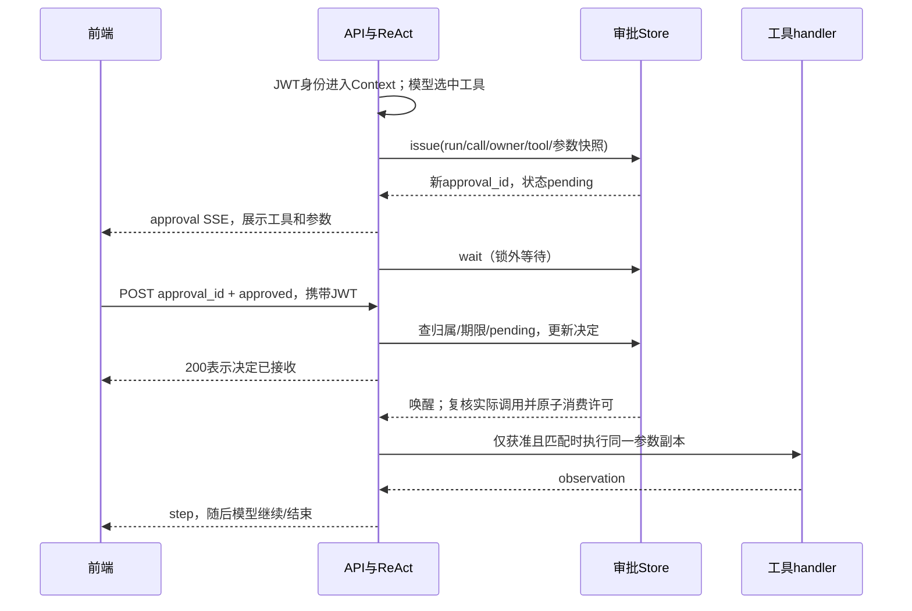
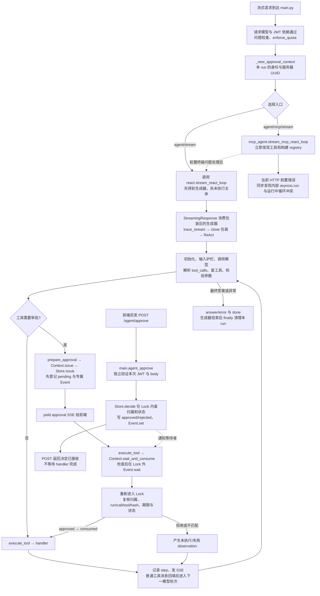
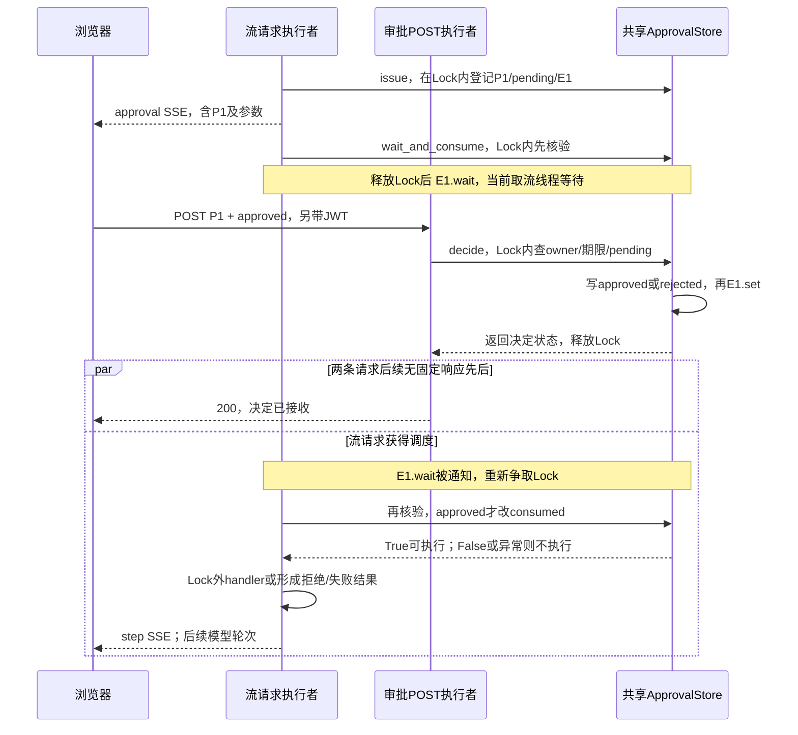

# D4：RAG 检索与工具审批绑定

> **最新状态 · 2026-10-16**：你已手动实施九个文件并提交 2.3.7，本轮在实际业务目录复跑 **59 passed**，Ruff、前端构建及 5 项测试通过。**D4 审批绑定按本轮范围复批通过**；Compose 的 A 同意/B 404/A 拒绝按你的回填登记，真实浏览器跨租户未做。完整复批、证据边界及面试口述见 [2.3.7 最新复批](#d4-recheck-20261016)。下方 10 月 15 日“待实施/隔离副本”的说明属于历史；不用重新应用补丁。

**三个接口的源码串讲**见 [2.3.9 执行链与 Lock/Event](#d4-flow-239)。本次还沿 MCP 路由复现了同步发现的事件循环冲突，单独标明当前可执行与前置失败后的路径；未修改业务代码，也不把 Context 透传测试当真实 MCP 联通证据。


> **2026-10-15 补交审批**：原答与诊断日志全部保留，下方逐题追加审批和参考答案。RAG 主链路与指标主体通过，审批方案须按 2.2/2.3 修正；滑动窗口原代码 10 例通过。**从 2.3.1 开始是你接下来手动实施的内容**，参考代码只在隔离副本验证，尚未写入业务源码。原启动说明保留用于对照，不代表今天仍未提交答案。

按 [30 天总日程](15_30天冲刺总日程.md)执行：**4h 源码复习 + 2h 审批诊断/方案/修复 + 1h 滑动窗口 + 1h 口述与岗位核查**。本页于 2026-10-14 启动；准备好材料不代表你已完成作业，也不代表审批已修复。

沿用你的学习方式：**先看具体要求 → 按顺序过指定函数 → 根据提示写自己的答案 → 我保留原答并批改 → 再按确认的方案手动修改代码。** 本轮不替你填答案或修改业务源码。

## 0. 分工、顺序与今天的交付

### 我已准备好

- 每题的目的、文件阅读顺序、具体问题、思考步骤和作答区。
- [审批诊断脚本](../practice/d4_approval_probe.py)：用 fake 模型和工具追踪真实路由、审批队列与执行前检查，不需要启动服务。
- [滑动窗口题目骨架](../practice/d4_longest_unique_substring.py)：10 个自检样本，函数留给你实现。
- 当前 RAG/审批相关测试基线：**43 passed**。范围和复跑命令见 1.6。这不是你的完成记录，也不是审批安全验收。

### 你需要做

1. **先完成 1.1–1.3 并回填原文档**，每题按小问编号回答。无需一次读完所有文件；遇到不懂的函数，写出“输入是什么、输出是什么、谁调用它”。
2. 继续 1.4–1.6，跑指定测试、手算指标，形成 RAG 主链路和证据边界。
3. 做 2.1 诊断，写 2.2 绑定方案与 2.3 验收设计。先提交方案，我再补具体逐行改法供你手动实施，避免你凭概念猜代码。
4. 实现第 3 节算法；第 4 节只做简短自述和更新原岗位台账，简历首版仍放 D7。

**时间规则**：各小节的时间包含阅读、操作和回填，不额外叠加。两小时不足以完成审批修复时，记录“已诊断/方案待批/已改未验收”等真实状态；D5 延续实施和一次性、过期验收。不要为了打卡把待修复写成已解决。

**D3 衔接**：会话归属主体和真实正常链路已验收，今天不重做建会话/PG/Redis 实验。D3 的 C 非流式专门断言、真实故障注入等未覆盖项仍保留在 [D3 收尾记录](18_D3工具循环与会话归属实作.md)，不因开始 D4 自动变成已验证。

## 1. 四小时复习：先把 RAG 链路读清楚

今天只看下面指定的函数和紧邻调用者。`docs/dayN` 是历史学习过程，有冲突时以当前源码为准；[02 RAG 链路](02_RAG链路.md)用于建立概念，[11 原理与排障](11_RAG原理排障与消融复习.md)用于查原理。

### 1.1 15 分钟：把会话归属迁移到工具审批问题

**目的**：复习 D3，并区分“这个人已登录”“这个对象属于这个人”“这个人同意执行这次操作”。

**具体题目**：先闭卷，三题各写 2–3 句。

1. A、B 都有合法 JWT，为什么 B 仍不能操作 A 的会话？当前聊天链路在哪里检查？
2. 现在用户 A 同意“向公司甲投递职位 X”。这份同意能否用来执行“向公司乙投递职位 Y”？除了登录身份，还应绑定什么？先说设计想法，不要求会写代码。
3. “fake 断言通过”“真实 PG/Redis 实验正常”“浏览器正常两轮对话”分别证明哪一层？哪项不能证明异常写入一定回滚？

**忘记时按这个顺序回看**：

1. [main.py](../app/main.py) 的 `_authorize_chat_session`、`chat_stream`：找到从 JWT 取身份、调用归属检查、返回 `StreamingResponse` 的顺序。
2. [D3 第 7 步复批](18_D3工具循环与会话归属实作.md)：只看最新证据摘要与口述，不重读旧实施代码。

**思考方法**：把“用户、会话、审批票据、实际操作”看作四个不同对象。先问请求者是谁，再问他对这个对象有什么权限，最后问他批准的是哪一次操作。

> 我的回答：
>
> ① 在 /chat 和 /chat/stream 路由中，将owner信息（tenant_id，owner_sub）和 session_id去session_store（Redis和Postgres）中做关联性校验，当前聊天链路（ /chat 和 /chat/stream）在校验请求体合规之后，与LLM交互之前检查
>
> ② 用户 A 同意“向公司甲投递职位 X”能用来执行“向公司乙投递职位 Y”，两个投递如果共用同一个请求中和ReAct循环中的request_id是不会被拦截的。除了登录身份，还应该绑定唯一approval_id，与审批操作一对一绑定，approval_id在Agent流式生成器调用wait的时候创建之后返回给前端，前端调用/agent/approve路由的时候再传入，这样可以保证审批操作准确性和安全性
>
> ③“fake 断言通过”证明路由层、函数层，“真实 PG/Redis 实验正常”证明数据层、缓存层，“浏览器正常两轮对话”证明网络层、路由层、函数层
> “fake 断言通过”不能证明异常写入一定回滚
> 这道题需要详细解释，我有点儿一知半解


#### 2026-10-15 审批：①基本正确；②混淆现状与安全要求；③须按实验边界理解

**正确答案与错误分析**：

1. ①归属判断方向正确。JWT 中是 `sub`，传给 store 时命名为 `owner_sub`；不是 JWT 自带名为 `owner_sub` 的字段。路由在创建 `StreamingResponse` 前核验 `session_id + tenant_id + user.sub`，缓存命中前与数据库读写处仍有相应检查。只说“LLM 前”不够精确，因为流开始后再拒绝通常不能改成正常的 HTTP 404。
2. ②从安全要求看，**批准甲/X 不能授权乙/Y**。当前代码只用 run 级 request_id 对应 bool，无法辨别同意属于哪个工具调用/哪组参数；第三个诊断演示了错误复用的可能。但 Queue 的一次 `get` 会取走一个 bool，不能说“一次点击会自动批准同 run 所有后续调用”。新的 approval_id 还须绑定身份、run、call、工具和参数。应先 `issue` 登记票据，再 SSE 发给前端，最后 `wait`；如果先阻塞在 wait，再想着把 ID 返回，用户就没有可点击的卡片。
3. ③不要把三种实验机械映射成互不重叠的“路由/数据/网络层”。关键是**哪些真实对象参与、触发什么场景、检查了什么结果**：
   - fake 测试：真实函数或路由配合假模型/假存储，证明给定输入走了预期分支。例如 B 得到 404、假 handler 未调用；不能推出真实数据库也具备相同事务行为。
   - D3 真实 PG/Redis 正常实验：真实建会话、消息写入、缓存失效/命中等被实际观察，证明这些正常路径接通。没有制造第二次 INSERT 失败，就没有证明真实回滚。
   - 浏览器正常两轮：真实前端发请求、创建 ID、续聊与展示正常；不等于异常、跨用户、断流或回滚都通过。
   - 要证明真实回滚：在隔离测试会话中让同一事务的第二条消息 INSERT 确定失败，随后用新查询确认本轮两条都没提交、已有消息不变。fake 中模拟事务只能证明自己的模拟/调用约定，不能替代 PostgreSQL 实验。

**面试可复述**：“认证、对象归属和操作审批是三层不同约束。我的会话归属修复已做 fake 与真实正常路径验证；真实故障回滚仍须单独注入故障验证。工具审批下一步绑定到具体用户和具体参数，不只认一个 ID。”

**验收**：能说出 JWT 身份不等于对象归属；能区分正常路径证据与故障路径证据。

### 1.2 40 分钟：文档怎样变成 chunk

**目的**：理解切分单位、重叠和 metadata，解释为什么 chunking 会影响召回，而不是只背“切成小块”。

**跟着读这三个位置**：

1. [knowledge_base.json](../data/knowledge_base.json)：只读前两份文档，辨认文档 `id/title/text`。原文档是一层对象，稍后的 chunk 是另一层对象。
2. [chunking.py](../app/chunking.py)：依次看 `chunk_text_fixed`、`chunk_text_semantic`、`chunk_documents`。先看固定切分的循环，再看语义切分的分段/合并/长段回退，最后看 metadata 如何生成。
3. [rag.py](../app/rag.py) 的 `build_retriever`：只找传给 `chunk_documents` 的策略、大小和 overlap，别把函数定义默认值与实际调用值混在一起。

**具体题目与操作**：

1. 手算 `chunk_text_fixed("0123456789", chunk_size=4, overlap=2)` 的全部结果，再运行下方命令核对。写出下一块起点怎样移动。
2. 当前 `chunk_size` 限制字符数还是 token 数？metadata 的 `char_count/token_count` 各怎样算？二者为什么可能不同？
3. 当前语义切分是否保证每两个 chunk 都有固定 overlap？标出“普通分段合并”与“长段回退固定切分”的差别。为什么不能把 fixed 的行为直接套到 semantic 上？
4. 从一条 chunk 里选 `chunk_id/doc_id/content_hash/chunking_version/prev_chunk_id/next_chunk_id`，说明各自用途。`prev/next` 如何避免连接到另一份文档？字段名称以源码实际拼写为准。
5. 文档 ID 不变、正文修改后，单靠 chunk ID 已存在，能否证明索引已更新？怎样用文本 hash/切分版本辅助判断？今天只写方案，不修改知识库。

**可复制操作**：在项目根目录运行，不需要 Uvicorn、PG、Redis 或真实模型。

```bash
cd /Users/zhitong/Desktop/AI-Agent/ai-job-agent
PYTHONPYCACHEPREFIX=/tmp/ai-job-agent-d4-pycache .venv/bin/python -c 'from app.chunking import chunk_text_fixed; print(chunk_text_fixed("0123456789", chunk_size=4, overlap=2))'
```

**思考方法**：先手算“块长 4、重叠 2”，再用代码验证；然后把字符长度、token 估算、身份 ID、内容版本四类信息分开。不要把 metadata 中存在一个 hash 写成“已经实现增量更新”。

> 我的回答：
>
> ① 手算结果、命令输出、起点规则：["0123", "2345", "4567", "6789"]
>
> ② 字符/token：chunk_size限制的是字符数，char_count取的是字符串长度、token_count取的是len(tiktoken.get_encoding("cl100k_base").encode(text))。
>
> 字符串长度通常按“字符”算，token长度指的是模型分词器 tokenizer 把文本切成多少个 token。token 可以是词、子词、标点、空格、甚至字节片段。
>
> ③ semantic 的 overlap：语义切分不能保证每两个 chunk 都有固定 overlap。chunk_text_semantic函数先将文本按照空行和标点切分，然后判断文本分段长度，过长段落按照固定长度+重叠词切分，短的段落合并。semantic能保证一定长度内的段落语义连贯通顺，直接上fixed可能会把大多数连贯文本切断，大大降低切分效果。
>
> ④ 六个 metadata 字段：chunk_id当前文档切块的唯一标识；doc_id对应文档唯一标识；content_hash当前文本对应哈希值，用于版本更新、内容变动等；chunking_version切分版本，对应文档内容版本变动；prev_chunk_id和next_chunk_id用于连接前后chunk；`prev/next`通过文档doc_id可以避免连接其它文档。
>
> ⑤ 内容更新方案：不能。文档 ID 不变、正文修改后，切分版本应该随之变动，文本 hash也要重新生成。


#### 2026-10-15 审批：手算与主体理解通过，版本和相邻关系两处需纠正

**逐题正确答案**：

1. ①结果正确；完整块的起点是 `0 → 2 → 4 → 6`，通常步长 `chunk_size - overlap = 2`，最后触及文本末尾即停止，不再多出 `"89"`。源码使用 `start = end - overlap`。当前重叠单位是**字符**，不是词。
2. ②正确。`len(text)` 是 Python 字符串的长度，token_count 用 cl100k_base 编码估算；它不保证等于实际远程模型 tokenizer 的用量，也不等于模型向量维度。
3. ③正确指出普通 semantic 相邻块不固定重叠。需要收紧“保证语义连贯”：它只是按标点/空行启发式分段后合并，并不能理解或保证语义；fixed 也不是必然更差，效果要评测。长片段才回退到 fixed + 字符重叠。
4. ④`chunking_version` 是**切分实现/规则版本**，当前是常量 `CHUNKING_VERSION = "v2"`，不是某份文档的正文版本。`content_hash` 是当前片段内容指纹，正文变动可能使它变化。`chunk_id` 当前为 `doc_id-index`，跨版本内容变化后同 ID 可能对应不同文本，并非永远不变的内容标识。prev/next 不串文档，是因为源码先为**单份文档建立局部 `doc_chunks` 列表**，只在这个列表里连接前后；并不是之后靠查询 doc_id 再阻止串联。
5. ⑤正文修改后应重算 chunk 内容 hash，但**不必因此修改切分算法版本**。方案应包含：记录文档版本/整体 hash → 按当前规则重新切分 → 比较新增、修改、删除的 chunk → 对变动内容重新 embedding/upsert → 删除已不再存在的旧 ID → 切换到可用的新索引版本。切分规则或参数变化再更新相应配置版本并重建受影响索引。当前 metadata 是这些工作的基础，当前代码并未完整接上这条增量更新流水线。

**记忆例子**：把一份简历从“3 年经验”改成“4 年经验”，正文 hash 会变；仍按相同规则每 120 字切分时，切分规则版本可以不变。

**验收**：手算与代码一致；指出实际切分单位和语义切分的重叠边界；用函数/字段解释，不泛写“提高效果”。

### 1.3 50 分钟：区分入库链路与查询链路

**目的**：理解 embedding 和持久向量库各负责什么，并核实“创建检索器”是否真的包含“把文档向量写入库”。

**按顺序过文件；每一步只跟一个数据对象**：

1. [agent.py](../app/agent.py) 的 `get_retriever` → [rag.py](../app/rag.py) 的 `build_retriever`：记录文档路径、切分参数、返回的**具体类名**。缓存检索器对象不等于更新知识库索引。
2. [embedding_registry.py](../app/embedding_registry.py)：看 profile 的 `dimension/max_tokens`，再看 `load_embedding_model` 如何选择本地/远程。远程分支再看 [remote_embedding.py](../app/remote_embedding.py) 的 `encode`，确认返回的是向量，不是答案。
3. 回到 `build_retriever`：找模型名、维度、collection 名和 `build_vector_store`。区分本地 profile 的维度与远程配置维度；不要一律套用某个本地模型的 profile。
4. [vector_store.py](../app/vector_store.py)：先看 `VectorStore` 的接口，再看 `ChromaStore.upsert/query`。`upsert` 写文档向量，`query` 用问题向量查已有数据；今天不启动 Qdrant。
5. 回到 [rag.py](../app/rag.py)：对比 **当前 `HybridRerankRetriever.__init__/retrieve`** 与较早的 `PersistentHybridRetriever.__init__`。找 `model.encode` 和 `store.upsert`，不要因为旧类实现过就认为当前入口也执行了。
6. 最后看 [vector_store_cli.py](../app/vector_store_cli.py)：读到程序退出即可，判断它是完整入库脚本，还是只创建适配器并打印配置。

**具体题目**：

1. 画两条箭头：`原始文档 → … → 持久向量库` 和 `用户问题 → … → 返回候选 chunk`。分别标记 `encode/upsert/query` 在哪条链上。
2. 当前默认构建路径中，你能找到哪一次“文档 embedding → upsert”？若找不到，请写清“查过哪些函数、缺少哪个调用”，不要凭运行时能回答就认定向量已入库。
3. 为什么查询向量与库中向量须处在同一个模型空间？维度相同、模型不同就一定可比较吗？模型/维度/切分版本变化时怎样处理索引？
4. collection 名含模型信息能解决什么，不能解决什么？正文变化但模型不变时，怎样避免老 chunk 留在库里？
5. 如果向量库是空的，为什么混合检索仍可能返回内容？要拿到什么证据，才能说“这一轮真的用了向量召回”？

**思考方法**：为每个 `encode` 标注输入是文档还是问题，为每个 `upsert/query` 标注读写方向。查不到入库就记录缺口，提出“初始化入库或独立 ingestion 任务”的候选方案；不要在复习阶段直接下载模型、清库或重建真实索引。

**当前源码核对提示**：`build_retriever` 返回 `HybridRerankRetriever`，其构造函数初始化了 chunk 映射和 BM25；较早 `PersistentHybridRetriever` 有文档编码/写入逻辑。今天重点核实这两条路径是否连通。尚未检查你服务器已有 collection 的实际内容，因此不能据此断言服务器库一定为空。

> 我的回答：
>
> ① 两条箭头：
> 原始文档 -> utf-8编码并转为json字符串 -> 切分格式化后的文档 -> 根据配置加载embedding模型的name、向量维度、实际模型 -> 构建持久化向量库 -> 将文档切片、embedding模型、持久化向量库、混合检索权重、候选数目、是否重排入参并初始化混合检索器
>
> 用户问题 + 候选top_k -> 混合检索器执行retrieve -> 检索模型将问题向量化 -> 持久化向量库执行向量检索 得到向量评分 -> bm25执行精确词检索得到精确词评分 -> 根据混合检索权重加权 -> 看是否重排，重排的话根据重排模型CrossEncoder得到候选结果
>
> ② 当前入库调用证据/缺口：HybridRerankRetriever没有找到文档 embedding → upsert，查过PersistentHybridRetriever类的__init__，其中有遍历文档chunk内容并入库的操作，应该在HybridRerankRetriever补上
>
> ③ 模型空间与索引变化：查询向量和库中向量须在同一个维度和模型空间中，这样能通过余弦计算语义相似度；维度相同、模型不同不一定可比较，不同模型默认的embedding方式不一致，不都是余弦向量化；模型/维度/切分版本变化时怎样处理索引？这个不知道
>
> ④ collection 和正文更新：collection 名含模型信息能根据模型名称和维度生成唯一模型名称，不能解决模型版本更新、维度变化、默认embedding变化带来的影响。正文变化但模型不变时，根据chunking_version、chunk_id、content_hash来判断是否老chunk，可做定期清理等操作
>
> ⑤ 向量召回证据：如果向量库是空的，混合检索走BM25精确词检索也可以返回内容，要拿到vector_hits才能判断是否向量召回。ps:这个回答是我猜的，这个题我不太会


#### 2026-10-15 审批：找到了入库断点；需要补完整链路和索引更新方案

**① 两条正确链**：

```text
应有的入库链：UTF-8 读取 JSON 文件 → json.load 得到 Python 文档对象
→ chunk_documents → 提取每块 text → 文档 model.encode
→ 检查模型/维度/版本 → store.upsert(chunks, vectors) → 可检索索引

当前查询链：问题 → 同一 embedding 模型 encode → store.query 得到 vector_hits
+ 当前 chunks 的 BM25 词项得分 → 候选 ID 并集 → 两路归一化/融合
→ 可选 CrossEncoder 重排 → 最终 top_k
```

原答“转为 JSON 字符串”与实际读取方向相反：源码 `json.load` 将文件解析成对象。第一条原箭头主要描述**构建检索器**，还没包含真正的文档编码与 upsert，不能叫完整入库链。

**② 缺口判断正确，但补在哪里要有取舍**：当前 `build_retriever → HybridRerankRetriever` 未执行文档 encode/upsert。小型演示可以初始化时补齐；更可控的方案是独立 ingestion 任务负责建库，查询服务只验证/使用已发布索引。不能每个用户查询都把全库重算，也不能照搬旧类“ID 已存在就跳过”的逻辑而忽略正文变化。本轮审批改造不顺便重建你的真实向量库。

**③ 为什么同维度不同模型仍不兼容**：embedding 是模型把文本映射为向量；余弦是之后**比较两个向量**的方法，并不是 embedding 的生成方法。不同模型即使都输出 512 维，坐标表达的含义也可能不同，不能拿模型 A 的问题向量与模型 B 的文档向量直接比较。类比两张比例尺相同但原点/方向不同的地图，数字个数相同仍不能直接定位。

**索引变化的可执行原则**：

- 模型/版本/维度变化：选定并固定新模型配置 → 用新模型重新编码全部目标 chunk → 写新 collection/index → 用一组查询验证 → 同时切换查询模型与索引引用；保留短期回滚，再处理旧库。不能只改查询模型。
- 切分规则/参数变化：重新切分并编码受影响内容，建立一致的新版本；维护新旧 chunk 清单，删除不再存在的旧块。
- 仅正文变化：按内容 hash/文档版本更新受影响 chunk 并删除过时块。不要只“定期清理”而容忍查询持续混入旧事实。

**④ collection 纠正**：`_collection_name_for_model` 生成的是**collection 名**，不是模型名；包含维度和模型名摘要，因此模型名/维度变化会得到不同名称，有助隔离不兼容索引。但它不会自动创建完整数据、重建向量或清掉正文旧块；同一个模型别名下服务商升级、切分配置变化，也可能没有被这个名字捕捉。配置清单与重建/切换流程仍需要单独管理。

**⑤ 你的猜测方向正确，补证据**：BM25 直接用当前文档 chunk 建词项统计，不依赖向量入库；因此即使没有有效向量命中，仍可能返回候选。应记录同一次 query 的模型/collection 配置、`vector_hits` 的 ID/得分及其与文档的映射，再跟踪它们是否进入融合/最终结果；有 hits 只证明向量分支返回了候选，不证明相关性良好、最终结果一定来自它。真实向量库状态还要查 collection 数量/写入记录；本轮没有查服务器实库，不下“库必为空”的结论。

**验收**：将实际调用与建议方案分开；不能拿旧类测试证明默认构建路径已经入库。

### 1.4 55 分钟：混合检索、重排与过滤边界

**目的**：讲清“先召回、再融合、再重排”，并理解为什么检索结果需要权限过滤。

**文件导读**：

1. [bm25.py](../app/bm25.py)：只看分词、`fit/score`，找到词频与文档统计参与打分的位置。当前实现对语料打分，不要未经证据称为已落地的倒排检索引擎。
2. [rag.py](../app/rag.py) 的 `HybridRerankRetriever.retrieve`：按“问题向量 → 向量候选 → BM25 候选 → chunk ID 并集 → 分数归一化 → 加权 → 重排/截断”的顺序逐段读。
3. 同文件 `_normalize`、`rerank`：归一化解决分数量纲问题；重排额外评价 query 与候选文本。注意重排排序依据与最终对象的 `score` 字段是不是同一分数。
4. [混合检索 fake 测试](../tests/test_hybrid_rerank_retriever.py)：先看 `FakeStore/FakeModel/FakeReranker`，再看 `test_hybrid_retriever_merges_vector_and_bm25_candidates` 和 `test_hybrid_retriever_passes_filters_to_store`。

**具体题目**：

1. `candidate_top_k=20`、最终 `top_k=3` 各控制哪个阶段？向量和 BM25 各最多取 20 个，并集为何可能超过 20 个？为什么需要按 ID 合并？
2. 写出当前融合公式；解释 `alpha=1`、`alpha=0`、`alpha=0.5` 的权重含义。某一路全是相同分数时 `_normalize` 怎样处理？这是否说明它“完全不相关”？
3. rerank 与 embedding 召回有什么差别？为什么不直接对整个语料做昂贵重排？重排能否找回从未进入候选集的正确 chunk？
4. 从 `filters` 跟到 `store.query(where=...)`，再检查 BM25 侧和最终并集。过滤是否覆盖所有候选？如果用于租户/用户权限，哪里可能重新混入本应排除的内容？
5. 现有 filter 测试只断言“参数传给 store”还是断言“最终结果全满足权限”？当前 metadata 中是否已有 tenant/owner？给一个可验证的反例设计，不直接宣称项目已有私有知识库隔离。

**思考方法**：先画两个候选集合并取并集，再计算融合。过滤题设两个 chunk：A 可访问、B 不可访问；让向量分支只返回 A，BM25 分支把 B 排前，观察 B 有没有机会进入最终结果。区别“过滤传参正确”和“最终候选权限正确”。

> 我的回答：
>
> ① 候选数/最终数/去重：candidate_top_k控制向量化和BM25粗排阶段，最终top_k控制最终结果和rerank精排阶段。向量和 BM25结果可能并不完全一致，所以并集可能超过20个。按ID合并是为了过滤掉重复结果。
>
> ② 融合公式和等分处理：alpha=1，完全向量化查询；alpha=0，完全BM25关键词查询；alpha=0.5向量化和BM25关键词各占一半。全是相同分数时，_normalize调用np.zeros_like。是否说明它“完全不相关”，这个应该不能，具体原因不清楚。
>
> ③ 重排作用与限制：rerank 是使用特定重排模型对候选结果进行crossencoder精排，embedding 召回是根据问题向量和文档向量库进行语义化相似度计算。直接对整个语料做昂贵重排成本更高，时间更长，代价更大。重排不能找回从未进入候选集的正确 chunk，重排只是在进入候选集的正确 chunk范围内做昂贵计算。
>
> ④ filters 传播链与缺口：过滤并不覆盖所有候选，向量化和BM25也只是选出前candidate_top_k个候选。如果用于租户/用户权限，BM25可能会根据关键词混入本应排除的内容，因为没有特定过滤条件。
>
> ⑤ 反例、断言与当前隔离边界：现有 filter 测试只断言“参数传给 store”，当前 metadata 中没有 tenant/owner。将对应文档与用户的tenant_id、owner_sub、role绑定，然后存入向量库，只有特定身份的用户才能访问特定文档。


#### 2026-10-15 审批：召回与重排基本通过，融合/过滤反例需补齐

1. **候选数**：两路各最多 candidate_top_k 个，按 chunk ID 去重后最多约 `2 × candidate_top_k`，受实际语料量限制；最终 top_k 控制返回量。这里通常可到 40 个候选，再输出 3 个，不能把“候选 20”误认最终只参与 20 个。
2. **融合公式**：`score = alpha × vector_norm + (1-alpha) × bm25_norm`；非等分时 `norm(x) = (x-min)/(max-min)`。等分返回全 0，是该路**无法在这组候选间区分高低**，不是证明全都不相关；例如所有得分都很高，也可能相同。alpha=1/0 是权重端点，当前实现仍计算两路并取并集，rerank 开启后还会按 CrossEncoder 重排，因此不能严格等同为“代码只执行向量/BM25 查询”。
3. **重排**：你的解释正确。embedding 适合先召回；CrossEncoder 联合看 query 与候选文本，通常更贵，只对候选集再排序。召回没找到的 chunk 不会被它凭空补出来。当前 `rerank` 改变顺序，但返回对象里的 `score` 仍是原融合分数，不应把它展示为 CrossEncoder 得分。
4. **过滤与 top-k 不同**：top-k 只限制数量，没有任何授权含义。当前 filters 传向量库，BM25 对整个 chunks 打分，再合并可能带回不允许的 chunk。BM25 是词项相关性打分，不等于精确短语匹配。
5. **你写的是改造方向，还不是反例/断言**。完整反例：A 可读、B 不可读；fake vector store 只返回 A；让 B 的文本对当前 query 有更高 BM25 得分；调用带 filters 的混合检索，断言最终 ID 中不存在 B。现有“where 收到 filters”断言即使通过，这个用例仍可能失败。真实权限方案要有可信的文档 ACL、由服务端身份导出的过滤，覆盖**两路召回与合并结果**；发给 reranker/LLM 前也不能混入无权材料。只给 metadata 加字段或存一个 role，尚不等于完成授权。

**当前结论**：可以讲“项目有混合检索和可选重排”，不能讲“已经实现私有知识库的完整多租户隔离”。

**验收**：说明各阶段输入/输出；给出能让“仅向量过滤”失败的反例；不把 filters 支持写成完整 ACL。

### 1.5 50 分钟：从接口追到 RAG 回答，练一次排障

**目的**：把检索算法接回自己项目，知道何时检索、怎样喂给模型，以及答案不好时先检查哪一层。

**阅读顺序**：

1. [main.py](../app/main.py) 的 `chat/chat_stream` → [async_agent.py](../app/async_agent.py) 的 `answer_question_async/stream_answer_question_async`：查看 `scene` 分支，身份和存储链已经熟悉，今天只追检索和模型入参。
2. 同文件 `_retrieve` → [agent.py](../app/agent.py) 的 `get_retriever/format_context/build_sources`：辨认原 query、检索结果、格式化 context 和 sources 结构是不同对象。
3. [tools.py](../app/tools.py) 的 `build_default_registry/search_knowledge`：看 `QUERY_REWRITE_ENABLED` 决定的工具路径。只有打开分支时才去 [query_rewriter.py](../app/query_rewriter.py) 看 `multi_query_retrieve`，今天不用读完整模块。

**具体题目**：

1. `scene=chat/job/project` 分别怎样走？`/chat/stream` 的检索是在模型生成之前由服务端执行，还是 LLM 自己执行？`asyncio.to_thread` 改变了什么，没有改变什么？
2. 画当前 `/chat/stream` 的 RAG 局部链：取检索器 → 检索 → context → messages → 预算裁剪 → 模型流。指出“检索结果太长”与“历史太长”最后在哪里影响模型输入。
3. 同步聊天返回的 sources，与流式聊天返回的事件有什么不同？`format_context` 中有 chunk 标记，是否就代表前端一定收到独立结构化 sources 事件？
4. query rewrite 在当前聊天主路径上默认启用吗？Agent 工具路径通过什么条件启用？写“入口 + 分支/开关”证据，不仅写模块名称。
5. 对下面三个故障，各写**第一检查点、需要看的证据、下一步动作**：
   - 知识库里根本没有相关材料；
   - 知识库有材料，但相关 chunk 没进最终 top-k；
   - 相关 chunk 已进 context，但最终答案与材料矛盾。

**思考方法**：从原文是否存在开始，逐层看“入库是否成功 → 召回候选 → 重排/截断 → 模型实际 messages → 最终答案”。不要一遇到错误就只改 prompt 或把 top-k 无限调大。记录实际上下文，才能区分检索错误与生成错误。

> 我的回答：
>
> ① scene、检索执行者、to_thread：scene为chat不走RAG，scene是job或者project的时候才执行RAG，并将检索结果放进messages列表中。/chat/stream的检索是在模型生成之前由服务端执行。asyncio.to_thread将同步向量检索放入线程池，这样Embedding 不会阻塞事件循环，当前进程可以用来执行其他任务；没有改变任务执行的顺序，后面初始messages依然需要等待检索结果。
>
> ② RAG 局部链与预算：取检索器 → 检索 → context → messages → 预算裁剪 → 模型流
> context环节：检索结果太长会造成噪声比较多，预算裁剪环节：历史太长会优先保留系统消息，LLM可能丢失用户上下文。
>
> ③ sources/事件差异：同步聊天返回的 sources由服务端生成，流式聊天返回的事件由LLM根据上下文检索结果生成。不一定，有chunk标记但是内容可能会被切割。
>
> ④ query rewrite 实际入口：query rewrite 在当前聊天主路径上默认不启用，Agent 工具路径通过 enable_rewrite为true 且 query_rewrite_client不为空 的条件启用，search_knowledge根据if enable_rewrite and query_rewrite_client is not None来启用query rewrite
>
> ⑤ 三个故障的检查点、证据、动作：
> 	1. 知识库里根本没有相关材料：检索知识库切分和embedding流程是否正常，是否成功存入向量库，维度和query向量化是否统一
> 	1. 知识库有材料，但相关 chunk 没进最终 top-k：知识库内容的切分方式是否存在问题，是否把连续内容切断
> 	1. 相关 chunk 已进 context，但最终答案与材料矛盾：chunk格式和字段内容是否缺失，LLM是否在编造


#### 2026-10-15 审批：调用顺序/to_thread 通过；SSE、预算与排障需纠正

1. **scene 与线程**：当前只有 job/project 分支检索，其他场景不检索；前端通用问答实际 scene 是 `general`，`chat` 在这里是接口类别，不是前端 Mode 的实际枚举。to_thread 将同步检索工作放入线程执行，避免其直接占住事件循环；不保证计算更快，也不省去 await 依赖，仍要拿到结果后才能构造模型输入。
2. **预算具体位置**：`format_context → build_chat_messages → ContextBudget.fit_messages → LLM`。context 被放进当前 user 消息，与历史一起计入预算；当前算法按消息组移除旧组，并没有专门按相关性压缩每个 chunk。极端情况下当前 user 组也可能被丢掉，只剩 system。因此“已经裁剪”不能自动保证当前问题/证据保留完整；要检查裁剪后的实际 messages。不能把检索噪声和 token 超限混为一件事。
3. **SSE 正确答案**：两种入口都由**服务端**组织返回。同步入口用 `build_sources(results)` 返回结构化 sources；流式入口读取模型 delta 后由 `sse_event("chunk", delta)` 包装，最后发 done，当前没有独立 sources 事件。LLM 生成的是文本/模型响应，不负责创建应用层 SSE 协议事件。没有 sources 的原因是源码未发送，不是引用标记被网络切碎；网络 chunk 的边界另由前端缓冲解析处理。
4. **query rewrite**：主体正确，补上调用者：聊天 `_retrieve` 直接调用 retriever.retrieve，未接 query rewrite；Agent `build_default_registry` 读取 `QUERY_REWRITE_ENABLED`（默认 false），其 search_knowledge 闭包再传入 client/enable_rewrite。不是所有 RAG 请求都经过改写。
5. **三种排障的第一检查点**：
   - 原文根本没有相关材料：先查语料是否存在/是否有访问权限，证据是原始文档或授权后的清单。缺材料先补数据或明确“不知道”，重建向量或改维度不能生成不存在的事实。
   - 原文有但没进 top-k：拿已知相关 chunk ID，逐级比对“已切出/已入库 → 两路候选 → 融合 → 重排 → 截断”，定位在哪一步丢失，再针对性调 chunk、召回量、融合或重排。切分只是候选原因之一，不应直接认定根因。
   - 已在 context 但回答矛盾：核对**实际发送**的裁剪后 messages，确认 chunk 未被裁掉，内容版本与问题匹配；再检查提示、冲突材料与生成约束，保留错误回答样本，做有依据的回答/拒答验证。不能仅凭格式完整就排除生成错误。

**验收**：能把用户问题跟到真实模型输入；解释开关/入口的差异；三类失败的第一检查点不能完全相同。

### 1.6 30 分钟：运行基线，手算指标，记录证据边界

**目的**：学习“测试证明了什么”，避免把 fake 检索或参考答案计算包装成真实 RAG 效果。

**步骤 1：复跑指定基线**。服务没有起来也能执行，不调用真实 LLM/远程 embedding，不要求真实 PG/Redis、Chroma/Qdrant 联调。

```bash
cd /Users/zhitong/Desktop/AI-Agent/ai-job-agent
OTEL_ENABLED=false PYTHONPYCACHEPREFIX=/tmp/ai-job-agent-d4-pycache \
  .venv/bin/python -m pytest -q --tb=short \
  tests/test_chunking.py tests/test_chunking_metadata.py \
  tests/test_embedding_registry.py tests/test_vector_store_helpers.py \
  tests/test_hybrid_rerank_retriever.py tests/test_persistent_retriever.py \
  tests/test_agent_rag_integration.py tests/test_react_stream.py
```

我在本轮当前源码上已得到 **43 passed**。你复跑后填自己的输出；失败就记录首个失败用例和异常，不要删断言。只需这组测试，不要求全量测试。

**步骤 2：读两份具体测试并说明边界**。

- [test_persistent_retriever.py](../tests/test_persistent_retriever.py)：找它实际构造哪一个类，能否证明默认 `build_retriever` 已完成向量入库？
- [test_hybrid_rerank_retriever.py](../tests/test_hybrid_rerank_retriever.py)：找 filter 断言，能否证明混合检索最终输出经过完整权限校验？

**步骤 3：手算一组检索指标**。

标准相关 chunk 集合是 `{a, c}`，返回的有序 top-3 是 `[b, a, d]`。计算 `Recall@3`、`Precision@3` 和这个 query 的 `RR`，写出分子/分母。再说明多个 query 的 `MRR` 如何由每条 RR 得到；单条 RR 不能代表全评测集。

计算后对照 [evaluate.py](../app/evaluate.py) 的 `recall_at_k/precision_at_k/mrr`。函数按什么输入长度计算分母，以源码为准；不足 k 条与去重情况要明确约定。今天手算样本恰好有 3 条且 ID 不重复。

**步骤 4：识别端到端评测的陷阱**。

看 [rag_evaluate.py](../app/rag_evaluate.py) 的 `evaluate_rag_end_to_end`：如果不传 `answer_fn`，答案从哪里取？`citation_coverage` 匹配引用标记，是否等价于验证答案每句话被材料支持？写出至少两项“本轮尚不能证明”的能力。

> 我的记录：
>
> 测试命令、结果与是否有跳过：结果：43 passed in 1.36s
>
> 两份测试覆盖/未覆盖：test_persistent_retriever.py：实际构造PersistentHybridRetriever，默认build_retriever返回的是HybridRerankRetriever，所以不能证明。test_hybrid_rerank_retriever.py：不能证明，filters只是传了{"source_type": "manual"}，没有权限校验。
>
> Recall、Precision、RR、MRR 计算：
>
> 1. Recall：分子a/分母[a, c] 结果是1/2 recall为召回率除以“相关总数”；
> 2. Precision：分子a/分母[b, a, d] 结果是1/3 precision为精确率除以“检索数量”；
> 3. RR:  分子1 / 分母为**第一个存在于检索结果的相关结果**的排名2 结果是1/2；
> 4. MRR是每个query的RR相加 除以 query数量
>
> answer_fn 与引用指标的限制：如果不传answer_fn，答案通过case.get("reference_answer", "")获取；citation_coverage 不等价于验证答案每句话被材料支持，原因不知道；“本轮尚不能证明”的能力不知道。


#### 2026-10-15 审批：43 项运行记录、指标手算通过；补评测含义

原始结果 `43 passed in 1.36s` 已保留；这是你运行给定 fake 基线的证据。你对两份测试边界与 Recall=1/2、Precision=1/3、RR=1/2、MRR 平均方法的回答正确。无相关命中时 RR=0；本次返回 ID 不重复且刚好 3 条，分母约定没有歧义。

**citation_coverage 为什么不等于语义正确**：当前实现只解析 `[chunk-id]`，检查这些引用 ID 是否存在于给定 source_ids；它计算“已出现引用中，有多少引用 ID 合法”。例如原文说“公司甲要求 5 年经验”，回答却说“公司甲接受零经验 [doc-a]”，只要 doc-a 是合法来源，指标可能仍为 1；引用了真实文档不代表那句话得到文档支持。没有引用的其他错误陈述也不会被这个分母识别。

**至少两项尚不能证明**：

- 不传 answer_fn 时直接取 reference_answer，不能证明真实 LLM 能根据本轮检索结果生成正确答案，更不能据此报告真实生成准确率/成本/延迟。
- 引用 ID 合法不能证明语义忠实、每个事实都有证据，也不能证明拒答和权限过滤正确。
- 这组 fake 测试不能证明真实 embedding/向量库已写入、真实远程模型可用、真实数据集上的召回质量提高。

**面试口述**：“我把检索指标、生成质量和引用有效性分别评估；目前单元测试能验证逻辑，默认参考答案分支不能当成真实端到端生成结果，真实效果需要接 answer_fn 并用独立样本验证。”

**验收**：有你实际运行的结果；指标包含计算过程；明确区分检索逻辑、真实向量入库、真实模型生成和语义引用正确性。

## 2. 两小时实作：审批必须绑定用户与本次操作

这部分沿用 D3 的对象归属思路，但审批对象是**某一次工具调用的待审批票据**。D4 聚焦用户/租户、票据存在性、工具/参数绑定；D5 在此基础上补一次性消费、超时、取消和 trace 归属。今天写设计时保留状态/期限字段，避免下一天推倒重来。

### 2.1 30 分钟：先复现三种当前缺口

**目的**：看到为什么“审批接口有 JWT”仍不够，以及只按整个 run 的 ID 存一个 bool 的问题。

**先过相关文件**：

1. [approval.py](../app/approval.py) 的 `decide/wait`：`_queues` 的 key 是什么，value 是什么？`setdefault` 在 key 不存在时做什么？队列内是否保存用户、工具和参数？
2. [main.py](../app/main.py) 的 `AgentStreamRequest/ApprovalRequest/agent_stream/agent_approve`：JWT 已解析出的 `user` 在审批处到底有没有使用？`approve_tool_call(tool_name, arguments)` 的两个参数有没有被消费？request_id 是否可由请求方提供？
3. [react.py](../app/react.py) 的 `stream_react_loop/_execute_tool`：按“参数校验 → approval 事件 → 等审批 → handler”追踪；另看 `_ensure_apply_job_events`，它也会产生审批，不能遗漏。
4. [App.tsx](../frontend/src/App.tsx) 的 `handleApproval` 和 [types.ts](../frontend/src/lib/types.ts) 的 `Approval`：前端收到什么、提交什么？HTTP 失败时是否仍清掉审批卡片？
5. 打开 [诊断脚本](../practice/d4_approval_probe.py)：先看 `probe_preapproval`，再看 `probe_other_owner`，最后看 `probe_arguments_not_bound`，按下面说明运行。

**执行**：

```bash
cd /Users/zhitong/Desktop/AI-Agent/ai-job-agent
OTEL_ENABLED=false PYTHONPYCACHEPREFIX=/tmp/ai-job-agent-d4-pycache .venv/bin/python -m practice.d4_approval_probe
```

用 `-m practice.d4_approval_probe` 运行，确保项目根目录在模块搜索路径；不要改成直接执行该文件后又误判 `No module named app` 是业务问题。

**不必启动服务的原因**：`TestClient` 在进程内访问 FastAPI。脚本替换了模型流和额度服务，用新的审批队列；跳过 lifespan 和 trace_stream 包装。第二个场景仍经过真实 JWT 校验、`/agent/stream` 回调和 `/agent/approve` 路由。第三个场景直接用真实 `_execute_tool` 加 fake handler，模拟“展示 A 参数却执行 B 参数”，不是浏览器实际篡改攻击的全链路实验。所有 patch 结束后恢复，不落库、不访问外部投递服务；**不证明真实依赖、多 worker 或 tracing 正常**。

**当前观察对照**：日志行可忽略，只取这些打印行。

- `1 preapproval_consumed = True`：尚未颁发票据的 ID 先收到同意，后来等待时竟可取到同意。
- `2 user_b_approval_http = 200`、`user_a_callback_approved = True`：同租户 B 通过真实审批接口影响了 A 的等待。
- `3 executed_company_after_approval_for_a = ['B']`：当前回调只读取 run ID 的 bool，没有验证实际执行参数就是被批准参数。

这是**缺口被复现**，脚本退出码 0 只表示诊断跑完。它没有为不安全行为写“应该通过”的安全断言。修复后要改成第 2.3 节的拒绝/不执行断言，不能继续把上述输出当目标。

**具体题目**：

1. 三个场景各是哪一层缺检查？分别引用一个函数或语句说明。
2. JWT 的哪两个字段应成为审批归属依据？为什么不能直接信任 body 中的 user/tenant？
3. 一次 run 可有多个需审批工具调用，整个 run 的 `request_id` 与某次调用的 `approval_id` 应如何区分？
4. 第三个诊断能证明什么，不能证明什么？生产修复需要检查“展示参数”和“实际执行参数”的哪两个时点？

> 我的诊断记录与回答：
>
> 命令和关键输出：
>
> OTEL_ENABLED=false PYTHONPYCACHEPREFIX=/tmp/ai-job-agent-d4-pycache .venv/bin/python -m practice.d4_approval_probe
> 1 preapproval_consumed = True
> {"timestamp": "2026-10-15T07:02:37.535592+00:00", "level": "INFO", "logger": "http", "message": "request completed", "request_id": "c319c9b40ff641e1aa843c73bf92eaf7", "trace_id": "-", "span_id": "-", "method": "POST", "request_path": "/agent/approve", "status_code": 200, "duration_ms": 0.635}
> {"timestamp": "2026-10-15T07:02:37.536248+00:00", "level": "INFO", "logger": "http", "message": "request completed", "request_id": "1563299c6dc24a10bd6bab70500c0032", "trace_id": "-", "span_id": "-", "method": "POST", "request_path": "/agent/stream", "status_code": 200, "duration_ms": 61.098}
> {"timestamp": "2026-10-15T07:02:37.536340+00:00", "level": "INFO", "logger": "httpx2", "message": "HTTP Request: POST http://testserver/agent/approve \"HTTP/1.1 200 OK\"", "request_id": "-", "trace_id": "-", "span_id": "-"}
> 2 user_b_approval_http = 200
> {"timestamp": "2026-10-15T07:02:37.536709+00:00", "level": "INFO", "logger": "httpx2", "message": "HTTP Request: POST http://testserver/agent/stream \"HTTP/1.1 200 OK\"", "request_id": "-", "trace_id": "-", "span_id": "-"}
> 2 user_a_stream_http = 200
> 2 user_a_callback_approved = True
> 3 executed_company_after_approval_for_a = ['B']
> 以上是缺口诊断，不表示安全验收通过；按 review/19 作答。
>
> ① 三个缺口与源码：
>
> 1. 场景1：只要拿到approval_id 就能执行审批决策
> 2. 场景2：用户b拿到用户a的任务流中的request_id也能进行审批操作并且成功
> 3. 场景3：用户b完成对用户a的审批决策后，后续的handler能以其他身份正常执行、并且审批动作没有保存审批者等信息
>
> ② 身份来源：JWT的owner_sub和tenant_id应该成为审批归属依据，body 中的 user/tenant可以被伪造，所以不能信任。
> JWT和body中的user/tenant区别是什么 帮我详细解释？？？
>
> ③ run/调用/审批的 ID：一个run过程中的request_id应该对应一个或者多个approval_id，保证审批节点的唯一性；并关联JWT，审批之前应该校验用户信息，对应的approval_id是否已经执行到或者是否已经审批完。
>
> ④ 参数绑定的证据边界：第三个诊断证明用户b完成对用户a的审批决策后，后续的handler能以其他身份正常执行、并且审批动作没有保存审批者等信息。生产修复需要检查审批前和handler执行前，run的request_id、approval_id、owner_sub、tenant_id是否可以正确关联。


#### 2026-10-15 审批：诊断执行通过；第三个场景的含义需要重建

**三个场景分别缺什么**：

1. 当前没有新的 approval_id，只有 run 级 request_id。`decide` 用 setdefault 创建未知 ID 的队列，因此可以**先塞同意，再等将来的调用来取**。问题不仅是“知道 ID 就能操作”，还是没有服务端先登记待审批对象。
2. B 的 JWT 验证通过，只证明请求者是 B。`agent_approve` 没用 user 对比票据 owner，便把决定放到 A run 的队列，缺对象级授权。
3. 第三个脚本中的 A/B 是 **company=A 与 company=B 两组业务参数**，不是 user-a/user-b。该场景没有切换用户身份；它用同一个 run ID 的 bool 同意 A 参数，再让真实 `_execute_tool` 收到 B 参数，假 handler 的记录是 `['B']`。这证明缺少参数绑定，**不能证明 handler 以另一个用户身份运行**。服务器函数默认在后端进程执行，也不是切换到审批者的操作系统身份运行。

**JWT 与 body 的信任差别，详细解释**：

- body 是请求者自己写的业务数据。A 可以把 JSON 中 owner_sub 写成 B，HTTPS 也不会替你证明这段内容真实。
- JWT 也由客户端传来，不能因为它在 Header 就直接信任。区别在于服务端 `decode_access_token` 用配置密钥/算法**验签并校验过期**，通过后才把签发的 `sub/tenant_id` 当请求者身份。改 JWT payload 不重新获得有效签名会失败；JWT 通常只是编码，不是加密，能读内容不等于能伪造有效签名。
- 此项目 TokenPayload 的字段是 `sub`，存票据时叫 `owner_sub`。接口读取 `user.sub/user.tenant_id`，不采信 body 自报身份。A token + body 声称 B，仍按 A 身份处理。
- 前提是签发方正确认证账号和租户、保护签名密钥；若签发时无校验地采纳任意权限，验签不会自动修复签发策略。当前审批绑定改造不等于全面审计所有认证策略。

**ID 与两个核验时点**：run_id 标识整次运行；tool_call_id 关联一项模型工具调用及其结果；approval_id 标识服务端颁发的一张审批票据。发送 SSE 前保存身份、工具、call 与参数快照；决定提交时校验 JWT owner 和 pending/期限；handler 前再次核验实际 run/call/tool/参数并原子消费许可。仅把几个 ID 连起来仍不足以阻止参数被换掉。

**验收**：复现结果如实记录；不会把 HTTP 200 或脚本正常退出写成审批安全通过。

### 2.2 35 分钟：设计一张绑定明确的审批票据

**具体交付**：写一份流程和字段说明，今天不要求先写数据库 SQL。先用单进程 store 说明契约，多进程共享实现作为后续限制记录。

**题目 A：字段怎么来、在哪检查**。

逐项说明下列候选字段的用途与可信来源，可以增减但须说明理由：

```text
approval_id：本次审批票据 ID
run_id：属于哪一次 Agent 运行
tool_call_id：属于哪一次工具调用
tenant_id、owner_sub：票据归属
tool_name：被批准的工具
args_hash：被批准的参数摘要
status：例如 pending/approved/rejected/consumed/expired
created_at、expires_at：创建与到期时间
```

这些是**待实现的设计字段**，当前 `ApprovalStore` 只有 ID 对应的 bool 队列。模型的 `tool_call_id` 用于消息关联；票据 ID 仍应由服务端生成，并与 run 组合绑定，不把模型返回的 ID 当授权凭证。

**题目 B：写 7–10 步流程**。

从“服务端收到待执行工具”写到“handler 执行或形成拒绝 observation”，至少覆盖：服务端登记 pending 票据、SSE 展示、前端提交、JWT 身份比较、票据状态与参数核验、执行前核验、回填 observation。未知票据、B/C 越权、主动拒绝的路径分别在哪里退出？

**题目 C：参数 hash 到底怎么用**。

1. `{"company":"A","position":"X"}` 与键顺序相反的相同对象，摘要应一致吗？用什么规则生成稳定 JSON？
2. 摘要是在服务端对**校验后的参数**计算，还是相信前端上传的 hash？为什么？
3. 审批等待期间实际参数变化怎么办？怎样防止只对展示快照计算 hash，却执行另一份对象？
4. 普通 hash 能否替代 JWT/对象归属检查？它证明内容一致，还是证明谁有权批准？

**题目 D：接口与前端契约**。

提出 approval SSE 和 `POST /agent/approve` 的最小 JSON 字段。说明旧 `request_id` 还承担什么关联作用；前端何时清卡片、失败时展示什么。不得默默退回“凭旧 run ID 放行”。

**解题思路**：

- 先从 JWT 拿 `tenant_id/sub`，在票据生成时绑定，审批提交时按这些字段查；参考 D3 对会话的两层检查。
- 创建 pending 对象应先于发送 SSE；`decide` 只查已登记票据，未知 ID 不自动建立队列。
- hash 可用服务端稳定序列化后的 SHA-256。简单字符串参数可考虑 `sort_keys=True`、固定分隔符/编码；需要先固定校验与规范化规则，再保存参数快照。hash 之外仍须比较用户、租户、工具和调用归属。
- 执行前对将交给 handler 的实际参数复核；变化则拒绝执行或颁发新票据重新审批。不是让前端额外报一个 hash 就完成绑定。
- 等待用户点击期间不占着数据库事务/行锁；D5 再细化状态原子迁移与一次性消费，但今天不要设计成可无限读取 approved。

> 我的方案：JWT 拿 `tenant_id/owner_sub` -> 票据生成时，approval_id为主键，绑定approval_id、run_id、tool_call_id、tenant_id、owner_sub、tool_name、args_hash、status、created_at、expires_at 存入Postgres数据库，删除Redis已有key -> 读的时候先查Redis，Redis有对应key值直接返回，Redis没有的话入库查询并重写Redis -> /agent/approve路由的agent_approve函数执行前，先校验对应参数的合法关联性和时间范围，不符合直接返回404，符合条件走decide逻辑
>
> A 字段用途、来源与检查处：
> approval_id：本次审批票据 ID，当前审批主键
> run_id：属于哪一次 Agent 运行，关联approval_id
> tool_call_id：属于哪一次工具调用，关联approval_id，便于回填到observation
> tenant_id、owner_sub：票据归属，用于校验请求用户信息
> tool_name：被批准的工具
> args_hash：被批准的参数摘要
> status：例如 pending/approved/rejected/consumed/expired
> created_at、expires_at：创建与到期时间，校验审批请求执行时间，需在两个时间点范围之间
>
> B 正常流程、越权/未知/拒绝分支：
> 服务端登记 pending 票据 -> SSE 展示 -> 前端提交 -> JWT 身份比较 -> 票据状态与参数核验 -> 执行前核验 -> 回填 observation
> 未知票据在票据状态与参数核验退出、B/C 越权在JWT 身份比较退出、主动拒绝回填 observation
>
> C 参数规范化、hash 与实际执行：
>
> 1. 不知道，摘要的概念和用法是什么？
> 2. 摘要是在服务端对**校验后的参数**计算，不相信前端上传的hash，因为有可能伪造
> 3. 审批等待期间实际参数变化怎么办？怎样防止只对展示快照计算 hash，却执行另一份对象？不知道
> 4. 普通 hash 不能替代 JWT/对象归属检查？它证明内容一致
>
> D SSE/POST 契约和前端失败处理：
> SSE 最小JSON字段：approval_id、run_id、tool_call_id、tool_name、args_hash、status、created_at、expires_at
> `POST /agent/approve` 的最小 JSON 字段：approval_id、run_id、tool_call_id、tenant_id、owner_sub、args_hash、status
> 旧 request_id 承担关联审批事件与ReAct事件流的作用
> 前端在审批过期、审批发送之后（无论请求/agent/approve是否成功执行）清卡片，失败时展示失败原因
>
> 当前采用的 store、并发/多 worker 限制：当前采用queue将审批队列存储，没有Store和并发/多worker限制


#### 2026-10-15 审批：绑定字段方向正确；存储、状态、参数与前端契约需调整

**最终采用的方案**：单进程内存 ApprovalStore + Lock + 每票据 Event，独立 ApprovalContext 绑定本次运行的 JWT 身份；不在 D4 增加 PG/Redis 双写。旧 queue 本来也是一种内存 Store，只是接口和数据结构简单。不同 worker 的内存不共享，重启也丢失，**不能说“没有多 worker 限制”**。部署约束与后续演进见 2.3。

PG 持久化是可选演进，但审批决定和消费要求原子状态迁移，不能简单照搬会话“Redis 命中直接返回”模式。缓存里的 approved 可能过时，多个执行者都拿到就可能重复执行；将来若用 PG，应以条件 UPDATE/事务取得唯一消费权，若用 Redis 则用原子操作/脚本，不能两份状态各自决定放行。

**A 字段的可信来源与检查**：

- run_id 和 approval_id：服务端生成；tool_call_id 来自该次模型调用的关联 ID，辅助演示调用则服务端生成。三者用途不同，不通过拼接 run ID 当作新授权。
- tenant_id/owner_sub：已验证 JWT 的 `user.tenant_id/user.sub`；tool_name、参数快照：服务端 registry 确认并校验后的实际调用。
- args_hash、created_at、expires_at：服务端计算；status：服务端受锁保护地更新。时间校验主要看 `now < expires_at`，不能信任客户端报的时间。
- tool_call_id 用于 `role=tool.tool_call_id` 回填关联；observation 是工具结果内容，不是一个可供客户端随意关联的独立身份凭证。

**B 正确流程（把 ReAct 与审批串起来）**：

1. API 验证 JWT，创建本次运行的 ApprovalContext；此时模型还没选工具，**没有需要预查的 approval_id**。
2. ReAct 获得 tool_call，取 call ID，查 registry 并校验参数。
3. 遇到 requires_approval，issue 新票据并保存不可变参数快照，初始 pending。
4. yield approval SSE，前端显示**工具及具体参数**。
5. ReAct 在锁外等待，浏览器另发审批 POST；不是让一个阻塞请求内部直接等浏览器函数返回。
6. POST 验证 JWT，按 approval_id 查已存在票据并核对 owner/租户/期限/pending；未知或越权 404，冲突或过期 409；合法时置 approved/rejected 并唤醒等待者。
7. POST 返回只代表决定已接收，**不在 POST 中执行 handler**；wait 也不能再把 approved 改回 pending。
8. ReAct 恢复，用实际执行参数复核 run/call/tool/hash，并在锁内将 approved 原子改为 consumed，取得唯一许可。
9. 锁外执行 handler，或生成拒绝/失败 observation；普通工具路径回填 assistant.tool_calls 与 role=tool，让下一轮模型读取。
10. 正常流结束清理本 run 票据。当前强制 apply_job 辅助路径也覆盖审批，但仍沿用其“生成 step 后直接结束”的旧行为，不把它说成完整的下一轮模型回填。

**C 摘要与快照，从零解释**：

摘要是把数据按固定规则转成字节，再计算固定长度“指纹”。当前用 SHA-256，结果通常为 64 个十六进制字符；它不是把参数加密，也不证明谁批准。`{"company":"A","position":"X"}` 与键顺序相反的对象，业务参数相同，使用 sort_keys、固定分隔符与 UTF-8 后得到相同 JSON/摘要。改 company 或 position 才应变化。复杂数值/字符串规范化要先通过 schema 明确，当前投递工具主要是字符串参数。

服务端保存的参数快照用不可变 JSON 字符串，发给前端的是解析副本；执行时再建立独立参数副本，对将交给 handler 的**这一份**算 hash 并核验，用同一份副本执行。这样前端乱报 hash 不起作用，外部改原字典也不能把已批准的执行参数偷偷换掉；不匹配拒绝执行或重新申请票据。

**D 最小契约与 UI**：

```json
{"approval_id":"服务端票据ID","approved":true}
```

上面是 POST body；JWT 放 Authorization Header。不要让前端提交 tenant/owner/status 来决定权限，也不必回传所有 run/call/hash/时间字段。SSE 至少包含 approval_id、关联 run/call、tool、**arguments**、expires_at，后端自己保留 owner/hash 等授权数据。request_id 可继续作为 run 的展示/trace 关联字段，不能单凭它审批。

200 后可清当前卡片，等待 step 显示执行结果；HTTP/网络失败不能一律隐藏。网络故障保留参数与未确认提示，禁止自动重试副作用；404/409 保留原因并禁用失效票据按钮；新到达的第二张卡片不能被第一张 POST 的迟到响应清掉。

**验收**：每个绑定字段都有可信来源和核验时点；票据在展示前登记；同一个 run 内多个调用有不同审批票据；参数变化不会复用旧同意。

### 2.3 55 分钟：把方案转为回归用例与修改计划

**目的**：让你的方案可实施、可验收。此轮先由你填写用例与改动点；批改后我按确认契约给出逐行代码，你手动操作。不要在方案未明确时同时猜 Python、HTTP 与前端接口。

**第 1 步，20 分钟：补六组具体回归场景**。每组写“准备什么 → 发送什么/调用什么 → 期望 HTTP/返回值 → handler 次数/票据状态”。

身份固定为 A=`tenant-d4/user-a`、B=`tenant-d4/user-b`、C=`tenant-other/user-c`，三者的 JWT 都合法。C 的不同点是租户不同，不能只测同租户换用户。

1. **合法 A 同意**：A 的票据已登记且参数未变；A 同意后执行一次 fake handler，实际参数与展示快照一致。
2. **同租户 B 和跨租户 C**：各持有效 JWT，提交 A 的票据；应拒绝，不能改变 A 的 pending 状态，也不能让 A 的等待返回同意。推荐对不属于当前身份的票据统一 404，避免泄露其存在。
3. **未知 ID/预授权**：对尚未登记 ID 提交同意；应 404，store 不凭提交创建 pending 或缓存同意。后来新票据也不能继承这次非法提交。
4. **相同参数不同键顺序**：规范化后摘要相同，允许正常 A 审批；不能误报参数变化。
5. **company/position 发生变化**：旧票据批准 A/X，待执行变成 B/Y；执行前拒绝或另发新票据。fake handler 次数应为 0，旧 approved 不能授权新参数。若直接暴露状态冲突接口，可用 409，须说明发生在哪一层。
6. **同 run 两次工具调用**：生成两个不同 approval_id；批准第一张不能自动批准第二张；第二次明确拒绝时形成拒绝 observation，并让模型继续读取结果。

还要检查已有“approval 同意/拒绝、answer/done、工具结果按 call ID 回填”的测试仍通过。D5 将追加重复点击、一次性消费、过期、取消等并发/生命周期场景。

**测试写法提示**：

- fake 的作用是把“有没有错误地调用 handler”变成确定的计数，不依赖 LLM 偶然选择什么工具。HTTP 用例用 TestClient 和 A/B/C JWT；store/参数规范化可直接测方法。
- 阻塞等待用有界超时或 Event 协调，不用任意 `sleep` 猜执行顺序。B 的提交应发生在 A 已登记票据之后；预授权用例恰好相反。
- 一个失败用例至少同时看“拒绝结果”和“副作用未发生”。只测 404 而不看票据状态/handler 次数，可能遗漏服务端先执行后报错。
- 一条合法场景也要有，否则“所有审批都拒绝”可能让越权断言通过，却破坏业务。

**第 2 步，20 分钟：填写源码改动地图**。

按下面顺序，各写一句“当前行为 → 打算改变的行为”。先描述接口与职责，不要求写完整代码：

1. [approval.py](../app/approval.py)：登记、查归属、提交决定、等待、执行前匹配将分成哪些方法？哪些方法禁止未知 ID 自动创建？
2. [main.py](../app/main.py)：`ApprovalRequest/agent_stream/agent_approve` 如何接收审批 ID、传递 JWT 身份、返回拒绝状态？
3. [react.py](../app/react.py)：`stream_react_loop/_execute_tool/_ensure_apply_job_events` 如何在展示前取得 call ID 和票据、执行前核验？当前 call ID 获取顺序是否需要调整？
4. [types.ts](../frontend/src/lib/types.ts) 与 [App.tsx](../frontend/src/App.tsx)：事件类型、POST body、响应失败处理如何同步改？
5. [test_react_stream.py](../tests/test_react_stream.py) 与拟新增的审批绑定测试：哪些旧测试更新契约，哪些新测试验证上面的缺口？

**第 3 步，15 分钟：核对其他模式与证据**。

运行下面两条搜索，列出还使用旧审批契约的入口/调用者。不要求今天把 Plan/Supervisor/Graph/MCP 全部改完，但共用 `/agent/approve` 的契约改变不能悄悄让其他入口无法批准或仍绕过绑定。

```bash
rg -n 'approval_store|approve_tool_call|approval_request_id|/agent/approve' app frontend/src tests
rg -n 'sse_event\(|requires_approval' app/react.py app/tool_executor.py app/plan_execute.py app/supervisor.py app/supervisor_graph.py app/mcp_agent.py app/mcp_agent_bridge.py
```

这些文件已在当前仓库核对存在。MCP 的工具审批属性在 bridge 里注册，实际循环复用 ReAct；Plan 另有 `tool_executor`。实现时共用调用者必须接入新契约或明确拒绝其危险操作，不能把旧路径保留为无需绑定的兼容兜底。

> 我的 2.3 回填：
>
> 六组用例（准备、操作、预期、handler 次数/状态）：
>
> 1. **合法 A 同意**：准备A的JWT，即`tenant-d4/user-a`，approval_id、run_id、tool_call_id、tool_name、args_hash、status、created_at、expires_at  → 发送准备好的参数，approval 同意，调用/agent/approve → 期望 HTTP：200，返回值成功审批 → handler 次数+1，票据状态改为approved → 将handler执行结果关联tool_call_id回填进messages，发给LLM
> 2. **同租户 B 和跨租户 C**：准备B、C的JWT，即`tenant-d4/user-b`和`tenant-other/user-c`，approval_id、run_id、tool_call_id、tool_name、args_hash、status、created_at、expires_at， → B、C携带approval参数各发送一次，调用/agent/approve → 期望 HTTP：404，返回值为用户校验不通过 → handler 次数不变，票据状态依然为pending
> 3. **未知 ID/预授权**：准备A的JWT，即`tenant-d4/user-a`，未知的approval_id，run_id、tool_call_id、tool_name、args_hash、status、created_at、expires_at， → 发送准备好的参数，调用/agent/approve → 期望 HTTP：404，返回值为未登记 ID 
> 4. **相同参数不同键顺序**：不知道
> 5. **company/position 发生变化**：准备B、C的JWT，即`tenant-d4/user-b`和`tenant-other/user-c`，approval_id、run_id、tool_call_id、tool_name、args_hash、status、created_at、expires_at， → 发送B的JWT和approval参数，调用/agent/approve → 期望 HTTP：200，返回值为审批成功 → 使用C的JWT和approval参数执行handler，handler执行参数校验不通过 → handler 次数不变，票据状态依然为pending
> 6. **同 run 两次工具调用**：准备A的JWT，即`tenant-d4/user-a`，两组 [ approval_id、run_id、tool_call_id、tool_name、args_hash、status、created_at、expires_at ]， → 发送审批同意 approval_id_1，调用/agent/approve → 期望 HTTP：200，返回值是否成功审批 → handler 次数+1，approval_id_1 票据状态改为approved → 将 approval_id_1关联的tool_call_id_1和handler observation回填到messages，发送给LLM  →  发送拒绝审批 approval_id_2，调用/agent/approve  →   期望 HTTP：200，返回值成功拒绝 → handler 次数不变，将 approval_id_2关联的tool_call_id_2和handler observation回填到messages，发送给LLM
>
> 五层源码改动地图：
>
> 1. [approval.py](../app/approval.py)：登记、查归属、提交决定、等待、执行前匹配将分成哪些方法？哪些方法禁止未知 ID 自动创建？
>
>    新增approval_id是否存在校验方法、新增用户身份与approval_id、run_id的关联查询校验方法、新增approval_id是否有效期内校验方法
>    登记：approval_id是否存在，否的话继续；approval_id写入数据库，删除Redis重合的key（若有）
>    查归属：approval_id是否存在先查Redis，有的话直接返回，没有的话查库，然后覆盖Redis
>    提交决定：approval_id是否存在，是的话继续 -> 用户身份与approval_id、run_id的关联查询校验，校验通过后继续 -> approval_id是否有效期内，有效期内继续 -> 写入approval_id修改后的状态，允许则执行handler、拒绝则返回对应提示
>    等待：approval_id是否存在，是的话继续 -> 用户身份与approval_id、run_id的关联查询校验，校验通过后继续 -> approval_id是否有效期内，有效期内继续 -> 写入approval_id修改后的状态pending
>    执行前匹配：approval_id是否存在，是的话继续 -> 用户身份与approval_id、run_id的关联查询校验，校验通过后继续 -> approval_id是否有效期内，有效期内继续
>
>    登记、查归属、提交决定、等待、执行前匹配都需要禁止未知ID自动创建
>
> 2. [main.py](../app/main.py)：`ApprovalRequest/agent_stream/agent_approve` 如何接收审批 ID、传递 JWT 身份、返回拒绝状态？
>    ApprovalRequest增加approval_id
>    agent_stream的approve_tool_call定义之前做一轮校验：approval_id是否存在，是的话继续 -> 用户身份与approval_id、run_id的关联查询校验，校验通过后继续
>    agent_approve参数带入了approval_id，执行前做校验：approval_id是否存在，是的话继续 -> 用户身份与approval_id、run_id的关联查询校验，校验通过后继续 -> approval_id是否有效期内，有效期内继续。校验不通过返回404和对应原因
>
> 3. [react.py](../app/react.py)：`stream_react_loop/_execute_tool/_ensure_apply_job_events` 如何在展示前取得 call ID 和票据、执行前核验？当前 call ID 获取顺序是否需要调整？
>    stream_react_loop在执行_ensure_apply_job_events前根据approval_request_id生成唯一approval_id并入库，入库成功之后执行_ensure_apply_job_events并将唯一approval_id作为参数传入，通过SSE返回给前端
>    _execute_tool参数至少增加approval_id和tool_call_id
>    call_id获取顺序放到 sse_event返回approval之前
>    这部分我的逻辑有点儿混乱了 没办法将整个ReAct和Approval流程串联起来了
>
> 4. [types.ts](../frontend/src/lib/types.ts) 与 [App.tsx](../frontend/src/App.tsx)：事件类型、POST body、响应失败处理如何同步改？
>    type Approval中至少增加approval_id和tool_call_id、POST body中也增加对应参数、响应失败弹出失败原因，隐藏掉审批按钮
>
> 5. [test_react_stream.py](../tests/test_react_stream.py) 与拟新增的审批绑定测试：哪些旧测试更新契约，哪些新测试验证上面的缺口？
>    关于投递的工具调用应该都需要更新契约
>
> 其他模式的调用者与处理策略：
> 命令1结果：app/agent_eval_cli.py、tests/test_react_stream.py、frontend/src/App.tsx、tests/test_human_in_the_loop.py、app/tool_executor.py、app/supervisor_graph.py、tests/test_guardrails.py、app/react.py、app/main.py、app/mcp_agent.py、app/supervisor.py、app/approval.py、app/workers.py、app/plan_execute.py
> 命令2结果：app/supervisor.py、app/mcp_agent_bridge.py、app/tool_executor.py、app/plan_execute.py、app/react.py、app/supervisor_graph.py
>
> 当前状态：仅方案 / 已实施 / 已实施并验收（据实选择）
>
> 若已实施：实际改动文件、测试命令/结果、fake 覆盖、真实服务覆盖、遗留项：


#### 2026-10-15 审批：用例方向部分正确；进入下面的最终手动实施步骤

- 场景 1：票据由服务端预先登记，客户端只交 ID 和 approved；POST 200 仅提交决定。handler 由恢复的 ReAct 执行，许可状态先变 consumed，不能用 approved 代表执行完成。
- 场景 2/3：404 与 pending 不被篡改的方向正确。未知 ID 的提交不能创建任何可被后来消费的同意；身份与票据字段不应由 body 自报。
- 场景 4：同参数不同键序，应得到同 hash 并正常执行；下面给出真实断言，不需要你猜摘要值。
- 场景 5：**保持同一个 A 用户不变**，只把 company/position 从 A/X 改成 B/Y，隔离“参数绑定”这个变量。旧票据允许 A/X，不允许 B/Y；handler 必须 0 次。B/C 用户越权已由场景 2 单独测，不能混在参数场景里。
- 场景 6：两张票据同 run、不同 approval_id/call ID。第一张消费后执行一次；第二张拒绝，产生拒绝 observation。你这里主线正确，补状态与服务端字段来源即可。
- 原“等待时写回 pending”会覆盖用户刚提交的同意；issue 才是唯一登记新 ID 的方法，decide/wait 只能查已颁发票据，不能说所有方法都禁止创建新对象。
- 当前阶段仍是**方案已批改、业务尚未实施**。下一节附经隔离副本验证的具体代码及操作，你手动执行后再回填真实结果。


<a id="d4-manual"></a>

#### 2.3.1 最终方案与实施范围：先看懂这条时序

**本轮采用：内存票据 + Lock/Event + 每次运行的 ApprovalContext。** 主 `/agent/stream` 和复用 ReAct 的 MCP 路径接入绑定；Plan/Supervisor/Graph 尚未接入可交互票据，所以它们的需审批操作暂时**立即拒绝**，读工具继续。这是本轮明确的范围收敛，不再保留旧 run-ID 审批队列作为兼容放行。Graph start/resume 原本没有传可放行回调，继续拒绝需审批工具；Graph 自身归属/幂等仍在后续日程。



**状态不要混用**：`pending → approved → consumed` 是许可生命周期；`pending → rejected` 不执行。consumed 只证明许可已被某次执行尝试取得，不保证 handler 已成功，也不提供外部副作用“恰好一次”。参数不匹配时本参考代码保留未消费的 approved 直到流结束清理，绝不会改回 pending；本 run 关闭后再查票据可得到 404。

**单进程限制**：Store 不持久化；服务重启票据丢失，须重新发起任务，不恢复旧同意。当前 Compose 的单 Uvicorn 进程可用；不要以为 Python Lock 能跨 worker。将来多实例要换共享权威状态和原子消费，不能靠读缓存 bool 放行。加入最小过期/一次性消费是为避免本轮方案留下明显复用洞，D5 继续做取消、并发边界、trace 归属等验证。

#### 2.3.2 我提供的代码在哪里；你从哪里开始改

**九个完整参考文件**已保存为 `.txt`，避免被 pytest 当成当前业务测试提前收集。打开链接可逐行复制，保留目录结构对应关系；它们是基于你这次提交时源码生成的完整版本，没有待实现 TODO。

1. [app/approval.py 完整参考](assets/d4-approval-reference/app/approval.py.txt)：替换旧 queue Store，增加绑定票据与 Context。
2. [app/react.py 完整参考](assets/d4-approval-reference/app/react.py.txt)：准备票据、执行前消费、普通/辅助审批路径、step 的 call ID。
3. [app/main.py 完整参考](assets/d4-approval-reference/app/main.py.txt)：新请求契约、JWT 绑定、主入口与 MCP 接入、其他模式拒绝旧审批。
4. [app/mcp_agent.py 完整参考](assets/d4-approval-reference/app/mcp_agent.py.txt)：把 Context 透传到 ReAct。
5. [frontend/src/lib/types.ts 完整参考](assets/d4-approval-reference/frontend/src/lib/types.ts.txt)：票据类型和卡片状态。
6. [frontend/src/App.tsx 完整参考](assets/d4-approval-reference/frontend/src/App.tsx.txt)：显示实际参数、检查响应、保留失败原因、防旧响应清掉新卡片。
7. [frontend/src/App.css 完整参考](assets/d4-approval-reference/frontend/src/App.css.txt)：参数换行，避免卡片撑宽。
8. [tests/test_react_stream.py 完整参考](assets/d4-approval-reference/tests/test_react_stream.py.txt)：更新两个旧 Store 用例，原工具流回归保留。
9. [tests/test_approval_binding.py 完整代码](assets/d4-approval-reference/tests/test_approval_binding.py.txt)：新增 16 项绑定、协议、调用者与真实 HTTP 路由配合 fake 的断言。

另外有 [逐行补丁](assets/d4-approval-reference/approval-binding.patch) 与 [版本指纹](assets/d4-approval-reference/manifest.json)。补丁中 `-` 是删除、`+` 是新增，能看到具体每一行。**我没有将补丁应用到你的业务目录。** 你已有的 async_agent.py 格式改动、算法答案和岗位记录不在补丁内。

先在终端确认位置及改动：

```bash
cd /Users/zhitong/Desktop/AI-Agent/ai-job-agent
git status --short
git apply --stat review/assets/d4-approval-reference/approval-binding.patch
git apply --check review/assets/d4-approval-reference/approval-binding.patch
```

`--stat` 显示九个文件；`--check` **不写文件**，成功通常无输出。本轮已在你当前目录通过。若你之后又改了这些文件导致检查失败，先比较差异，不强行覆盖。

接着按 2.3.3 的文件顺序，在编辑器对照完整参考版手动修改；若你选择由自己一次写入这个已审阅版本，可**由你执行**下面命令，效果与按补丁逐行修改一致，不要两种方法重复做：

```bash
git apply review/assets/d4-approval-reference/approval-binding.patch
```

不需要新增数据库表或迁移，也不需要修改 D3 的会话 Store。

#### 2.3.3 按这五层理解并修改具体代码

**第 1 层：app/approval.py，完整替换旧实现。** 可直接从参考文件复制全部内容。几个方法分工如下：

- `canonical_arguments/arguments_hash`：固定 JSON 顺序/编码，计算参数指纹。hash 的输入是对象实际内容，不包含客户端自报身份。
- `issue`：唯一颁发新 ID 的入口，保存不可变字符串快照与 owner/run/call/tool；先于发 SSE。
- `_owned_locked/decide`：锁内检查对象归属、有效期与 pending，提交决定并 Event.set 唤醒。
- `wait_and_consume`：锁外等待，恢复后锁内复核并把 approved 改为 consumed；锁内不运行慢工具或 LLM。
- `close_run`：流正常结束/生成器清理时删除本次记录；容量与到期清理避免无限累积。
- `ApprovalContext`：服务器持有的本次运行上下文，不通过请求 body 接收。

关键的执行前原子部分如下，完整方法见参考文件：

```python
# self._lock 内，且已经复核 owner、run/call/tool/hash/期限
if record.status in {"rejected", "cancelled"}:
    return False
if record.status != "approved":
    raise ApprovalConflict("审批不可重复消费")
record.status = "consumed"
return True
```

**第 2 层：app/react.py，新增 helper、修改执行点及两类审批路径。**

导入增加 `uuid` 和 `ApprovalContext/ApprovalTicket/canonical_arguments`，具体位置见补丁。`_prepare_approval` 与 `_execute_tool` 的完整代码如下：

```python
def _prepare_approval(tool, arguments, call_id, request_id, approval_context):
    if approval_context is not None:
        ticket = approval_context.issue(tool.name, arguments, call_id)
        payload = ticket.public_payload()
    else:
        # 仅保留本地 CLI/fake 回调契约；HTTP 入口必须传 ApprovalContext。
        ticket = None
        payload = {
            "request_id": request_id or "local-only",
            "tool_call_id": call_id,
            "tool": tool.name,
            "arguments": json.loads(canonical_arguments(arguments)),
        }
    return ticket, sse_event("approval", json.dumps(payload, ensure_ascii=False))

def _execute_tool(tool, arguments, retriever, approve_tool_call, *,
                  approval_context: ApprovalContext | None = None,
                  approval_ticket: ApprovalTicket | None = None,
                  tool_call_id: str | None = None):
    try:
        # 新建独立快照；核验与 handler 使用同一份参数，外部改原字典不影响它。
        actual_arguments = json.loads(canonical_arguments(arguments))
        if tool.requires_approval:
            if approval_context is not None:
                if approval_ticket is None or tool_call_id is None:
                    return f"工具 {tool.name} 缺少审批票据，未执行。"
                if not approval_context.wait_and_consume(
                    approval_ticket, tool.name, actual_arguments, tool_call_id,
                ):
                    return f"工具 {tool.name} 已被用户拒绝或审批已取消，未执行。"
            else:
                if approve_tool_call is None:
                    return f"工具 {tool.name} 需要人工确认，但当前没有审批处理程序。"
                if not approve_tool_call(tool.name, actual_arguments):
                    return f"工具 {tool.name} 已被用户拒绝。"
        return tool.handler(actual_arguments, retriever=retriever)
    except Exception as exc:
        return f"工具 {tool.name} 执行失败: {exc}"
```

在 `stream_react_loop` 签名末尾增加 `approval_context: ApprovalContext | None = None`。普通工具的原“发 approval → execute → 取 call_id”段，改成下面这段；原来的后置 call_id 赋值要删除，不能保留两份。当前调用点把实际 `call_id` 单独传给执行器，不能仅拿票据自身的 call ID 与它自己比较；新增的实际 call ID 不匹配用例也检查这一点。

```python
                call_id = getattr(tool_call, "id", None) or f"call_{len(steps)}"
                ticket = None
                if not guard_error and tool.requires_approval:
                    ticket, event = _prepare_approval(
                        tool, arguments, call_id, approval_request_id, approval_context,
                    )
                    yield event

                if guard_error:
                    observation = f"工具 {tool_name} 参数校验失败: {guard_error}"
                else:
                    observation = _execute_tool(
                        tool, arguments, retriever, approve_tool_call,
                        approval_context=approval_context, approval_ticket=ticket,
                        tool_call_id=call_id,
                    )
```

另外三处不能漏：

1. `_ensure_apply_job_events` 加 Context 参数，用 `forced_...` call ID 走相同 `_prepare_approval/_execute_tool`；这是模型没调用 apply 时的辅助演示路径，**不是每轮都必须走的主路径**。完整替换函数在 react 参考文件中。
2. `stream_react_loop` 调用这个辅助函数的两处都传入 Context：一处无 tool_calls 的文本回答，一处 finish 分支。
3. 普通/辅助 `step` JSON 都增加 `"id": call_id`，前端据此清掉对应卡片；原 assistant.tool_calls 和 role=tool 回填保留。

本地 CLI/单测的可信 bool 回调仍保留用于原功能测试，**HTTP 主/MCP 路由不使用它作为授权来源**；其他 HTTP 模式的回调固定拒绝。不能在 HTTP 初始化失败时偷偷退回一个 True 回调。

**第 3 层：app/main.py 与 app/mcp_agent.py，接通可信上下文。**

main 增加导入：

```python
from pydantic import BaseModel, ConfigDict, Field, StrictBool
from app.approval import (
    ApprovalConflict, ApprovalContext, ApprovalNotFound, approval_store,
)
```

替换请求模型并新增两个小函数：

```python
class ApprovalRequest(BaseModel):
    model_config = ConfigDict(extra="forbid")
    approval_id: str = Field(min_length=1)
    approved: StrictBool

def _new_approval_context(user):
    return ApprovalContext(
        approval_store, run_id=str(uuid.uuid4()),
        tenant_id=user.tenant_id, owner_sub=user.sub,
    )

def _close_approval_stream(stream, context):
    try:
        yield from stream
    finally:
        context.close()
```

主 `agent_stream` 的问题/额度检查保留；从原 `request_id = ...` 到返回 StreamingResponse 改为：

```python
    context = _new_approval_context(user)
    stream = stream_react_loop(
        request.question,
        approval_context=context,
    )

    return StreamingResponse(
        trace_stream(
            observability_store,
            request.question,
            context.run_id,
            _close_approval_stream(stream, context),
        ),
        media_type="text/event-stream",
    )
```

`agent_approve` 整个函数含装饰器替换为：

```python
@app.post("/agent/approve")
def agent_approve(
    request: ApprovalRequest,
    user=Depends(get_current_user),
):
    try:
        status = approval_store.decide(
            request.approval_id, request.approved,
            tenant_id=user.tenant_id, owner_sub=user.sub,
        )
    except ApprovalNotFound as exc:
        raise HTTPException(status_code=404, detail=str(exc)) from exc
    except ApprovalConflict as exc:
        raise HTTPException(status_code=409, detail=str(exc)) from exc
    return {"approval_id": request.approval_id, "status": status}
```

其他接入点的准确改动：

- `agent_mcp_stream` 同样新建 Context，传 `approval_context=context`；trace 使用 context.run_id，包装 `_close_approval_stream`。完整函数在 main 参考文件。
- `mcp_agent.py` 导入 ApprovalContext；`stream_mcp_react_loop` 签名增加同名可选参数，调用 `stream_react_loop` 时透传。同步 MCP 函数不改。
- main 中 `agent_plan_stream/agent_supervisor_stream/agent_graph_stream` 三处旧 `return approval_store.wait(request_id)` 改为 `return False`，删除三处已无用途的 request_id 赋值。每次危险操作立即产生拒绝结果，不再卡在旧队列。
- Graph start/resume 不新增放行回调；不修改 trace 获取接口的归属逻辑，那个缺口留在 D5/D6 明确处理。

**第 4 层：前端类型、提交函数和卡片一起改。**

types.ts 替换 Approval 类型，Message 增加卡片提交/错误/失效状态。具体值都在完整参考文件，不要只加一个 approval_id 就结束。POST body 只发送：

```typescript
body: JSON.stringify({ approval_id: approval.approval_id, approved })
```

完整 `handleApproval` 在 [App.tsx 参考文件](assets/d4-approval-reference/frontend/src/App.tsx.txt)。它还做五件事：提交中禁用按钮；非 2xx 读取错误；网络失败保留参数与未确认提示；404/409 禁用失效按钮；更新前比较当前 approval_id，防止第一张卡片的迟到响应清除第二张。

渲染卡片时显示 `JSON.stringify(message.approval.arguments, null, 2)` 和到期时间。只显示工具名会让用户不知道批准了什么，不能完成知情确认。新 approval 事件重置该票据 UI 状态，带同 call ID 的 step 清除旧卡片，流结束后也清理卡片；App.css 追加参数换行样式。

**第 5 层：测试更新与新增。**

原两个 Store 用例不再用“未知 ID 先 decide”为正确流程；先 issue(owner/run/call/tool/args)，再 decide，再 wait_and_consume。两个完整替换用例在参考 test_react_stream.py 末尾。原流式同意/拒绝测试仍保留。

新增 test_approval_binding.py，完整复制到 tests 目录。下面是参数变化用例的完整代码，注意始终是同一个 A 用户：

```python
def test_changed_company_is_not_changed_user_and_never_executes():
    store = ApprovalStore()
    ticket = issue(store)
    store.decide(ticket.approval_id, True, **OWNER)
    tool, calls = tool_and_calls()
    result = react._execute_tool(
        tool, {"company": "B", "position": "Y"}, object(), None,
        approval_context=context(store), approval_ticket=ticket, tool_call_id=ticket.tool_call_id,
    )
    assert "不匹配" in result
    assert calls == []
    assert store.status(ticket.approval_id, **OWNER) == "approved"
    context(store).close()
    with pytest.raises(ApprovalNotFound):
        store.status(ticket.approval_id, **OWNER)
```

此函数需要同文件的 helper/导入，因此应复制完整测试文件。其他测试还覆盖键序、B/C 身份、未知/旧 body、相同 run 两张票据、辅助路径、重复/到期、并发消费、其他模式的拒绝以及实际 HTTP 入口恢复和清理。

#### 2.3.4 无需启动服务的验收：先跑这里

**后端命令**：明确使用测试占位密钥，不调用真实 LLM；app 依赖的配置可加载即可，TestClient 不进入 lifespan，不需要真实 PG/Redis。

```bash
cd /Users/zhitong/Desktop/AI-Agent/ai-job-agent
OPENAI_API_KEY=d4-reference-fake-key \
JWT_SECRET=d4-reference-only-secret-at-least-32-chars \
OTEL_ENABLED=false PYTHONPYCACHEPREFIX=/tmp/ai-job-agent-d4-pycache \
  .venv/bin/python -m pytest -q --tb=short \
  tests/test_approval_binding.py tests/test_react_stream.py \
  tests/test_human_in_the_loop.py tests/test_guardrails.py tests/test_multi_tool.py \
  tests/test_plan_execute.py tests/test_supervisor.py \
  tests/test_supervisor_graph.py tests/test_agent_state.py

.venv/bin/ruff check app/approval.py app/react.py app/main.py app/mcp_agent.py
```

参考副本的实际结果是 **59 passed，Ruff 通过**。若你手改后数量或结果不同，保留完整汇总及首个失败原因；不通过就先停在这里，不急着开真实模型排查。要定位一项可在上述命令加 `-k changed_company` 或 `-k http_stream_real_loop`；不要用旧 d4_approval_probe.py 的不安全输出作为修复后的目标，它调用的是旧接口。

**前端命令**：当前默认 node 是 v18，项目需要较新 Node；本机已核对有 v24.14.0，使用以下路径即可，无需重装依赖。

```bash
cd /Users/zhitong/Desktop/AI-Agent/ai-job-agent/frontend
PATH=/Users/zhitong/.nvm/versions/node/v24.14.0/bin:$PATH npm run build
PATH=/Users/zhitong/.nvm/versions/node/v24.14.0/bin:$PATH npm test
PATH=/Users/zhitong/.nvm/versions/node/v24.14.0/bin:$PATH npm run lint
```

参考副本：TypeScript/Vite 构建通过、Vitest **5 项通过**；lint **0 错误/1 个原有 initAuth Hook 依赖警告**。这 5 项是现有 parser 测试，不能代表新审批卡片已做浏览器交互验收。

**这些断言的原理与期望**：

- 合法 A：同一组参数仅键顺序改变，hash 相同；决定被接收、执行许可消费、fake handler 一次。
- B/C：JWT 均有效但 owner/tenant 不同，审批 404，A 的状态仍 pending，handler 没被放行；随后 A 仍能正常批准。
- 未登记/旧请求：未知 approval_id 为 404，旧 request_id-only 或自报 owner 的 body 为 422；没有任何待取的预授权。
- 参数 A/X 变 B/Y：身份不变，hash 不匹配，返回失败 observation，handler 0 次；不是通过改用户模拟。
- 同 run 两张票据：ID 不同；第一张允许不能替第二张决定，拒绝结果仍按 tool_call_id 回填。
- 并发消费：同张票据两次尝试只有一次拿到许可。这个锁内断言不代表多进程/分布式副作用幂等已完成。
- HTTP 用例：真实 JWT、FastAPI 路由、Store、ReAct 与 handler gate，模型/额度/工具外部行为 fake；跳过 trace_stream 包装，故不验证 OTel 跨线程上下文问题。MCP 只测 Context 透传，没有启动真实 MCP server。

#### 2.3.5 服务没起来怎么启动；已部署的怎么更新

先在宿主机跑完 2.3.4。下面才进入真实服务，读取你已有 `.env`；本轮不代你调用真实模型或启动容器。

**推荐沿用 D3 已接通的 Compose 环境**：

```bash
cd /Users/zhitong/Desktop/AI-Agent/ai-job-agent
docker info
docker compose up -d postgres redis
docker compose up -d --build backend frontend
docker compose ps
curl -f http://127.0.0.1:8000/health
```

Docker 守护进程未运行时先打开 Docker Desktop。期望 PG/Redis 健康，backend/frontend 运行，health 返回 `{"status":"ok"}`。修改源码后要 `--build`，因为当前 Compose 没把宿主 app 源码挂进容器；只 restart 可能仍跑旧镜像。前后端一起更新，旧前端 request_id-only 请求会被新接口 422 拒绝。

**失败时看哪一段**：

```bash
docker compose logs --tail=80 backend
docker compose logs --tail=80 frontend
```

缺配置先按具体报错补已有 .env；PG/Redis 连接错误先看 D3 健康检查。模型/embedding 失败属于真实依赖链，不要因此删审批断言或恢复旧接口。当前 RAG 入库缺口也不在这次补丁内。

**如果你使用本机后端和 Vite**：PG/Redis 必须用此前 D3 配好的、宿主可访问的 URL；当前 Compose 默认不映射这两个数据库端口，不能直接假设 localhost:5432/6379 可连。两个终端分别启动：

```bash
cd /Users/zhitong/Desktop/AI-Agent/ai-job-agent
OTEL_ENABLED=false .venv/bin/uvicorn app.main:app --host 127.0.0.1 --port 8000
```

```bash
cd /Users/zhitong/Desktop/AI-Agent/ai-job-agent/frontend
PATH=/Users/zhitong/.nvm/versions/node/v24.14.0/bin:$PATH npm run dev -- --host 127.0.0.1
```

后端保持一个 worker；Vite 代理配置沿用项目已有设置。如果服务本来已运行，停止该终端进程后再启动，或使用 Compose 的重建路径，不需要两个后端争抢 8000。

#### 2.3.6 浏览器验收：把 fake 与真实交互证据分开

先把下面 B 窗口代码准备好，再触发 A 的审批；票据有期限，避免操作到一半自然过期。

1. 普通窗口 A 打开 `http://127.0.0.1:5173`，登录或使用独立游客身份。DevTools Network 保持打开，确认页面加载的是更新后的前端。
2. 选择“求职 Agent”，输入“帮我投递公司甲的 AI Agent 工程师岗位，先让我确认”。模型实际返回 apply_job 后应出现带**company/position 参数**的卡片。Network 的 SSE 中应有新 approval_id/run_id/tool_call_id；若模型走辅助路径，call ID 会以 forced_ 开头，展示“未知公司”时按实际参数判断，别当作已经正确提取公司名。
3. 复制这个 approval_id（不是 JWT）到独立无痕窗口 B；B 先打开同网址，形成另一个游客/登录身份。打开 B 的 Console，执行下面代码，把占位 ID 换成 A 的实际值：

```javascript
const d4ApprovalId = "替换为A窗口的approval_id";
const d4Response = await fetch("/agent/approve", {
  method: "POST",
  headers: {
    "Content-Type": "application/json",
    Authorization: `Bearer ${localStorage.getItem("ai_job_agent_token")}`,
  },
  body: JSON.stringify({ approval_id: d4ApprovalId, approved: true }),
});
console.log(d4Response.status, await d4Response.json());
```

期望 B 得到 404，A 仍等待，没有因 B 的提交产生投递 step。若 B 是 401，先确认其页面已建立独立会话；不要把未认证的 401 当作跨用户授权测试通过。

4. 回 A 点击同意：POST body 只有 approval_id/approved，HTTP 200；随后 SSE 出现 step 以及最终 answer/done。当前 apply_job 只返回模拟文本；浏览器看到一条 step，不等于真实外部投递完成。下一张票据若到达，不能被上一张响应误清。
5. 重新发起一次请求点击拒绝，step 应有拒绝/未执行信息。普通 ReAct 路径随后继续模型轮次；以工具 observation 为实际执行证据，不凭 LLM 自述“已投递”作结论。也可以用 Network 的请求重放验证旧 request_id-only body 返回 422。
6. 404/409 错误应有明确提示而非假装成功；短暂网络错误保留未确认原因，不自动重试审批。过期后可能 409，若该 run 已清理则 404；两者都不得放行。

**范围说明**：C 跨租户已在 fake HTTP 场景断言，未配置真实多租户账号就不要在记录里写“浏览器跨租户也验收”。前端目前整条流有 120 秒超时，审批票据也有期限；断流不等于立即杀掉同步等待线程，D5 继续验证取消/超时，不把快速点击正常链路说成完整恢复能力。Plan/Supervisor/Graph 需审批写操作本轮按范围立即拒绝，不出现可放行卡片。

#### 2.3.7 你实施后回填这里；不要覆盖上面的原方案

```text
1.实施日期与方式（编辑器/补丁）：2026.10.16 编辑器
2.实际改动文件（九个是否齐全，有无额外改动）：九个
3.后端命令与结果（59 项是否全通过）：59 passed in 2.11s
4.Ruff / 前端 build / test / lint 结果：Ruff：All checks passed! TypeScript/Vite 构建通过、Vitest 5 项通过；lint 0 错误/1 个原有 initAuth Hook 依赖警告
5.fake 能证明的边界：修改后的ApprovalStore可以根据approval ticket正常流转到执行工具；同租户其他用户和跨租户用户执行审批会被正常拦截、审批状态不变；预审批的三个场景会返回对应http code；更改组织后的原用户会被拦截；测试负载是副本而非存储的快照；即使参数相等、测试实际调用ID也必须与工单匹配；测试两个调用相同，第二次被拒绝，两个消息均返回；测试强制应用辅助函数也使用了工单；测试过期和重复决策失败；仅执行两次尝试，但只消耗一次权限；测试其他HTTP模式，不使用旧队列；MCP正常；测试 HTTP 流，真实循环等待所有者并清理资源；修改后的ApprovalStore在决定之后票据被正常消耗，没有决定的话失效时间到了会正常超时。
边界不太清楚？？？

6.真实服务环境（Compose/本机/服务器）：Docker Compose
7.A 同意/B 越权/A 拒绝的请求与 SSE 观察：A同意后执行后续Tool：apply_job；B 越权返回404；A 拒绝后将observation回填到"tool": "apply_job"的SSE流中
是否实际做了浏览器跨租户：未做，具体不知道如何mock跨租户数据
8.单 worker、无持久审批审计、取消/trace/MCP 等遗留项：未做

当前状态：已改未验收 / fake 通过待真实交互 / 已完成本轮范围验收
```

**参考验证与实际实施分开（2026-10-15 历史快照，现状见下方复批）**：2026-10-15，我只在 `/private/tmp` 隔离副本应用参考代码验证，后端 59 passed、四文件 Ruff 通过，前端 build/5 tests 通过且 lint 仅一个原有警告；当前业务目录未应用这套补丁，未运行真实 PG/Redis/MCP/LLM 或浏览器审批联调。你完成后我再依据你的代码和回填复批，不能现在就标修复完成。

<a id="d4-recheck-20261016"></a>

#### 2.3.8 2026-10-16 实际实施复批：通过 D4 既定范围，原回填完整保留

**结论**：主体源码已实施，实际仓库局部回归通过，Compose 的正常同意、B 被拒绝、主动拒绝交互按你确认的记录登记完成。可以将实施状态记为 **“已完成本轮范围验收（单进程审批绑定）”**；这不等于完整多租户平台、分布式审批或真实外部投递已完成。本轮没有代改你的源码，也没有重新调用真实模型或操作 Compose 服务。

##### 一、源码和验证结果逐项复查

1. **九文件齐全，通过。** MCP 适配器、前端三文件、两个测试文件共六个与参考版逐字一致；`approval.py/react.py/main.py` 三个仅有换行/排版差异，Python AST 一致，未发现手动实施引入的逻辑偏差。你原有 `async_agent.py` 格式调整保留，未覆盖。
2. **后端实际仓库复跑通过。** 使用 2.3.4 的九文件命令，本轮结果 **59 passed in 2.17s**，无跳过；四个 app 文件 Ruff 为 `All checks passed!`。这次结果来自你的业务目录，已不只是昨天的隔离参考代码。
3. **前端通过既定静态/单元门槛。** Node v24.14.0 下 TypeScript/Vite build 成功，Vitest **5 项通过**，lint **0 错误/1 个原有 initAuth Hook 依赖警告**。这 5 项仍是 parser 测试，没有新增 React 审批组件的自动交互测试。
4. **Compose 手验按你的回填通过登记。** 你记录了 A 同意后出现 apply_job、B 提交返回 404、A 拒绝后出现对应 observation。本轮没有独立查看你的浏览器/服务器日志，故称“用户已手验并回填”，不写成“我重新做过真实联调”。
5. **未做的内容保持未验证。** 真实浏览器 C 跨租户未做；多 worker、持久审批审计、断流取消、trace 归属、真实 MCP 连接仍是限制或后续任务。它们不推翻已完成的 D4 绑定范围，也不能被 59 项通过替代。

##### 二、第 5 项“fake 能证明的边界”，逐句校正

先记一个判断方法：**哪些对象是真代码，哪些是替身；触发了哪条路径；断言观察了什么。** 测试名里有 real/HTTP，不代表模型、数据库、网络与浏览器都真实。

- **“审批票据流转到执行工具”——通过，但工具是 fake handler。** 真代码包括 Store、Context、执行前核验、部分真实 ReAct；handler 只把参数记入列表。能证明获准后进入执行入口及次数/参数，不能证明外部岗位提交成功。项目自己的 apply_job 也只返回模拟文本。
- **“同租户/跨租户被拦截，状态不变”——有直接断言。** A=`tenant-d4/user-a`，B=`tenant-d4/user-b`，C=`tenant-other/user-c`；B/C 的合法 JWT 提交 A 的票据，HTTP 404，A 仍为 pending。组合 HTTP 用例还断言此时 fake handler 为 0，随后 A 可批准。
- **“预审批三个场景”——需要分清三种请求。** 未颁发的 approval_id 为 404；旧 request_id-only body 为 422；额外自报 owner_sub 的 body 也为 422。后两项是请求契约校验，不是同一种预授权，也不是跨用户授权实验。
- **“更改组织后的原用户被拦截”——这里改的是公司参数，不是租户。** `test_changed_company_is_not_changed_user_and_never_executes` 始终使用同一 A 身份；只把公司/岗位 A/X 换成 B/Y，hash 不符，handler 0 次。票据当时仍是 approved、没有 consumed，随后 close 才清理，不是回到 pending。
- **“测试负载是副本而非存储的快照”——正确含义是展示对象与内部快照分离。** 票据内部有不可变 arguments_json 快照；public_payload 返回新解析出的字典。修改输入原字典或前端展示字典，不会改掉内部快照。不是“Store 没存快照”。
- **“参数相等，实际调用 ID 也必须匹配”——通过。** 同参数但传入 another-call，仍被执行器拒绝、handler 0 次；这样防止只验证内容却把旧票据用到另一项调用。
- **“两个调用相同，第二次被拒绝”——参数相同，调用对象不同。** 两个不同 call ID 与 approval_id 属于同一个 run；第一个同意、第二个明确拒绝，两个 role=tool 消息均按 call ID 回填。另一个测试才是“同一张票据尝试执行两次，最多取得一次许可”，两者不要混讲。
- **“强制应用辅助函数”——应称强制 apply_job 辅助路径。** 它同样登记票据并接受拒绝，断言 handler 0 次。该路径在原函数中可直接接最终 answer/done，不代表所有拒绝后都额外调用了一轮模型。
- **“过期、重复、超时通过”——有基础单元证据，不是完整等待 120 秒的端到端实验。** 到期用可控 clock 推进，重复决定断言 ApprovalConflict；无决定用短 wait timeout 验证返回 False。前者尚未单独验证真实 HTTP 409 的全链路，后者也不是浏览器自然等到票据过期。短等待上限先到时会记 cancelled，票据到期检查走 expired/冲突分支，不能把状态一律叫 expired。
- **“两次尝试只消耗一次”——是单进程内的许可保护。** 两个线程尝试同票据，fake handler 一次；这不是多进程共享状态或外部副作用恰好一次的证明，也没有做高并发容量压测。
- **“其他 HTTP 模式不使用旧队列”——通过的是安全收敛契约。** 用 fake stream 确认 Plan/Supervisor/Graph 收到的需审批回调返回 False，不再等待旧队列；不代表这些模式的完整真实模型链路都在本次联调了。
- **“MCP 正常”——范围应收紧。** 仅验证 MCP 适配器把同一个 ApprovalContext 传给复用的 ReAct；registry 发现和循环入口被替换，没有连接真实 MCP server、没有验证工具发现/传输/服务端副作用。
- **“HTTP 流、真实循环等待 owner 并清理”——是进程内组件集成。** FastAPI 路由、JWT 验签、Store、ReAct 和执行门禁是真代码；模型、额度、检索器、外部工具行为是替身。TestClient 不进 lifespan，trace_stream 被跳过，不跑真实 PG/Redis、真实 TCP/browser 或 OTel。测到正常结束后的票据清理，不等于断流后的即时取消已经验证。

**可直接用于面试/记录的准确摘要**：

“59 项局部回归验证了单进程内审批票据登记、身份归属、参数与 call ID 绑定、拒绝/未知请求、基本过期/重复消费，以及普通与辅助工具路径的消息回填。HTTP 组件测试用了真实路由和 JWT 验签，但替换了模型、额度、检索与外部工具，绕过了 lifespan 和 tracing。另在 Compose 中手验了 A 同意、B 被拒绝和 A 拒绝。真实浏览器跨租户、多实例、完整取消和 MCP 外部连接尚未验证。”

##### 三、第 7 项 SSE 观察的正确解释

你写的 `"tool": "apply_job"` 是 **SSE step 事件 JSON 中的字段**。它给前端展示工具过程；下一轮给模型的结果则是 `{"role":"tool","tool_call_id":"...","content":"observation"}`，属于消息历史，两者不是同一个对象。

因此，你的 Compose 回填可证明前端观察到同意/拒绝的 step；普通 ReAct 路径正确回填下一轮消息，还由源码和 fake 消息断言支持。未记录实际 call ID/分支时，不凭一条 step 推断一定经过下一轮模型；辅助路径可能直接结束。B 的 404 按你的记录登记，fake 另行验证了 A pending 不受影响；两份证据各有范围。

##### 四、浏览器跨租户未做是否需要补；如何理解现有 C 用例

**本次不作为 D4 收尾阻塞项。** C 已在进程内 HTTP 用例覆盖，真实浏览器 C 未做就如实写未做。两个普通/无痕游客通常只是同租户不同用户，不能因为窗口不同就叫跨租户。

现有 [test_approval_binding.py](../tests/test_approval_binding.py) 已有下面的数据，不需要为这个 fake 用例新增 PostgreSQL 用户：

```python
OWNER = {"tenant_id": "tenant-d4", "owner_sub": "user-a"}

# 同租户 B 与跨租户 C：该参数化测试各运行一次
[("user-b", "tenant-d4"), ("user-c", "tenant-other")]

# headers(subject, tenant) 内部实际调用：
token = create_access_token(subject, ["user"], tenant)
# 再通过 Authorization: Bearer ... 提交 A 的 approval_id
```

这里身份是测试代码用**测试环境的签名密钥**签发，再让真实 get_current_user 验签；不是只改 body 的 tenant_id，也不是手改 JWT payload 后跳过验签。票据存于内存 Store，当前认证依赖解析 JWT，不要求这个用例去建立真实用户目录。它证明这段归属判断尊重 tenant/sub，不证明真实账号系统的租户分配和签发策略已全量验收。

如果你只想单独看 B/C 的断言，可选运行下面命令，预计这两项通过；它们已经包含在本次 59 项中，**不是新增必做作业**：

```bash
cd /Users/zhitong/Desktop/AI-Agent/ai-job-agent
OPENAI_API_KEY=d4-reference-fake-key \
JWT_SECRET=d4-reference-only-secret-at-least-32-chars \
OTEL_ENABLED=false PYTHONPYCACHEPREFIX=/tmp/ai-job-agent-d4-pycache \
  .venv/bin/python -m pytest -q tests/test_approval_binding.py \
  -k other_owner_http_cannot_change_pending
```

将来做浏览器 C，应在隔离开发环境准备经过正常服务端签发的另一租户身份；本轮无需临时开放生产注册或修改真实账号租户。

##### 五、第 8 项“未做”应拆成实现限制与待验证场景

- **当前实现限制**：内存 Store 只在单个进程共享；重启会丢票据；无持久审批审计。Lock/Event 不能跨 worker。当前有记录数量上限与流结束清理，但同步等待仍占线程，容量与多实例未压测。
- **已做基础测试、仍待更完整场景**：基本到期/重复/许可消费有单元断言；浏览器等待到期、刷新/断网取消、进程故障恢复、争抢边界未完整验证，不要把它们全写成“没做过任何过期测试”。
- **后续日程**：D5 继续取消/一次性边界、trace 归属与可观察性。当前 trace 获取接口仍未补对象归属；本轮 TestClient 绕过 trace_stream，不能用其结果消除这个缺口。
- **MCP 与其他模式**：MCP 已透传 Context，但真实连接未验；Plan/Supervisor/Graph 的需审批操作当前拒绝，只读工具仍可用，不是已经接通各模式的交互审批。
- **业务边界**：apply_job 仍是演示 handler，许可 consumed 先于实际 handler；即使已消费，handler 仍可能失败。这不是数据库事务提交，也不是外部投递“恰好一次”。

##### 六、完整面试复述：问题 → 实现 → 取舍 → 验证

“我最初的审批按整个 run 的 request_id 存一个 bool，审批接口虽然验证 JWT，却没有把用户身份和具体工具参数绑定起来，因此存在其他用户干预、未知 ID 预授权，以及同意被错误用于另一组参数的风险。

我把它改为服务端为每次待审批工具调用颁发独立票据，保存 tenant/sub、run ID、tool call ID、工具名、规范化参数快照及摘要。ReAct 先登记 pending 再发 SSE，前端展示具体参数。审批 POST 只发送票据 ID 和同意/拒绝，由服务端从 JWT 取身份，核验归属、期限和状态；未知或越权统一 404，已处理或到期按冲突处理。

用户提交决定后，ReAct 被唤醒，用当前调用独立传入的 call ID 和将交给 handler 的参数再次匹配，在锁内把 approved 原子改成 consumed，锁外运行工具。拒绝或不匹配不执行，普通路径把 observation 按 call ID 回填，让模型继续。POST 200 只代表决定被接收，工具是否成功还要看实际结果。

本轮先采用单进程内存 Store，减少引入双写和过时缓存状态的复杂度。我在实际仓库跑了 59 项局部回归，检查了合法用户、B/C 越权、参数/call ID 变化和重复消费；另在 Compose 手验 A 同意、B 404、A 拒绝。测试中的模型和外部工具是 fake，MCP 只测透传。该实现还不支持多实例共享、持久审批审计和完整取消，真实岗位投递也是模拟能力；这些限制我单独记录。”

**当前收尾要求**：无需重改九文件或重复应用补丁。把上面的证据范围和 approved/consumed/执行成功区别复述一次即可；岗位匹配栏与口述训练按原收尾清单处理。D5 不自动开始。

<a id="d4-flow-239"></a>

#### 2.3.9 三个接口的实际执行链：流式请求、审批请求、Lock 与 Event

本节以 **2026-10-16 当前源码**为准，四个主文件是 [main.py](../app/main.py)、[react.py](../app/react.py)、[approval.py](../app/approval.py)、[mcp_agent.py](../app/mcp_agent.py)。涉及真实 handler 的位置时，补充链接到它实际定义的文件，不把其他模块的工作算到这四个文件名下。

**先抓住主线**：两个流式入口最终使用同一套 `react.stream_react_loop`；浏览器点击审批，是另外发一个 `/agent/approve` 请求。两条 HTTP 请求通过**同一个进程里的 ApprovalStore、同一张票据和它的 Event**联系起来。批准 POST 不直接执行工具，等待中的 ReAct 恢复后才尝试执行。

**MCP 现状必须先说明**：当前 MCP 包装函数会立即执行同步工具发现，底层使用 `asyncio.run()`；它从 `async def agent_mcp_stream` 中被直接调用，会发生运行中事件循环冲突。本轮用 fake 的底层工具列表协程、跳过额度外部访问，沿真实路由函数和 MCP 调用链复现了：

```text
RuntimeError: asyncio.run() cannot be called from a running event loop
```

没有启动真实 MCP/LLM/PG/Redis。所以下图将**当前 MCP HTTP 的前置失败点**标出；后面共用 ReAct 和 MCP executor 的路径，是其前置调用问题处理后才能沿该 HTTP 入口到达的逻辑，不能据 D4 的 Context 透传单测宣称真实 MCP 路由已跑通。本次只补解释，不改业务代码。

##### A. 先认清内存中三个对象，否则很容易把等待和审批混在一起

**1. 整个进程一个 Store。** `approval.py` 模块末尾执行一次：

```python
approval_store = ApprovalStore()
```

`main.py` 导入的是这个对象。流式请求和审批 POST 在同一个后端进程时，都操作它，不是每个路由重新创建一个 Store。Store 管的是所有当前票据，不是某个用户的单独队列。

**2. 每次 Agent 运行一个 Context。** `main._new_approval_context(user)` 创建新的服务器 run UUID，保存已验证 JWT 的 tenant/sub，并引用上述 Store。Context 的作用是“带着本次运行的可信身份调用 Store”，不是新建一份存储，也不是一张审批票据。请求 body 中可选的旧 request_id 当前不用于生成这个 run ID。

**3. 每次待审批工具调用一条 Record。** `ApprovalStore.issue` 颁发新的 approval_id，建立 `_Record(ticket)`。结构可以按下面理解：

```text
approval_store                     整个进程共用
├── _lock: L                       整个 Store 的一把互斥锁
└── _records
    ├── P1 → _Record
    │        ├── ticket            run=R，call=C1，owner=A，tool，参数快照/hash，时间
    │        ├── status=pending    实际决定存在这里
    │        └── event=E1          仅通知：状态有变化，可以重新检查
    └── P2 → _Record
             ├── ticket            同 run 的另一次调用，call=C2
             ├── status=pending
             └── event=E2          新票据有自己的 Event
```

`_Record` 使用 `field(default_factory=threading.Event)`，因此 P1、P2 各有独立 Event。**不是所有票据共享一个通知开关。** `ApprovalTicket` 保存不可变字符串快照，`public_payload()` 解析出供前端展示的副本；用户改展示对象不会改掉 Store 中的快照。

##### B. 总览图：两个入口在哪里汇合，审批 POST 从哪里加入



图中的“通知”等虚线不是新 HTTP 请求；它们表示同进程内的线程协调。真正的跨请求数据始终在 Store 的那条 Record 里。

##### C. 环节 1–4：两个 main 路由怎样建立可执行的流

**环节 1：FastAPI 准备入参，进入路由。**

- 文件/函数：`main.AgentStreamRequest`、`main.agent_stream` 或 `main.agent_mcp_stream`；身份依赖是 `auth_dependencies.get_current_user`，额度依赖是 `main.get_quota_service`。
- 请求模型解析和依赖通过后才进入路由主体。JWT 解析得到本次请求的 user；不能把 body 自报的用户当成它。
- 主体先检查 `question.strip()`，空问题 422；然后 `await main.enforce_quota(..., agent=True)`。它调用额度服务的 `check_request` 和 `consume_tokens`，检查请求配额与估算 token 预算，不是执行工具审批。

**环节 2：创建运行上下文。**

- 文件/函数：`main._new_approval_context(user) → approval.ApprovalContext(...)`。
- 生成 run UUID，绑定 `user.tenant_id/user.sub`，指向全局 approval_store。
- 此时还没有工具名和工具参数，**不会提前创建某个工具的审批票据，也不会查一个前端传来的 approval_id。** 只有后面实际遇到需审批的调用才 issue。

**环节 3a：普通 Agent 分支只先拿到生成器。**

```python
# main.agent_stream 中的实际调用
stream = stream_react_loop(request.question, approval_context=context)
```

`react.stream_react_loop` 函数体包含 yield，所以此处得到生成器对象；函数体尚未运行，尚未初始化检索器、调用模型或等待审批。也没有先调用同步 `run_react_loop`。返回生成器与把整个 Agent 执行完，是两回事。

**环节 3b：MCP 分支有一段立即执行的前置过程。**

```text
main.agent_mcp_stream
→ mcp_agent.stream_mcp_react_loop
→ mcp_agent._build_registry_and_prompt
→ mcp_agent_bridge.discover_mcp_tool_registry
→ mcp_client.list_mcp_tools_sync
→ asyncio.run(list_mcp_tools(...))        当前 async 路由在此冲突
```

`mcp_agent.stream_mcp_react_loop` **自身没有 yield**，即使返回类型写 Iterator[str]，也不是生成器函数，调用时前置代码会立即运行。不能把它和 `react.stream_react_loop` 的惰性行为混为一谈。

如果前置发现可正常执行：bridge 获取 MCP 工具描述，按 policy 过滤并建立本地 ToolRegistry，给各工具绑定远端 handler；`build_mcp_agent_system_prompt` 构造提示。MCP 包装函数再获取 retriever，将 registry、retriever、system_prompt、**同一个 approval_context**传给 `react.stream_react_loop`，返回那个生成器。

当前 HTTP 入口的发现失败发生在 `StreamingResponse` 返回之前，不在 ReAct 主体的初始化 try 内，也不是已建立 SSE 后发出的标准 error/done。后续需要在合适的异步/线程边界处理同步发现；本次没有实施修复。同步 CLI 调用环境与已有 fake 透传单测不等于这个 async HTTP 调用环境。

**环节 4：框架开始消费生成器，才真正进入 ReAct。**

两个路由正常建立流后的包装结构相同：

```text
StreamingResponse
└── observability.trace_stream(..., context.run_id, inner)
    └── main._close_approval_stream(stream, context)
        └── react.stream_react_loop(...)
```

- `observability.trace_stream` 也是生成器。正常消费时先创建业务 trace，先发一条 trace SSE，再迭代内层事件；它不是审批决定的存储处。
- `_close_approval_stream` 用 `yield from stream` 向内取事件，finally 负责 `context.close()`。
- 已核对当前安装的 Starlette：`StreamingResponse.__init__` 对同步 iterator 使用 `iterate_in_threadpool`，后者通过 `asyncio.to_thread.run_sync` 取下一项；同步 ReAct/LLM 调用和 Event.wait 因此在取事件的工作线程执行。
- `main.agent_approve` 是普通 def，当前 FastAPI 也通过线程池运行它。两条请求可以在不同工作线程协调；**不是整个 run 永久绑定某一个固定线程 ID**，也不是浏览器把决定写进原请求 body。

##### D. 环节 5–7：模型选工具，先登记票据再发审批事件

**环节 5：`react.stream_react_loop` 初始化并调用模型。**

1. 建立/更新 `AgentState`，mark_running。
2. 取 retriever、registry，调用 `registry.to_openai_tools()` 生成给模型的工具 schema。普通入口通常取默认 registry；MCP 复用其前置阶段提供的 registry。
3. 调用 `prompt_guard.guard_user_input(question)`；不安全时返回 answer/done 并结束。**当前代码是初始化后才做这层护栏**，不是先护栏再初始化所有依赖。
4. 构造 system/user messages；循环中调用 `react._call_model(messages, tools, ...)`。这个函数通过同步 client 调用模型，并处理指定的连接/超时/限流重试。

模型只给出内容或 tool_calls；真正的 Python/MCP 工具执行仍由服务器负责。初始化 retriever 也不等于每轮必定检索，实际 RAG 查询取决于选中的工具。

**环节 6：解析某个普通 tool_call。**

- 文件/函数：`react.stream_react_loop` 的 tool_calls 循环。
- `json.loads` 解析 arguments，`registry.get_tool(tool_name)` 找 Tool；不存在则进入外层失败处理。
- 调用 `guards.validate_tool_arguments(tool_name, arguments)`；失败时直接形成参数失败 observation，不发审批、不执行 handler。
- 取得本次 call_id；当前优先用模型 tool_call.id，缺少时生成当前步骤关联 ID。它关联模型调用与结果，不能单独当授权凭据。

**环节 7：需审批时，`_prepare_approval` 颁发票据并生成 SSE。**

```text
react._prepare_approval(tool, arguments, call_id, ..., approval_context)
→ approval.ApprovalContext.issue(tool.name, arguments, call_id)
→ approval.ApprovalStore.issue(...可信 owner/run/call/tool/参数...)
```

Store.issue 的实际工作分两段：

1. 先校验绑定字段，调用 `canonical_arguments` 得到稳定 JSON 字符串，计算 SHA-256，生成新 approval_id 和 created/expires 时间，构造不可变 ApprovalTicket。
2. `with self._lock`：清理已到期记录并通知其等待者，检查 max_records 上限，将 `_Record(ticket)` 放入 `_records`。新记录 status=pending，专属 Event 初始未 set；退出 with 释放 Lock，再返回 ticket。

随后 `_prepare_approval` 调用 `ticket.public_payload()`，用 `streaming.sse_event("approval", ...)` 包装。ReAct **yield 这个事件**；外层 trace 包装记录相应副本，再转发给前端。

**此刻完成的只是“票据已登记、审批事件已产出”**：尚未执行 handler，也尚未保证前端已展示。下一次框架继续取生成器事件，才从 yield 后恢复，进入 `_execute_tool`。SSE 事件在网络上仍可能被拆分/合并，前端解析边界不改变 Store 中已登记的事实。

##### E. 环节 8–10：Event 与 Lock 怎样把两个请求接起来



此图表示逻辑执行者，不承诺线程 ID 恒定，也不保证浏览器先收到 POST 200 还是 step；set 之后两条请求可并发继续。

**环节 8：流执行者进入 `_execute_tool` 并等待。**

文件/函数链：

```text
react._execute_tool
→ approval.ApprovalContext.wait_and_consume
→ approval.ApprovalStore.wait_and_consume
```

1. `_execute_tool` 用 canonical JSON 生成独立的 actual_arguments 副本。后面的核验与 handler 使用这一份，不直接拿外部可能变化的原字典。
2. 需审批且有 Context 时，要求 ticket 与**本次调用独立传入的 tool_call_id**都存在；不退回旧 bool 回调放行。
3. Store 第一次 `with self._lock`：`_owned_locked` 查票据/tenant/owner/期限；`_match` 比对 run、call、tool 与实际参数 hash；计算 `wait_for = min(本次等待上限, 票据剩余时间)`。
4. 退出 Lock，执行 `signaled = record.event.wait(timeout=...)`。这是等待通知的地方。等待阻塞当前工作线程，不是 async await，也不是让整个服务器的事件循环主动睡两分钟。

**为什么这里已经退出 Lock？** 另一个审批 POST 必须进入同一 Store 的 decide；若流执行者拿着 Store Lock 等用户，decide 就拿不到 Lock、无法改状态和 set，正常审批会互相卡住，直到超时等路径打破等待。

**环节 9：另一条审批 POST 写决定并发通知。**

- 文件/函数：`main.ApprovalRequest → main.agent_approve → approval_store.decide`。
- body 只接收 `{"approval_id":"P1","approved":true}`；批准/拒绝是严格 bool，额外身份字段不作为来源。FastAPI 为**这个新请求**独立验证 JWT，可能与原流用户不同。
- decide 取得 Store Lock，调用 `_owned_locked`。未知或不属于此 JWT 用户的票据抛 ApprovalNotFound；已到期抛 ApprovalConflict；存在且属于请求者也要 status=pending 才能提交。
- 合法时先写 `record.status = "approved"/"rejected"`，再 `record.event.set()`，返回这个状态。退出 with 后释放 Store Lock。
- 路由把未知/越权映射成 HTTP 404，把已处理/过期冲突映射成 409；认证和请求校验失败由依赖/模型处理为 401/422。200 的内容是票据 ID 和决定状态，**这个路由没有调用 handler**。

**环节 10：流执行者醒来，重新核验并消费。**

Store.wait_and_consume 在 Event.wait 后再次取得 Lock：

1. 再 `_owned_locked`、再 `_match`。等待期间票据可能到期、被删除或状态改变，醒来不能直接执行。
2. 未到 TTL、但短等待上限已到且未收到通知时，当前代码设 cancelled、set 并返回 False。
3. rejected/cancelled 返回 False；approved 才能在 Lock 内改 consumed 并返回 True；其他状态（如已 consumed）冲突。
4. 返回后 Lock 已释放，`react._execute_tool` 才运行 `tool.handler(actual_arguments, retriever=...)`；False 生成未执行文本，异常被捕获成执行失败 observation。

**注意源码的检查顺序**：到达 TTL 时，第二次 `_owned_locked` 会先标 expired 并抛冲突，可能根本不走 cancelled 分支；close_run 或到期清理已删记录时，会抛 NotFound。它们在流路径中被 `_execute_tool` 转成 observation，**不是给已经建立的流重新返回一个 HTTP 404/409**。该流后续可以照常产生 step/answer/done。

##### F. Lock 和 Event 的职责，分别放回当前代码看

**Lock：保护共享票据状态的一组操作。**

它解决的是“多个线程都可能读写 `_records/status`，但判断与修改必须作为整体”的问题。主要保护点是：

- issue：清理、容量判断、插入新记录。
- decide：查归属/期限 → 检查 pending → 写决定 → 通知。
- wait_and_consume：等待前核验，以及等待后的**复核 → approved 改 consumed**。
- status：受保护地查看；
- close_run：匹配本 run、标取消、通知、删除。

例如两个执行尝试都想拿同张票据：第一个拿锁，看到 approved 并改成 consumed；第二个随后拿锁，看到已 consumed，不能再次获得许可。即使某个字典读写单独能正常完成，也不代表“查状态 → 判断 → 改状态”整体不会交错；不能用 GIL 代替这条业务约束。

当前一把 Lock 保护整个 Store，**不是为每个用户/票据各建锁**。`_owned_locked/_match` 本身不再 acquire Lock，由调用它们的 Store 方法保证临界区；这也避免把普通非重入 Lock 在同线程重复获取。锁不跨 HTTP 全流程、不包住用户等待或慢 handler。

**Event：一张票据对应的通知开关，不是审批结果。**

- 新 Event 的内部标志初始 False；wait 等它被 set 或等待上限到达。
- set 后标志保持为 True；当前等待者被唤醒，后来的 wait 也能立即观察到通知。
- **同意、拒绝、过期、取消都可能 set**；结果要回 Record 查 status 和绑定字段，不能把 `wait() is True` 解读为用户同意。
- 每个新票据新建 Event，本轮不复用旧票据/不通过 clear 重置它。否则容易让旧通知影响新的操作。

这还解决一个正常的时序竞态：票据已经 issue 并发出 SSE，用户很快点击，POST 在 ReAct 真正进入 wait 前就完成了 decide/set。Event 的标志会保留，随后 wait 立即返回，**不会丢掉这次合法决定**。这与旧方案“对未登记 ID 提前塞同意”不同：现在必须先有服务端颁发的、owner 匹配的 pending 票据。

**为什么两者缺一不可？**

- 只有 Lock：能安全改 status，但等待者仍需另有通知方式；不断轮询字典会增加延迟/开销。
- 只有 Event：能叫醒线程，但通知不能原子完成“核验 approved 并取得唯一消费权”；多个醒来的执行者仍可能争用同一许可。
- 当前做法：**Lock 内登记/改状态，Lock 外等待 Event，醒来重新进 Lock 核验消费，Lock 外执行工具。** Event 自己维护通知所需的内部同步，也不等于保护了 Store 的全部业务状态。

使用 threading 版本是因为当前 ReAct 是同步生成器，审批 POST 也能由工作线程执行。Event.wait 不忙轮询，但仍占用等待中的工作线程；线程池资源有限，不能据此声称无限并发。换成 asyncio.Event 不能原样放进这套同步调用链就自动变成异步，还需要重新安排 await 与调度边界。

##### G. ApprovalStore 为什么设计成类，而不是一个全局 bool/Queue

不是“写成类就更安全”，而是把需要共同遵守的规则集中在一个接口里：

1. **按 approval_id 隔离操作**：同 run 两次调用有 P1/P2，不共享一个 run 级 bool。
2. **绑定可信身份和动作**：ticket 同时保存 owner/run/call/tool/hash/期限，随机 ID 不是授权本身。
3. **统一合法入口**：只有 issue 创建新票据，decide/wait 查已有票据；从机制上去掉未知 ID 自动建队列的预授权行为。
4. **统一并发状态转换**：所有许可决定/消费围绕同一把 Lock，避免每个路由各写一套检查而遗漏。
5. **隔离内容快照与展示对象**：内部字符串不可被外部字典引用改写，实际参数仍要再匹配。
6. **管理生命周期和资源**：TTL、容量上限、run 结束清理都集中管理，便于单测用可控时钟和 fake handler 验证。

Context 则把“这个 Store 操作属于哪个已验证用户/运行”的参数固定下来，减少在深层函数间漏传/误传身份；它的 frozen 不代表 Store 不能变化，Store 恰恰是多个请求共同修改的对象。

**适用范围**：这是单进程内存 Store，重启丢失、多 worker 各有一份；Lock/Event 不提供跨进程共享，也不是数据库事务或持久审计。把 approved 改 consumed，只证明最多一份许可被取得；handler 失败或外部响应丢失，仍需另行考虑业务幂等，不能把 consumed 当“投递已经成功”。

##### H. 环节 11–12：handler 到下一轮模型，再到流清理

**普通入口与 MCP 的 handler 实际区别**：

- 普通入口：`react._execute_tool → Tool.handler`，例如 [tools.py](../app/tools.py) 的 search_knowledge/apply_job。当前 apply_job 只返回模拟投递文字；search 工具才会实际调用检索器，不是每个工具都跑 RAG。
- MCP 共用路径：`react._execute_tool → mcp_agent_bridge._build_remote_handler` 产生的闭包 handler。闭包先做通用参数护栏/策略检查，再经 [mcp_client.py](../app/mcp_client.py) 的 `call_mcp_tool_sync → call_mcp_tool` 调 MCP executor，最后脱敏/序列化结果返回 observation。不是 mcp_agent.py 自己实现所有工具业务。
- 这里“核验后使用同一参数”指传给本地 Tool.handler 的 actual_arguments。**MCP 闭包内部当前还可能再次清洗值**，远端实际收到的表示可能变化；这项顺序边界已列入 [D5 1.3](20_D5安全链路与Trace归属.md)，不能概括成“所有远端参数一定与展示字节完全相同”。

**环节 11：普通工具结果回填的精确顺序。**

```text
_execute_tool 返回 observation（执行结果、拒绝文本或失败文本）
→ steps.append(ReactStep(...))
→ yield SSE step，供前端展示
→ 生成器再次被取值时，收集 assistant_tool_calls 与 role=tool 结果
→ 本轮 tool_calls 处理完，messages.append(assistant) + messages.extend(tool结果)
→ 更新 state.steps；若有 checkpoint_path 才保存
→ 下一次 _call_model，让模型看到各 call_id 对应的结果
```

因此“前端已看到 step”不自动等于“下一轮模型已经读取结果”。当前先 yield step，再继续拼装后面的消息；一个 SSE step 也不是模型 messages 中的 role=tool 消息本身。拒绝不自动结束普通 ReAct 循环，模型仍能在下一轮解释或继续决策。

**结束与特殊分支也要分清**：

- 模型返回 finish，或无 tool_calls 但有有效文本：校验最终答案，更新 state，发 answer/done 并 return。finish 是控制分支，不执行普通 handler，也不额外请求审批。
- 用户明确要投递、已有 steps 中又没有 apply_job 时，上述结束前可能进入 `_ensure_apply_job_events`：推断参数、生成 forced_ call ID，复用相同票据/等待/handler 门禁，发 step，然后回到结束分支。**这个辅助路径通常不再把新 observation 交给下一次模型**，不能套用上面的完整回填循环。
- 初始化失败或循环外层捕获的错误：走 error/done；工具内部被 `_execute_tool` 捕获的审批/执行错误通常先是失败 observation，不必然升级为整条流 error。
- 两个 HTTP 入口没有传 checkpoint_path，所以当前默认不因有 AgentState 就自动持久化恢复状态。

**环节 12：生成器结束时清理，而不是 POST 自己清理整次 run。**

```text
ReAct 结束/被实际关闭
→ main._close_approval_stream 的 finally
→ approval.ApprovalContext.close
→ approval.ApprovalStore.close_run(run_id, tenant_id, owner_sub)
```

close_run 在 Lock 内找该身份/run 的记录，标 cancelled、Event.set、从字典删除。正在等待者即使还持有 Record 对象引用，也会被通知；重新查字典可能得到 NotFound，最终转成未执行/失败 observation。正常完成的 consumed 记录也会在此删除，不能把这份临时字典当持久审批审计。

客户端看到 done，与服务器生成器已被继续迭代到结束/执行 finally，也不是同一个瞬间；更不能说浏览器一刷新，就立即杀掉正在 Event.wait 的同步工作线程。真实取消传播、跨上下文 tracing 和多实例仍按 D5 的边界单独验证。

##### I. 用一张票据把整个故事复述一次

“A 发起 Agent 流，main 创建带 A 身份的 Context，ReAct 选中 apply_job 的 C1 调用。服务器先登记 P1，里面存 A、run、C1、工具、参数 hash、期限与 Event E1，再发审批 SSE。流执行者释放 Store Lock 后等 E1。

A 通过另一个审批 POST 提交 P1 同意；main 重新验证这个请求的 JWT，Store 在 Lock 内确认 P1 属于 A 且仍 pending，写 approved 并 set E1。POST 只回执决定，模型没执行工具，审批路由也没执行工具。

流执行者被通知后重新拿 Lock，核验当前调用与参数，并把 approved 原子改 consumed，然后在 Lock 外运行 handler、发 step、回填消息继续模型。B 即使知道 P1，也因 owner 不匹配无法改状态；同一张 P1 的第二个执行尝试也不能再次消费。运行结束后清理本 run 的临时记录。”

**一句话记忆**：Store 保存“谁批准了哪次什么操作”，Context 带可信运行身份，Event 负责通知，Lock 保护决定/消费的原子性，ReAct 在许可通过后才执行 handler；MCP 还需先解决当前 HTTP 前置发现的事件循环冲突。


**验收**：方案能映射到明确函数；有合法与非法对照；不把“已经写好设计”当作修复验收。当前 `apply_job` 是返回模拟投递文本的 handler，不具备真实外部岗位提交能力；fake 计数证明授权执行边界，不能宣称真实投递成功。

## 3. 一小时算法：最长无重复字符子串

### 3.1 题目与交付

这是算法练习。给定字符串 `s`，返回**不含重复字符的最长连续子串的长度**；不是子序列、不返回具体子串。Python 按字符迭代；空格、中文都算字符，不要求处理视觉上组合成一个字形的 Unicode 分段。

- `"abcabcbb" → 3`，例如 `"abc"`。
- `"bbbbb" → 1`。
- `"pwwkew" → 3`，`"wke"` 连续；`"pwke"` 不连续，不能算 4。
- `"" → 0`。

你只修改 [practice/d4_longest_unique_substring.py](../practice/d4_longest_unique_substring.py) 中 `length_of_longest_substring`；保留原自检样本。文档回填不变式、复杂度与边界说明。

### 3.2 操作步骤与思路

1. **前 10 分钟**：写窗口不变式：“当前 `[left, right]` 内字符互不重复”。手推 `abba`，遇到重复后怎么移动 left，为什么 left 不能倒退？
2. **后 20 分钟**：选一种方式实现：集合维护窗口并逐步移除左边字符，或字典记录最近出现位置并跳动 left。先写清选择理由，再编码，不调用 AI 直接生成答案。
3. **再 20 分钟**：运行下面命令。骨架未实现时出现 `NotImplementedError` 是预期；实现后目标为 `D4 sliding window: 10 cases passed`。失败时对照第一个反例手推，不改 expected 值。
4. **最后 10 分钟**：补回填。至少解释 `abba/dvdf`、空字符串、全部重复、全部不同、中文/空格。说明输入长度 n 增长时指针移动和容器占用如何变化。

```bash
cd /Users/zhitong/Desktop/AI-Agent/ai-job-agent
.venv/bin/python practice/d4_longest_unique_substring.py
```

**思路提示**：D2 双指针已经练过“指针移动只前进”。这题右端逐个扩展，重复时缩小左端，让窗口重新合法，再比较最大长度。最近位置在当前窗口之外时，不应把 left 拉回旧位置。提示到这里，代码与推导留给你完成。

> 我的算法回填：
> **帮我讲解任意算法题中时间复杂度和空间复杂度的原理和推导方式**
>
> 采用集合/最近位置字典及理由：
>
> 窗口不变式、指针如何移动：
>
> abba 的手推过程：
>
> 时间复杂度与推导：
>
> 空间复杂度与推导：
>
> 边界解释、运行命令和结果：


#### 2026-10-15 算法审批：第二版通过；补复杂度的通用推导方法

本轮运行你原文件，输出 **D4 sliding window: 10 cases passed**。保留第一版注释与第二版实现，代码未代改。第二版是可用于面试的线性滑动窗口。

**先理解复杂度在量什么**：时间复杂度描述输入规模增长时，基本操作次数如何增长；不是运行了几毫秒。空间复杂度通常统计**额外同时占用的内存**，输入本身默认不算，输出是否计入要说明。Big-O 忽略常数和较低阶项，面试一般报告最坏规模的增长；哈希表查找/写入按平均 O(1) 讨论。

**可用于其他算法题的推导顺序**：

1. 定义规模：字符串/数组常用 n，两个数组用 m+n，图要分 V/E。没定义 n 就不能只报 O(n)。
2. 列出基本操作：索引/整数比较一般 O(1)；列表 `in`、`index` 要逐个比较，最坏 O(k)；长度 k 的切片会复制，时间和新增空间都是 O(k)；字典平均查找/写入 O(1)。不同容器不是同一种成本。
3. 算执行总次数：顺序段相加，嵌套通常乘；但双指针虽有内层 while，若每个指针最多走 n 次，总次数仍可线性。每次规模减半通常是 O(log n)，每个元素扫描一次是 O(n)，对每个起点扫描剩余文本通常是 O(n²)。递归还要把每次工作量、分支数量和最大深度分开算。
4. 取主导项：`3n+20 → O(n)`，`n²+n → O(n²)`；不能因为代码“只有一层 for”就直接判 O(n)，还要看循环体成本。
5. 算内存峰值：把同时存在的数组、集合、字典和递归栈相加，取最大规模。循环 n 次创建一个临时对象且每次释放，不自动等于同时占 O(n)；一直 append 保存才会增长。递归栈深度 d 通常至少 O(d)。

**再用四类常见题练推导**：

- 两段各扫描 n、m 个元素是 O(n+m)；外层 n 次、每次内层 m 次才是 O(nm)。内层只走到外层下标 i 时，总次数约 `1+2+…+n`，仍是 O(n²)。
- 二分每轮把待查范围减半，k 轮后剩 `n/2^k`，令它约为 1，得到 k≈log₂n；迭代二分通常额外空间 O(1)，递归实现还需 O(log n) 调用栈。
- 归并排序每层总合并 n 个元素，递归约 log n 层，时间 O(n log n)；可复用的合并数组峰值 O(n)，调用栈 O(log n)，总额外空间 O(n)，并不是把所有层临时空间相加成 O(n log n)。具体实现若保留更多中间副本，需要按实际峰值重新分析。
- 树 DFS 每个节点访问一次，时间 O(n)；递归栈只同时保存当前路径，空间 O(h)，平衡树 h≈log n，链状树 h=n。不能因为“有两次递归调用”就一律说指数复杂度，要看子问题是否把原数据拆开、是否重复求解。

**你的两版对比**：第一版列表 `in`/`index` 和切片都可能按当前窗口长度扫描/复制；例如全不同字符，`in` 的比较次数约 `0+1+…+(n-1)`，最坏 O(n²)。`list(s)`、窗口列表和切片临时副本的峰值仍是 O(n) 额外空间，不是 O(n²)。

第二版 right 遍历 n 个字符，每轮是常数次字典操作和整数更新，期望总时间 O(n)。left 只向右跳，不反复扫描；字典保存见过的不同字符，其额外空间为 `O(min(n, 字符集规模))`，一般简写 O(n)。left/right/best 是常数个变量。若题目限定很小的固定字符集，可说明该约束下字典有常数上限，不能在通用字符串题中无条件说 O(1)。

**abba 手推**：

- right=0，a：left=0，窗口 a，best=1，last[a]=0。
- right=1，b：left=0，窗口 ab，best=2，last[b]=1。
- right=2，b：上次 b=1 在窗口内，left=2，窗口 b，best=2，last[b]=2。
- right=3，a：上次 a=0 已在窗口外，left 保持 2，窗口 ba，best=2。若无 `last[ch] >= left` 判断，把 left 改回 1，就错误纳入重复 b。

**不变式与边界**：每轮调整后 s[left:right+1] 无重复，best 记录此前合法窗口最大值；空串循环不进入返回 0，全部重复最多 1，全部不同返回 n，dvdf 的正确窗口是 vdf（3）；空格/中文按 Python 字符处理。复杂度分析完成，后续只需闭卷复述这些理由，不要求再抄一版算法。

**验收**：10 个样本通过；无需对每个起点重复扫描整个字符串；解释为何整体时间可做到 O(n)，空间须按选用集合/字典中可能保存的不同字符数量说明。不只写两个 Big-O 符号。


## 4. 一小时求职与口述：今天不写完整简历

### 4.1 30 分钟：30 秒自述和已核实能力清单

**目的**：把已有学习成果变成准确的项目介绍，为 D7 简历准备事实素材。只需口述和几个短句，不整理完整履历。

1. 5 分钟，用自己的话说“目标用户是谁、解决什么问题、我实际做了什么”。
2. 10 分钟，用 4–5 句写一个约 30 秒介绍：业务 → 两条核心链路 → 一个已验收的工程改进 → 当前限制。录音计时或自己读一遍。
3. 15 分钟，选最多 6 项能力，每项写“入口/文件 → 当前接入状态 → 证据 → 限制”。示例只示范格式：`会话归属：/chat/sessions + chat_store → 已实施 → D3 正常与归属测试 → 真实故障回滚尚未验证`。其他项由你根据今天源码核查填写。

不要说“生产级 RAG”“完善的多租户审批”“自动向真实岗位投递”，除非已具备对应实现和验证。介绍可诚实说明 AI 协助搭建，以及你独立追踪、修改、验收了哪些部分。

> 我的 30 秒自述：第一条业务包含/chat和/chat/stream两个路由，分别是一次性返回输出和流式输出的普通对话场景，场景链路中包含问题校验、session与user身份关联校验，session限流和token用量检测，会话开始之后可以加载会话历史、根据场景进行RAG、构建messages并裁切上下文，由LLM返回会话结果；另一条业务线由/agent/stream路由进入，前置问题非空校验、token用量检测，函数开始之后包含RAG、工具表注册、指令守卫、ReAct循环、Function calling、工具审批、AgentState和checkpoint状态保存等相关技能，是一个完整的单Agent链路。
>
> 我的能力清单（最多 6 项）：
>
> 1. /chat和/chat/stream -> 问题校验、session与user身份关联校验 -> session限流和token用量检测 -> 会话开始之后可以加载会话历史、根据场景进行RAG、构建messages并裁切上下文 -> 由LLM返回会话结果
> 2. 完整的单Agent链路: agent/stream路由 -> 前置问题非空校验、token用量检测 -> 函数开始之后包含RAG、工具表注册、指令守卫、ReAct循环、Function calling、工具审批、AgentState和checkpoint状态保存
> 3. 工具审批链路：单Agent的ReAct循环中进入审批场景判断分支 -> 校验审批工具合法性和工具参数等 -> SSE抛给前端审批事件 然后存到approval_store中等待 -> 将是否有审批处理程序approve_tool_call、是否拒绝等作为observation放进Agent steps列表中 -> 返回前端，结束SSE
> 4. Redis和Postgres的缓存读写 -> 先读Redis，Redis存在直接返回 -> Redis不存在读Postgres，并重写Redis -> 写的话直接写入库 -> 删除Redis对应key值
> 5. RAG：文档切分（语义化切分：先切段落，再切句子，句子内容过长进行固定长度+overlap切分）-> embedding -> 入向量库（根据实际场景选择本地库还是远程库）-> 查询 -> 向量化语义检索+BM25精确词检索 构成混合检索 -> 根据crossencoder模型重排 -> 上下文注入 -> 生成回答 -> 标注引用来源


#### 2026-10-15 审批：链路熟悉度提高，但当前版本不适合作为 30 秒自述

原答更接近接口清单，缺目标用户/业务问题，长度也偏长。具体边界需纠正：

- `/agent/stream` 创建 AgentState，但路由未传 checkpoint_path，不能说这个入口已持久化 checkpoint 或具备跨请求恢复；函数有可选参数不等于主链路启用。
- Agent 初始化取检索器不等于每次都会检索；实际检索由选中的工具触发。
- 审批事件应登记后发送；普通工具拒绝后生成 observation、回填下一轮模型，并非一拒绝就结束 SSE。强制 apply 辅助路径与普通模型工具路径另有差别。
- Redis 命中前仍要核验归属，不是“有 key 就直接信任”。
- RAG 原理链可讲，当前默认入库缺口、过滤边界与流式 sources 未接入必须保留，不能把原理当作已落地清单。

**约 30 秒参考**：“这是一个面向求职学习的 AI 应用，支持岗位知识问答和工具执行演示。我用 FastAPI、React 和 RAG 搭建主链路，Agent 采用 ReAct，由服务端执行工具。项目由 AI 协助开发，我近期亲自完成了会话归属修复及 PG/Redis 验收。目前在补审批绑定和检索验证，岗位投递仍是模拟。”按你自己的语速删减，不背不理解的能力。

**可准确复述的能力清单**：聊天/会话归属已接入且有 D3 证据；ReAct/工具声明与执行有 fake 回归；混合检索/重排有单元验证但默认入库待补；审批缺口已复现且本轮给出参考方案、待你实施；PG/Redis 正常链路已手验但真实失败回滚未做。先按“能力 + 状态 + 证据 + 限制”说清，不追求填满六项。


### 4.2 30 分钟：更新同一份岗位台账

继续 [岗位筛选与投递台账](岗位筛选与投递台账.md)，不用新建表。

1. 从现有线索选择 2 条北京、社招、偏 AI Agent 应用/AI 全栈的岗位，优先补直达 JD、在招状态与职责证据。也可新增 2 条有详情的匹配岗位，避免重复线索凑数。
2. 每条补“匹配的 2 个要求、目前的 1 个差距、下一步动作”。算法/RL 研究岗位与应用工程岗位分开判断；薪资没写就标未披露，不自行推算目标薪资。
3. 台账记录核查日期；无需重写之前所有条目。已有简历是否投递按既定安排，简历首版仍在 D7。

> 我的回填：台账条目编号、核实了什么、下一步动作：

## 5. D4 收尾与下一次提交

下面是**你的交付检查**，当前不预勾：

- [ ] 1.1–1.3 已填写：会话/审批区别、chunk 手算、入库与查询两条链。
- [ ] 1.4–1.5 已填写：混合检索、重排、过滤边界、接口链与失败定位。
- [ ] 1.6 有实际基线结果、指标手算和评测限制。
- [ ] 2.1 已复现并说明三类审批缺口。
- [ ] 2.2–2.3 有票据绑定方案、六组用例和调用者清单，已提交待批。
- [ ] 若进行了审批实施，另有实际改动和回归结果；未实施明确写待修复。
- [ ] 滑动窗口自检通过，并补复杂度和边界解释。
- [ ] 30 秒口述、能力清单和两条 JD 核查已完成。

**建议分两次提交**：先交 1.1–1.3，解决术语和数据流；再交 1.4–2.3 与算法记录。后续批改保留原答，分别追加审批意见、正确答案和错误分析。D5 承接审批实施/生命周期以及安全链路，不要求在 D4 提前学完所有内容。

## 6. 2026-10-15 批改后的下一步（历史，已被 10 月 16 日实施复批更新）

上面的启动检查项保留作历史对照。你已提交 1.1–2.3、项目自述与算法代码，逐题审批已补；算法 10 例通过。原始 206 行回答/诊断日志均保留，批注另列。

现在直接从 [2.3.1 手动实施](#d4-manual)继续：先看方案时序，再检查补丁，按参考代码改九个文件，跑 2.3.4，随后做真实服务/浏览器验收并在 2.3.7 回填。我验证的 59 项是隔离参考副本结果，不能替代你当前业务目录的实施验收。

岗位方面已有 15–17 三条新增线索，选两条补匹配点/差距/下一步即可。D4 审批代码仍待你手动操作，D5 尚未自动启动。


#### 2026-10-15 审批：新增线索已记录，匹配分析仍有空项

台账新增 15–17 三条小米岗位线索，本页回填及这三条的匹配判断栏仍空，不能直接标“核查完成”。本轮不要求你再加岗位数量；从中选两条，补核查日期、两项匹配点、一项差距和下一步动作即可。当前没有本轮在线核实证据，不把录入链接当成仍在招的确认；简历首版继续 D7。

## 7. 2026-10-16 当前进度

- D4 审批绑定实施与本轮范围复批通过；九文件已修改，实际仓库 59 项局部回归通过，前端构建/测试通过。
- Compose 的 A 同意、B 404、A 拒绝按用户回填登记；真实浏览器 C 跨租户未做，不据此虚构证据或新增必做门槛。
- 原答、原实施记录、10 月 15 日参考说明保留作历史对照；以 [2.3.7 最新复批](#d4-recheck-20261016) 为当前结论。
- 还需区分证据边界、许可状态与工具结果；岗位匹配/短口述按原清单收尾。D5 尚未启动。

