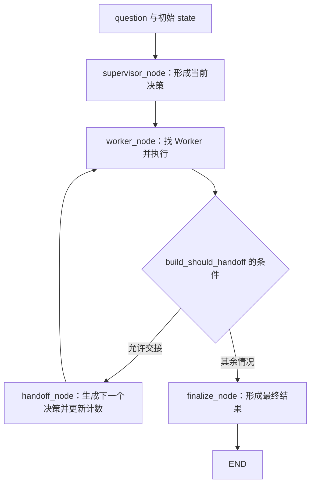
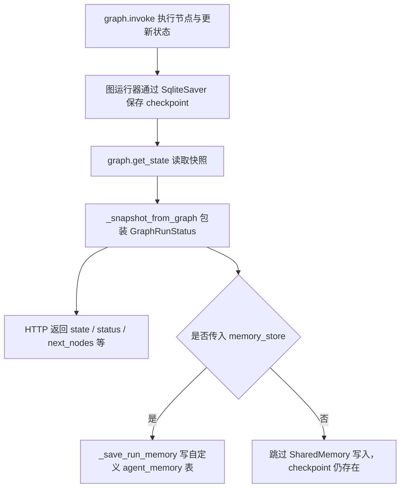
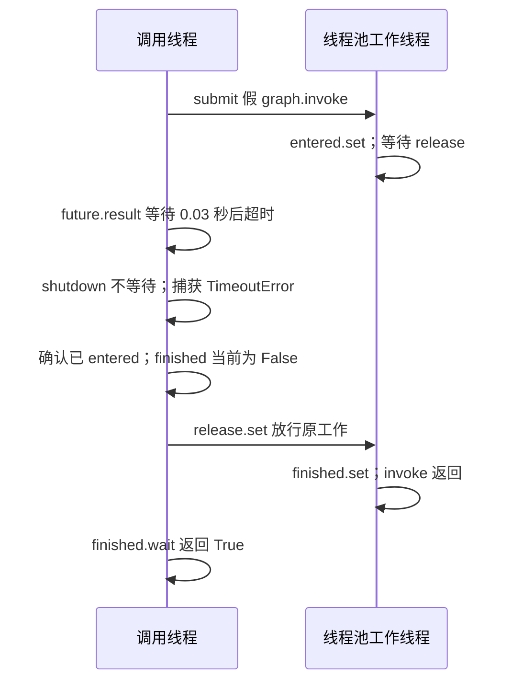
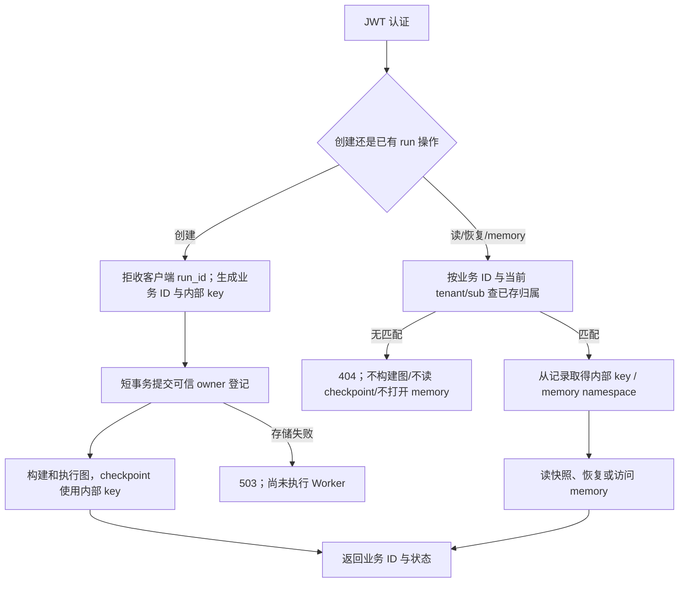

# D6：Graph 状态恢复与运行归属

**2026-10-28 实施与剩余作业复批**：你已应用补丁，原方案、2.5.9 实施记录、算法和模拟原答均保留。实际业务目录 **65 项 Graph、74 项 D5、八文件 Ruff 通过**，Compose 归属/SQL/memory 验收按本人回填通过，[工程复批见 2.5.10](#d6-implementation-recheck)。[二分实现通过](#d6-binary-review)，但提示辅助完成与独立限时要分开；[模拟边界题](#d6-mock-review)和[岗位判断](#d6-jobs-review)已逐项纠正。D6 工程可收尾，记录补范围说明、口述短复测与岗位动作仍需处理；[第 10 节](#d6-wrapup-next)给收尾与 D7 规划，不重做旧实验。

2026-10-26 启动，沿用 [30 天总日程](15_30天冲刺总日程.md)。今天先弄清“流程执行到了哪里、状态存在哪里、谁有权查看或继续执行”，再由你提出归属修复方案。**先导读和提示 → 你回填 → 我保留原答批改 → 给逐行实施代码 → 你手动修改和验收。** 本页保留你的原答，助手批改另列；业务代码继续由你手动实施。

**D5 收尾**：你已在 review/20 的 2.4.9 补齐业务 UUID 来源、Compose 同意/拒绝 observation、answer/done 和旧票据 404；按你的实际回填，本轮约定验收通过。助手本轮没有重复调用真实服务。`yield from/Span/use_span` 已初步理解，深记忆安排到 D6、D8、D12 的短复习，不要求今天重新通读几百行 Trace 解析。

## 0. 今天先做什么；哪些是我准备的，哪些由你完成

### 我已准备，你不需要重新编写的材料

- 本页的通俗术语、源码逐跳导读、具体问题、思考步骤、回填区和验收要求。
- [d6_graph_probe.py](../practice/d6_graph_probe.py)：诊断脚本，已运行。使用真实 HTTP 路由、JWT 校验、LangGraph 和临时 SQLite；模型决策、Worker/检索、额度使用替身。观察现状，**不代表安全验收通过**。
- [d6_binary_search_first.py](../practice/d6_binary_search_first.py)：算法题骨架和 14 个自检样本，函数还没实现，由你编码。
- 助手 2026-10-26 四文件基线 **21 passed in 1.76s**；你 10-27 回填 **21 passed in 1.14s**、probe 一致，运行记录已批改。这是基础回归和缺陷复现证据，不是“跨用户读/恢复已安全”。

### 你按这个顺序做

1. **1.1–1.3 已提交并批改**，不重写原答；先读各节批注，修正事实与术语。
2. 第二批 2.1、1.4、1.5、2.2 已交并批改。按 [第 8 节](#d6-owner-design-next) 定点看本次补课，重点分清 checkpoint 写入、先占位、共享授权与等待超时。
3. 2.5 已实施，2.5.10 复批通过本轮归属范围；按批注补验收来源/业务状态/未做范围，不重复应用补丁或重跑已通过的测试。
4. 二分实现和模拟已提交，读各节批注后用原时段短复测；4.2 选岗有记录但证据/行动尚不完整，跟同一台账的本次评注推进。简历首版仍在 D7。

### 8 小时怎样计时，不重复算模拟时长

- **复习 4h**：1.1–1.5 共 210 分钟；模拟中的项目口述 5 分钟、源码追问 15 分钟、反馈 10 分钟，共 30 分钟。
- **诊断/方案 2h**：2.1 30 分钟、2.2 30 分钟、2.3 45 分钟、2.4 15 分钟。
- **算法 1h**：手推 10 分钟、模拟中的编码 30 分钟、自检和复杂度/边界解释 20 分钟。
- **求职 1h**：更新同一台账两条候选的证据和下一步，不另开简历提纲任务。

模拟总计 60 分钟，由上面的复习 30 分钟和算法 30 分钟拼成，不额外再加一小时。超过时间盒，记录具体卡点后提交；未实施/未验证的修复不打勾完成，必要时沿总日程借 D7 时间。

### 先认识六个词，后面就不容易混

- **Graph/图**：可以先理解成“把步骤和下一步的规则写成程序化流程图”。节点是函数，边决定下一步到哪个函数；用了图不自动等于多个模型同时工作。
- **State/状态**：这次工作当前携带的变量包，例如问题、当前 Worker 决策、Worker 结果和交接次数。
- **Checkpoint/检查点**：执行中的状态存档；框架用它找回当前状态和待执行位置，不是对 HTTP 流做网络续传。
- **thread_id**：LangGraph 查找某条状态历史的标识。本项目把 run_id 放在这里；**不是 Python 线程编号，也不是 threading.Event**。
- **Resume/恢复**：从已有存档继续推进。本项目用了静态节点前暂停和 `invoke(None, config)`；先按这条现有实现读，不改成别的 API 写法。
- **Replay/重放**：从某个历史位置重新执行后续步骤。恢复和重放要看起点与执行内容，不能笼统理解为“重新发起原请求，工具也不会重复”。

LangGraph 官方将 checkpoint 与图外的长期 Store 区分为两种持久化机制，见 [Persistence](https://docs.langchain.com/oss/python/langgraph/persistence)。本项目的 `SharedMemoryStore` 是自己用 SQLite 写的类，并非因为名字带 Store 就自动使用了官方 Store 或接入了权限校验。

## 1. 三小时半导读：沿一条实际调用链理解 Graph

### 1.1 15 分钟：D5 与 D3 的短回忆

**目的**：把已经修过的归属问题迁移到新对象，不要求再背整段 OTel API。

**操作与题目**：先闭卷 5 分钟，用 1–3 句回答；剩余 10 分钟只核对忘记的函数。

1. 合法 JWT、知道对象 ID、拥有该对象，三者分别说明什么？B 拿到 A 的 run_id，能否直接恢复？
2. D5 的业务 run UUID、OTel trace_id、Span 名称 `agent.trace` 有何不同？回答到能区分即可。
3. `yield from` 是否自己创建线程？`use_span` 退出和 `span.end()` 是否是一回事？
4. D3 为什么不能仅靠 Redis key 中加 tenant/sub 就认定数据库读写已经安全？这对今天的 checkpoint key 有什么启发？

**忘记再看**：[D5 2.4.10–2.4.12](20_D5安全链路与Trace归属.md#d5-yield-from)；[D3 文档](18_D3工具循环与会话归属实作.md) 搜 `_authorize_chat_session`。只找对应句和调用点，不整篇重读。

**思路**：按“身份 → 对象 → 可信归属关系 → 操作”复述；另用“创建/激活/结束”区分 Span 动作。

> 我的回答：
>
> ① JWT、ID、对象归属与恢复权限：合法 JWT 代表某一用户的合法身份标识；知道对象ID只能说明从某处获得了这个ID，当前用户并不一定可以进行查询、恢复等操作；拥有该对象说明拥有者可以对该对象进行所属查询、恢复、修改、删除等操作。B 拿到 A 的 run_id不能直接恢复，要进行run_id的归属关联查询，不能所有合法用户都能操作不属于自己的run_id。
>
> ② 业务 UUID / OTel ID / 名称：业务 UUID是与一次问答ReAct循环唯一对应，用于创建审批上下文，如果循环中有审批事件，一个业务 run UUID可以对应一个或者多个approval_id，approval_id数量取决于一次循环中的审批数量。OTel trace_id是某一Agent循环中的一组数据上报集合的唯一标识。Span 名称 `agent.trace`是OTel tracer创建的一段起止时间内工作记录的对象命名。
>
> ③ yield from、use_span、end：yield from不创建线程，而是将iterator数据流暴露出来，让外部调用者通过next逐步调用；trace.use_span是创建一个单独的上下文，可以给工具子Span传递父上下文，又不跨yield持有上下文变量，use_span退出说明当前临时上下文关闭；span.end是本段时间内工作记录的对象结束记录，释放span名称。
>
> ④ 缓存/checkpoint key 与授权：Redis key 中加 tenant/sub不能确定当前tenant/sub和Redis key存在关联归属，数据库读写应该通过单独的session_id与tenant/sub的关联表查询确定关联性，后续进行读写才是安全合法的。checkpoint key应该增加run_id和tenant/sub关联表，新建的时候查重后增加新数据，修改和读取的时候增加run_id和tenant/sub的关联校验。

#### 2026-10-27 逐题批改：归属主线正确，Span 术语还需校准

**① 审批：基本正确，补充“操作权限”和“当前漏洞”的区别。**

你已正确区分身份、对象 ID 与归属。需要收窄的是“拥有对象就能查询、恢复、修改、删除”：owner 校验只是授权的一部分，某个操作还可能受角色、对象状态和产品规则限制；拥有记录不代表系统一定开放所有操作。

**正确表述**：合法 JWT 表示令牌认证通过，服务端取得可信 tenant/sub；run_id 只是定位对象。请求者还要与创建时保存的 owner 匹配，并满足该操作的规则。按安全要求 B 不能恢复 A 的 run；**但当前 Graph 缺少这层校验，诊断显示 B 实际可以恢复**。回答时用“应该拒绝”和“目前会放行”区分要求与事实。

**② 审批：业务关联基本正确，OTel trace_id 的范围说窄了。**

主 Agent/MCP 当前用 `ApprovalContext.run_id` 关联一次运行、业务 Trace 和该运行中的票据；一次运行可有零张或多张审批票据。不能扩大为“项目每次问答都一定是 ReAct，也一定创建审批 Context”。Graph 今天使用的是它自己的运行 ID 路径。

**正确表述**：业务 UUID 是本项目运行对象的标识；OTel trace_id 是一条遥测调用链的关联标识，链上可以有多个 Span，不保证与一次 Agent 循环一一对应。例如 Agent Span 若继承 HTTP 父 Span，它们可属于同一条 OTel Trace。`agent.trace` 是本项目给 Agent Span 起的名称，可重复使用；一个 Span 的身份不能靠名称判断。

**③ 审批：知道 yield from 不起线程是正确的；“创建独立上下文”“释放名称”需纠正。**

- `yield from inner` 委托内部生成器逐条产出，并有 close/throw 等委托语义；它不创建线程。本项目把 MCP 包装函数变为生成器后，函数体延迟到 next 才执行，线程池消费由 Starlette 负责。
- `trace.use_span(span, ...)` 是把**已有 Span 临时设为当前上下文中的活动 Span**，退出时恢复此前上下文。不是每次创建一条独立 Trace 或一个新 Span；恢复上下文也不是销毁上下文本身。
- “不跨 yield 持有 token”取决于本项目**先退出 with、再 yield** 的代码位置，不是调用 use_span 就自动保证所有生成器都安全。
- 本项目设置 `end_on_exit=False`，因此退出一次 use_span 不结束 Span；最终 `span.end()` 才结束该 Span 的记录生命周期。它不“释放 span 名称”，名字本来就允许重复。可以类比“这张计时卡结束了”，不是“以后不能再写这个标题”。

官方语义参考：[OpenTelemetry use_span](https://opentelemetry-python.readthedocs.io/en/latest/api/trace.html#opentelemetry.trace.use_span)。这里按 [observability.py](../app/observability.py) 当前代码的位置和参数解释，不要求你再背 SDK 内部实现。

**④ 审批：方向正确，补可信来源和创建时原子约束。**

数据库保存 session/run 的 owner，读写前比较这份可信关系，与你的方案一致。更准确的因果是：Redis key 即使由可信身份生成、能分开缓存，也不能替代数据库对实际记录的授权；不能只讨论 key 名字“是否有关联”。Graph 同样需要先登记 owner，后续读取/恢复前核对，旧无 owner checkpoint 不自动认领。

创建时“先查重再插入”可改善提示，但两个请求可能同时查到不存在，不能只靠这一判断防并发冲突；持久存储还需唯一约束/原子插入，并禁止冲突时覆盖他人 owner。今天先记住这个边界，具体表结构和代码等 2.3 方案批改后再实施。

**本节结论**：可继续；重点短记“身份不是授权、Span 名称不是 ID、退出激活不是结束 Span”。不用重答四题。

**验收**：可以翻源码后修正，但保留最初不确定点；会区分 ID 和权限即可继续。

### 1.2 50 分钟：谁选 Worker；图中四个节点做什么

**目的**：把“多 Agent”落到实际函数与状态更新，不停留在框架名称。

**逐跳阅读，按顺序做 5 件事**：

1. 打开 [models.py](../app/models.py)，只读 `SupervisorDecision/HandoffDecision/WorkerResult/SupervisorResult`。把 decision 理解成“派谁、做什么、带什么材料”，把 WorkerResult 理解成“完成/失败/转交的回执”。
2. 打开 [supervisor.py](../app/supervisor.py)，只读 `decide_worker` 和 `decision_from_handoff`。前者通过结构化模型输出选 Worker；后者把旧上下文、Worker 输出和交接材料合起来。今天不展开 Function Calling 重试实现。
3. 打开 [workers.py](../app/workers.py)，看 `WorkerRegistry/WorkerSpec/build_default_worker_registry`，再看两个 `run_*_worker`。注意注册表取出的不是另一个 HTTP 服务地址，而是可调用的 Worker；知识 Worker 里还会用 Plan-and-Execute。
4. 打开 [supervisor_graph.py](../app/supervisor_graph.py)，读 `SupervisorGraphState` 和四个 `*_node`。每个节点画两条线：**读 state 中哪些字段 → 返回哪些字段更新**。
5. 同文件看 `build_should_handoff/build_supervisor_graph`：重点看 `add_edge/add_conditional_edges`，确认交接后回到哪里、什么时候走 finalize。`partial(...)` 可先理解为“先固定 registry/retriever 等参数，运行时由图传入 state”。

**辅助流程图：照着源码给箭头补解释**



**具体题目**：

1. `supervisor/worker/handoff/finalize` 各读什么、写什么？按“函数名 → 输入字段 → 输出字段”分行写，不需要做横向大表。
2. “选哪个 Worker”和“Worker 内部如何完成任务”分别由什么函数负责？交接是否每次重新调用 Supervisor 模型？
3. 手推：初始 `handoff_count=0`、`max_handoffs=2`，假设每次 Worker 都返回合法 handoff。最多经过几次 Worker、几次 handoff，最后走到哪里？不要只写“有上限”。
4. `total=False` 能否让不存在的字段直接被 `state["question"]` 安全读取？节点返回部分字段，是否代表整个 state 只剩返回的那几项？结合初始化和一个节点说明。
5. 仅凭“注册了两个 Worker”能否说当前图并行执行？指出边的证据。与 `/agent/stream` 的 ReAct 循环相比，今天这条图在哪一层控制下一步？

**解题思路**：先把节点当普通 Python 函数读，再看图如何调用它们。交接计数每更新一次就在纸上加 1，按条件实际跑，不凭“max=2”猜总执行次数。`TypedDict` 是类型描述，别把它当 Pydantic 的运行时自动校验。

> 我的回答：
>
> ① 四节点的读写字段：supervisor_node -> 输入SupervisorGraphState的实例state、WorkerRegistry的实例worker_registry -> 输出current_decision和handoff_count组成的dict；worker_node -> 输入SupervisorGraphState的实例state、WorkerRegistry的实例worker_registry、检索器retriever、审批调用工具approve_tool_call -> 输出worker_result组成的dict；handoff_node -> 输入SupervisorGraphState的实例state -> 输出下一个决定current_decision、交接列表handoffs、交接次数handoff_count组成的dict；finalize_node -> 输入SupervisorGraphState的实例state -> 输出SupervisorResult
>
> ② 决策、Worker 执行与交接：选哪个Worker由supervisor_node或者handoff_node返回的current_decision决定，Worker 内部如何完成任务由worker.run、即build_default_worker_registry注册的Worker中key为run对应的函数体决定。交接不用每次调用Supervisor。
>
> ③ max_handoffs=2 的逐步推演：最多经过3次Worker，2次handoff，最后走到finalize。
>
> ④ total=False、缺字段、部分更新：total=False不能被`state["question"]`安全读取，应该使用state.get("question", "")并进行结果非空判断；节点返回部分字段也不代表整个 state 只剩返回的那几项，例如supervisor_node返回current_decision、handoff_count不代表question为空，worker只返回worker_result也不代表handoffs为空数组。
>
> ⑤ 串行/并行证据、与 ReAct 的控制层区别：不能仅凭“注册了两个 Worker”说当前图并行执行，需要注册【边】和【条件边】来连接节点，build_supervisor_graph中通过add_edge连接supervisor和worker、handoff和worker、finalize和END，通过add_conditional_edges连接worker与handoff或finalize、并通过build_should_handoff进行条件判断。与 `/agent/stream` 的 ReAct 循环相比，图在Supervisor和Handoff层控制下一步。

#### 2026-10-27 逐题批改：控制流理解正确，补到字段和真实返回值

**① 审批：函数依赖列得对，但题目要求的 state 字段还不完整；finalize 返回类型需纠正。**

你写出了函数形参，说明已经找到位置。现在再向函数体里走一步，区分“依赖参数”和“state 中真正读的字段”。`SupervisorGraphState` 是 TypedDict 描述的字典结构，不是 Pydantic 模型实例。

**四节点的标准读写链**，对应 [supervisor_graph.py](../app/supervisor_graph.py)：

- `supervisor_node`：读 `question`、现有或默认的 `handoff_count`；调用 decide_worker；返回 `current_decision` 和 `handoff_count` 的更新字典。registry 是另传的依赖，不是 state 的某个字段。
- `worker_node`：读 `current_decision`，校验成 SupervisorDecision；按 decision.worker 从 registry 找 Worker，调用 `worker.run(...)`；返回 `{"worker_result": worker_result.model_dump()}`。找不到 Worker 时也返回失败的 worker_result。
- `handoff_node`：读 `current_decision`、`worker_result`、已有 `handoffs` 和 `handoff_count`；生成下一决策、构造包含本次交接的新列表、计数加一；返回这三个字段的更新。
- `finalize_node`：读 `current_decision`、`worker_result`、已有 `handoffs`；内部构造 SupervisorResult，**实际返回 `{"result": result.model_dump()}`**。它不是直接返回 SupervisorResult 对象。

因此有三层：节点内部的 Pydantic 对象 → 节点返回的普通更新字典 → 图合并后的整体 state。后续 API 再包装成 GraphRunStatus，不是所有层都叫同一种 result/snapshot。

**② 审批：正确；把 Worker 的 run 称为“属性”更准确。**

初始 `supervisor_node → decide_worker` 调模型，得到 Worker 路由决策；交接时 `handoff_node → decision_from_handoff` 根据已有 handoff 结果生成下一决策，不再自动调一次 Supervisor 模型。

WorkerRegistry 存的是 WorkerSpec 对象，`run` 是该对象保存的可调用属性，不是字典里名为 run 的 key。worker.run 指向注册的 `run_knowledge_worker` 或 `run_jd_analysis_worker`，它们内部再使用各自的计划执行/分析逻辑。你对职责分离的理解正确，改准确措辞即可。

**③ 审批：次数和终点正确；补最后的失败结果及逐步证据。**

```text
Worker 第 1 次：count=0，允许 handoff → handoff_node 后 count=1
Worker 第 2 次：count=1，允许 handoff → handoff_node 后 count=2
Worker 第 3 次：count=2，仍请求 handoff，但 2 < 2 为 False
转 finalize；worker_result.status 仍是 handoff
finalize 形成 status=failed，错误“超过最大 Handoff 次数”
```

所以是 **3 次 Worker、2 次真正执行的 handoff_node**；第三次只是提出交接要求，并没有第三次执行交接节点。这里不是进入 finalize 就一定成功，也不会再运行第 4 次 Worker。

**④ 审批：知道 total=False 不保护缺失键、部分更新不清空其他字段，正确；不必一律改用 get。**

TypedDict 的 `total=False` 表示类型层面允许键缺省；运行时仍是普通 dict，缺失时 `state["question"]` 仍可能 KeyError，框架也不会凭这个标记自动补空字符串。参考 [Python TypedDict](https://docs.python.org/3/library/typing.html#typing.TypedDict)。

但 `question` 是本项目 start 初始化就写入、supervisor 节点所必需的字段。在这一调用契约下直接下标访问是合理的；如果必需字段缺失，应在边界校验或明确报错。把所有必需字段都默认成 `""`，可能掩盖状态构造错误，还让无意义输入继续进入模型。`get` 更适合有明确定义的可选字段/默认值，例如 handoff_count。

**部分更新的正确解释**：当前 state 各字段没有自定义 reducer，节点返回的字段通常覆盖该字段的旧值，未返回的字段保留，不是清空整个 state。question 会在 supervisor/worker 的部分更新后保留；handoffs 也不会因为 worker 没返回它就变成空数组。列表不会自动“追加”，所以 handoff_node 显式构造了 `旧 handoffs + 本次 handoff` 再返回。参考 [LangGraph 的状态更新与 reducer](https://docs.langchain.com/oss/python/langgraph/graph-api#reducers)。

**⑤ 审批：串行判断正确；还要把“图执行器”和“路由决策”分开。**

你已列出实际边，证据有效。再精确一点：当前每次只执行一个 worker 节点，之后选择 handoff 或 finalize，没有同时派发两个 Worker 的分叉；因此这条图是顺序推进。不能泛化成“有边的 Graph 都串行”，别的图可以有并行分支。

**正确的两层控制**：Supervisor 模型/交接结果决定“本轮选哪个 Worker”；LangGraph 运行器按已注册的边和 `build_should_handoff` 决定“下一节点去哪里”。Worker 内部又有自己的执行策略。主 ReAct 则在工具粒度上由模型返回 tool_calls，服务端循环校验和执行。你说“Supervisor/Handoff 层”抓住了高层路由，但不能漏掉实际推进节点的图运行器。

**本节结论**：控制流主线通过；优先记 `节点返回更新 dict`、`Worker.run 是可调用属性`、`最多交接两次但 Worker 可执行三次`。字段级正确答案已补，无需再重抄。

**验收**：可以按箭头讲一次成功链和一次交接超限链；不把 Worker、工具和模型调用混成同一个对象。

### 1.3 50 分钟：三个 HTTP 接口分别干什么；身份在哪里消失

**目的**：区分“创建/继续执行”和“只是读取”，并追踪可信身份是否真的用到了对象授权。

**逐跳操作**：

1. [main.py](../app/main.py) 搜 `GraphRunRequest/agent_graph_start`。画出 body 的 question/run_id/request_id/tenant_id/timeout_seconds，以及依赖注入的 user，分别从哪里来。
2. 对照它实际调用 `start_graph_run(...)` 的参数。**请求模型中有字段，不代表路由一定采用这个字段。** 标出传了哪些、没传哪些：特别是 `user.sub` 和 `memory_store`。
3. 同文件读 `GraphResumeRequest/agent_graph_resume/agent_graph_state`。state 是 GET，resume 是 POST；分别追到 [supervisor_graph.py](../app/supervisor_graph.py) 的 `get_graph_run/resume_graph_run`。
4. 继续追 `_run_config/_snapshot_from_graph`，找 checkpoint 定位参数和返回 `GraphRunStatus.tenant_id` 的来源。画到 `graph.get_state` 或 `graph.invoke` 为止。
5. 先别用前端 Graph 模式代替本实验。前端的 `/agent/graph/stream` 与今天的 `/start → /state → /resume` 是不同入口；本页会用现成脚本直接请求后三个接口。

**具体题目**：

1. 给三个接口各写一句“是否会推进图、读/写什么、返回什么”。GET state 与 POST resume 不能只写成“获取任务数据”。
2. body 中写 `tenant_id="别人租户"`，现有路由实际把谁的 tenant 传下去？为什么“用了 JWT tenant”仍不能直接证明 checkpoint 属于该用户？
3. 从 `user.sub` 到 `_run_config` 有没有可信 owner 比较？已存 run 的 owner 当前在哪里？没有找到就写“未找到”，不要替代码脑补。
4. C 访问 A 的 run，若响应 `tenant_id` 变成 C 的 tenant，但 state.question 还是 A 的问题，算隔离成功吗？请同时检查“返回标签”和“实际取到的记录”。
5. `run_id/request_id/thread_id` 在当前实现各用于什么？run_id 能否由客户端指定？这对重复 start 或覆盖已有运行有什么影响？先写风险和应验收行为，今天不要求你马上实现并发幂等。

**思路**：画两条并排的纵向链：① JWT 身份如何传；② checkpoint 如何定位。只有中间存在“以已存 owner 核验请求者”的证据，才能把两条线连成授权。不要用响应里回显的 tenant 充当已经保存的 owner。

> 我的回答：
>
> ① start / state / resume 的职责与是否推进：/agent/graph/start接口：会推进图，因为调用了 _invoke_with_timeout；读request的question、run_id、request_id、tenant_id、timeout_seconds/写graph；返回snapshot（包含run_id、request_id、tenant_id、status、values、next_nodes、result、error）。/agent/graph/resume接口：会推进图，调用了 _invoke_with_timeout；读run_id、tenant_id、timeout_seconds/写graph；返回snapshot。/agent/graph/state接口：不会推进图；读run_id、tenant_id/写graph；返回snapshot。
>
> ② body tenant 与 JWT tenant：body中写`tenant_id="别人租户"`，实际传下去的租户值还是当前请求用户的tenant_id，因为是从get_current_user获取的；虽然用了 JWT tenant，但是在创建和修改checkpoint的时候并没有将其与用户的sub关联存储，所以不能直接证明checkpoint 属于当前请求用户。
>
> ③ sub/owner 的传递和校验位置：`user.sub` 到 `_run_config` 没有可信 owner 比较；没找到已存 run 的 owner。
>
> ④ C 的返回标签与 A 的实际数据：get_graph_run中没有租户校验，不算租户隔离成功，用户粒度上都没有隔离。C只要拿到A的run_id，就可以获取对应Graph的所有数据快照，并且返回中的tenant_id还会被C的租户信息覆盖。
>
> ⑤ 三个 ID、客户端 run_id 与风险：run_id用于标识一次Graph执行、查询、记忆存储；request_id用于memory查询判断；thread_id用作给Graph传入保存配置，实际传入的值还是run_id。run_id不能由客户端指定，应该由服务端指定、做用户和租户隔离、去重、存储并下发给客户端，客户端指定的话重复 start 或覆盖已有运行的几率大大增加。

#### 2026-10-27 逐题批改：缺失 owner 定位正确，接口事实需纠正

**① 审批：start/resume 会推进、state 不推进，判断正确；“写 graph”和返回字段要具体。**

- **POST start**：读取 body 的 question/run_id/request_id/timeout_seconds，但 tenant 使用 JWT 的 `user.tenant_id`；构建初始 state，调用 `_invoke_with_timeout → graph.invoke` 执行节点并保存 checkpoint。HTTP 当前传了 finalize 前静态暂停设置，所以它不等于总是执行到最终成功。最后通过 `_snapshot_from_graph` 返回 GraphRunStatus。
- **POST resume**：读取已有 run_id、JWT tenant 和 timeout，调用 `graph.invoke(None, config=同一 run 的配置)` 继续已有状态；可能推进节点并更新 checkpoint，然后返回 GraphRunStatus。不是再次构造一份原问题作为新输入。
- **GET state**：按 run_id 定位已有 checkpoint，调用 `graph.get_state(config)` 读取；**不 invoke、不推进节点、不更新这次运行的业务 state**。源码虽然构建了图对象，但“构建图”不等于“执行/写入图状态”，所以不能把它也写成“写 graph”。这也不等于承诺底层完全没有数据库初始化等 I/O。

HTTP 返回字段是 **run_id、request_id、tenant_id、status、state、next_nodes、result、error**；`values` 是内部 LangGraph snapshot 的属性，包装时通过 `state=values` 变成 API 的 state 字段。不要把框架原生快照和接口响应混在一起。

**② 审批：判断正确；不仅缺用户 sub，tenant 也没参与 checkpoint 的 owner 校验。**

路由实际传 `user.tenant_id`，不是请求 body 的 tenant_id。可是 `_run_config(run_id)` 只提供 `thread_id=run_id`；随后按这个键直接取 checkpoint，没有拿“这条 run 创建时保存的 tenant/sub”核对。即使把调用者的 tenant 一路传到响应，也不会自动变成授权。

**正确表述**：可信身份来源已存在，对象归属登记/比较缺失；既不能隔离同租户 B，也不能靠当前传参挡住跨租户 C。这里只加 sub 参数但不实际保存/核验，同样无效。

**③ 审批：正确。**

从 main 的 Graph start/state/resume 调用到 `_run_config`，没有传递并核对 owner_sub，也没找到可信的 run-owner 登记。`GraphRunStatus.tenant_id` 是响应字段；可选 SharedMemory 的 tenant namespace 也不是运行归属授权表。你据实写“没有找到”比拿字段名推断已实现更准确。

**④ 审批：越权结论正确；“所有快照”“被覆盖”需要收窄。**

当前 state 接口调用 get_state 返回的是**当前定位到的状态快照**，不能据此说这个接口导出了所有历史 checkpoint。`_snapshot_from_graph` 用调用者传来的 tenant_id 构造一个新 GraphRunStatus；因此 C 会看见“tenant 标签为 C、state 却来自 A”的响应。

这是**返回结果被重新贴了标签**，不是本次 GET 把 SQLite 中 A 的 checkpoint 或一个已存 owner 字段改写成了 C。泄漏依然成立，但因果要准确：

```text
C 的 JWT → 得到 tenant=C
C 提交 A 的 run_id → _run_config 仍定位到 A 的 checkpoint
get_state → 读到 A 的 values
GraphRunStatus(tenant_id=C, state=A的values) → 回给 C
```

**⑤ 审批：改进方向合理，但“当前 run_id 不能由客户端指定”与源码不符；request_id 含义还需补全。**

**当前事实**：GraphRunRequest 有可选 run_id；`main.agent_graph_start` 明确传 `run_id=request.run_id`；`start_graph_run` 使用 `run_id = run_id or uuid.uuid4().hex`。所以**客户端传入非空 run_id，当前会被采用；没传/为空才生成**。同一个 ID 会定位同一份 checkpoint 历史，重复 start 可能用新的初始输入推进/改变原有逻辑运行，不能仅把它描述成随机碰撞“几率增加”。

**三个 ID 的标准答案**：

- `run_id`：本项目一个逻辑运行对象的标识，可经历多次 start/read/resume 请求；不是每次 HTTP 请求都换一个运行对象。
- `thread_id`：LangGraph checkpoint 历史的定位标识，本项目 `_run_config` 直接取值 run_id；不是 Python 工作线程 ID。
- `request_id`：本实现打算用于**重复启动请求的幂等关联**。显式传 memory_store 时，先按 tenant namespace 和 request_id 查已有 run 映射，命中则返回原 run；不是普通的随意 memory 查询。HTTP start 当前没有传 memory_store，因此仅填 request_id 不会启用这段去重，也没有证明并发原子性。

**改进方案**：“服务端生成业务 run_id、创建时绑定可信 tenant/sub、后续先授权再用登记的 checkpoint key”适合本轮目标；这是准备实现的方案，不是当前事实。允许客户端生成 ID 并非所有系统都错误，但那需要原子注册、归属/冲突和幂等契约；当前代码没有这些保障。即使采用服务端 UUID，也仍需授权，不能靠难猜代替 owner。

**本节结论**：问题定位通过，接口事实尚需校准。以后按两句话答：“当前源码是……；我计划改成……。”尤其先纠正 GET 写状态、响应贴标签与真实存储改写、客户端 run_id 这三处，不需要重写整节。

**验收**：能标出哪个字段来自可信 JWT，哪个来自客户端，哪个只是 checkpoint 定位键；找到缺失环节就如实写缺失。

<a id="d6-checkpoint"></a>

### 1.4 55 分钟：Checkpoint 如何保存位置；恢复是否重跑 Worker

**目的**：读懂状态存档，而不是把“恢复”理解成网络重连或重新执行整个请求。

**按这个顺序看**：

1. [supervisor_graph.py](../app/supervisor_graph.py) 的 `get_default_checkpointer/DEFAULT_CHECKPOINTER`：SQLite 文件默认在哪里，`SqliteSaver` 保存什么；不要动项目里的实际数据库文件。
2. `build_supervisor_graph` 最后的 `compile(checkpointer=..., interrupt_before=...)`：图的节点定义与 checkpointer 是在编译时装配的。
3. `start_graph_run`：看初始 state、config、`_invoke_with_timeout`，再看 `_snapshot_from_graph`。
4. `resume_graph_run`：比对 start，重点看传给 invoke 的输入为什么变成 `None`，config 是否仍定位同一 run。
5. `_snapshot_from_graph`：分别跟 `values/next/interrupts/result`，按 if/elif 顺序判断返回 status。再看 [test_supervisor_graph_checkpoint.py](../tests/test_supervisor_graph_checkpoint.py)，留意它给 FakeSnapshot 手工填了什么。

**具体题目**：

1. 对 `interrupt_before=["finalize"]`，执行暂停时，Worker 是否已经执行？state 中可能有哪些字段，哪些尚未出现？下一节点是什么？
2. 用同一 run_id、`invoke(None, config)` 恢复，与用新 run_id、重新传 question start，有什么不同？仅正常从 finalize 前继续时，是否需要再执行原 Worker？用 probe 的 Worker/finalize 计数说明，别扩大成“所有重放都不会重复副作用”。
3. 为什么持久化保存状态不等于业务动作“恰好一次”？假设某个 Worker 已发出外部请求，但写入确认状态前进程失败，恢复时需要考虑什么？只描述风险和解决方向，D7 再深入幂等。
4. 诊断中出现 `status=running、next_nodes=["finalize"]、interrupts=0`，而 worker/finalize 计数为 `[1,0]`。请对照 `_snapshot_from_graph` 解释：这个 status 是怎样算出来的？能否据此断言“后台还会自动继续跑”？静态暂停不一定等于源码里 `interrupts` 列表非空。
5. 原有 checkpoint 单测为何能通过 `status == interrupted`，却不能单独证明真实静态暂停的 status 映射正确？指出 fake 提供的数据与真实诊断的差异。

**解题思路**：在纸上画三个时刻：“start 前 → Worker 结束、finalize 前 → resume 后”。每个时刻写 state、next_nodes、Worker 计数、finalize 计数。`invoke(None)` 走的是已有存档；是否重跑，取决于恢复点与节点执行语义，不能凭接口叫 resume 就作绝对保证。

官方文档区分静态节点断点和节点内动态 `interrupt()`，动态中断还有 `Command(resume=...)` 语义，见 [Interrupts](https://docs.langchain.com/oss/python/langgraph/interrupts)。今天源码使用前者，不把动态中断示例直接粘贴进当前实现，也不新增升级依赖任务。

> 我的回答：
>
> ① 暂停位置、已执行节点、state 与 next：执行暂停时，Worker 已经执行；state有question、current_decision、worker_result、handoff_count，尚未出现的有result，handoffs不确定、因为不一定出现worker交接任务。下一个节点是finalize_node。
>
> ② 正常恢复与新 start、计数证据：同一 run_id、`invoke(None, config)`恢复的是已创建的任务，接下来会从该任务的中断处继续执行；新 run_id、重新传 question start是开启一段新的Graph，从start -> Supervisor处执行。仅正常从 finalize 前继续时，不需要再执行原 Worker。probe中【RESUME B HTTP/status/finalize delta】和【RESUME C HTTP/status/finalize delta】两处执行的counts["finalize"] - before都是1，后续打印可以证明counts["worker"]在resume处未改变。
>
> ③ 状态存档不能保证外部动作恰好一次的原因：worker_result中的status可能为handoff或者failed，handoff_count到达最大次数下一个节点会走到finalize，所以当前Graph状态存档和外部动作恰好一次没有必然关系。假设某个 Worker 已发出外部请求，但写入确认状态前进程失败，恢复时需要考虑worker_result的实际内容、分析失败原因，决定是否要重新执行Worker或者将任务交接给其他Worker。
>
> ④ running 的计算分支与是否自动继续：_snapshot_from_graph函数的snapshot.interrupts为空，进入了elif next_nodes分支，不能据此断言“后台还会自动继续跑”。
>
> ⑤ FakeSnapshot 单测与真实 checkpoint 观察的差异：test_start_graph_run_returns_interrupted_snapshot显式声明了interrupts=("interrupt_before_finalize",)，所以可以通过run.status == "interrupted"。为何不能单独证明真实静态暂停的 status 映射正确，这个不知道。

#### 2026-10-27 第二批逐题批改：正常恢复主线正确，补存档与证据边界

**① 审批：暂停位置判断正确；handoffs 并非不确定，节点名也要区分。**

本题按“一个新 run 正常执行到 finalize 前暂停”回答：Worker 已执行；state 已有 `question/current_decision/worker_result/handoff_count/handoffs`，尚未由 finalize 生成 `result`。**handoffs 在 start 的初始 state 就设为 `[]`**，没有交接时仍存在，只是空列表；有交接则被 handoff_node 更新，不是没交接就没有字段。

待执行节点是 `"finalize"`，对应函数 `finalize_node`。源码 `graph.add_node("finalize", finalize_node)` 把节点名与函数绑定，snapshot.next 保存前者，所以输出是 `["finalize"]`。

**② 审批：恢复与新启动的区别正确；现有输出没有直接报告 Worker 增量。**

同 run_id 配合 `invoke(None, config)` 继续已有 checkpoint；新 run_id 配合初始问题是新运行，从入口 supervisor 开始。正常从 finalize 前继续时，下一个节点就是 finalize，不必重新执行此前已结束的 Worker；这与任意失败后都不会重做 Worker 不是一回事。

你引用 `finalize delta=1` 能证明 B/C 的请求实际推进到了 finalize，证据有效。但**当前 probe 只在这两处打印 finalize 增量，没有打印对应的 Worker 前后差值**；“后续打印可以证明”是一个合理的补充验证办法，不能写作当前日志已经测得 Worker delta=0。此处可依据图的边和待执行位置解释，后续修复回归再加明确计数断言，无需为了这一个数字现在重跑整套练习。

**③ 审批：这题还未答到关键；handoff/failed 与副作用恰好一次不是同一层问题。**

题目问的是：**外部已经做成一件事，本地还没来得及记“做成了”，恢复后能否知道该不该再做？** 它与最大交接次数没有直接关系。

```text
1. checkpoint：记着“下一步要执行 Worker”
2. Worker 向外部系统提交操作，外部实际已经成功
3. 本进程在保存 Worker 成功结果前崩溃
4. 恢复只看到第 1 步的存档，可能再次执行 Worker
5. 如果外部没有去重，同一操作可能做了两次
```

你说“看 worker_result、分析失败原因再决定”有排障意识，但第 3 步正是**结果可能根本没存下来**，仅靠本地字段无法判断外部是没做、做失败了，还是已经做成。不能把“缺少成功记录”当作“肯定没执行”。

**正确答案**：checkpoint 记录图的执行进度，不会自动把“外部操作”和“本地记录结果”变成同一笔原子事务。真实工具需要稳定的业务操作 ID/外部幂等支持，或查询外部结果、对账/人工处理不确定状态；确认需要重试时仍要防重复。D7 再深入实现，不要求今天写完整方案。当前 apply_job 是演示 handler，上面是换成真实外部动作时的故障场景，不代表项目已经真实对外投递。

**④ 审批：正确，补全状态映射的前提。**

本次快照还没有最终 result，`interrupts=()`，但 `next_nodes=["finalize"]` 非空，于是代码命中 `elif next_nodes: status="running"`。这只是 `_snapshot_from_graph` 按字段算出来的标签；真实执行已停在静态节点断点处，必须再次调用恢复才会继续，不能凭 running 推断另有后台执行者在自动跑。

另外输出中的 `0` 是 **`len(snapshot.interrupts)`**，表示这份快照携带的中断信息列表长度，不是整个任务历史上的“总中断次数”。静态节点前暂停不要求该列表一定非空。

**⑤ 审批：已找到 fake 输入，下面补“为什么不能外推”。**

原单测把 `build_supervisor_graph` 换成 FakeGraph，并主动提供了一个非空 interrupts；没有用真实 LangGraph 去执行那个静态暂停，再读取其快照。因此它验证的是**给定这些假输入，包装函数会走哪个分支**。

```text
单测给的输入：无 result，interrupts=("interrupt_before_finalize",)，next=("finalize",)
代码实际命中：elif interrupts → interrupted

真实静态暂停：无 result，interrupts=()，next=("finalize",)
代码实际命中：elif next_nodes → running
```

这说明单测本身能覆盖一个映射分支，但它没有证明“真实静态暂停一定长成假输入那个样子”。你的 probe 用真实图和 SqliteSaver 配合假 Worker，才观察到了另一种真实快照形态。进一步验证状态映射需要这类组件集成证据，而非只再构造一个期待值。**不要求本轮立即修改状态码或状态标签；先记为独立边界，归属修复仍优先。**

**本节结论**：正常暂停/恢复理解可继续；重点补“handoffs 初始就有”“外部成功、本地未记账的不确定窗口”“fake 条件与真实组件行为不能等同”。原答不重写。

**验收**：能区分“待执行节点”“接口返回状态”“当前是否真的有执行者在跑”；知道恢复/重放时还要考虑副作用。

<a id="d6-memory-timeout"></a>

### 1.5 40 分钟：SharedMemory 与 checkpoint 的区别；超时是否停止执行

**目的**：把三个常被混在一起的问题拆开：状态存在、对象有权访问、执行是否还活着。

**阅读和操作**：

1. [shared_memory.py](../app/shared_memory.py) 只看建表 SQL、`set/get/list_namespace/delete/close`。把一行数据理解成 `namespace + key → JSON value`，SQL 中 `?` 是参数占位，不是字符串拼接。
2. [supervisor_graph.py](../app/supervisor_graph.py) 看 `_run_namespace/_idempotency_namespace/_save_run_memory` 及 start 中 `if request_id and memory_store`。分别记“什么时候写”“写到哪里”“没传 Store 会怎样”。
3. [main.py](../app/main.py) 看 `agent_memory_list/agent_memory_get/agent_memory_delete`，比较其 namespace 是否包含用户 sub，有没有查询 run 的可信 owner。
4. 最后读 `_invoke_with_timeout`：先看 `future.result(timeout=...)`，再看 `shutdown(wait=False, cancel_futures=True)`。可把 Future 理解成“将来能取结果的任务凭条”，取结果等超时不等于杀死执行线程。

**具体题目**：

1. checkpoint 与本项目 SharedMemory 分别保存什么，读/恢复 Graph 状态实际使用哪一个？如果 HTTP 没传 memory_store，checkpoint 能否仍然保存？
2. SharedMemory 的 `UNIQUE(namespace,key)` 保证什么？能否替代用户授权，或让“get 未找到 → 执行 Worker → set 映射”的整个流程自动变成并发原子操作？
3. 相同 request_id：为什么 HTTP 连续 start 两次，与直接函数调用且显式传 memory_store，可能得到不同结果？请用实际传参和 probe 的 Worker 计数作证据。
4. 若两个用户在同一租户，memory namespace 只含 tenant/run，是否足以区分他们？在设计 Graph 归属修复时，memory 的读/删是否应复用同一层授权？
5. 超时诊断中“等待先超时、随后释放假任务、任务仍完成”分别证明什么？cancel_futures 能否终止已经开始运行的线程？本轮只解释证据，不要求实现容器强杀或完整取消系统。

**思路**：分开问三句话：“我从哪份存储取数据？”“谁有权取/改？”“当前有没有执行者继续做事？”唯一约束、RLock、tenant 前缀各只覆盖一部分问题，不用一个机制解释全部。

> 我的回答：
>
> ① 两份存储、HTTP 未传 memory_store 的影响：checkpoint通过_snapshot_from_graph保存Graph的GraphRunStatus字典，写入data/langgraph_checkpoints.sqlite文件中；SharedMemory将Graph信息保存为数据表（列为memory_id、namespace、key、value、created_at、updated_at）。读/恢复 Graph 状态实际使用checkpoint。HTTP 没传 memory_store，checkpoint 仍然保存。
>
> ② 唯一约束、授权、并发原子性的区别：`UNIQUE(namespace,key)`保证namespace和key的唯一性。不能代替用户授权，当前没有传入owner_sub并做owner_sub、tenant_id、run_id的关联校验。不能让“get 未找到 → 执行 Worker → set 映射”变成并发原子操作，原因不知道，也不太了解**并发原子操作的概念**。
>
> ③ HTTP 与显式 memory_store 的重复请求证据：直接调用函数且显式传memory进入了if request_id and memory_store和if existing and existing.value.get("run_id")判断分支，直接返回了run，所以不会执行两次；HTTP 连续 start 两次调用start_graph_run的时候，并没有显式传入memory，所以不会进入if request_id and memory_store判断。probe中HTTP duplicate same run/worker delta = [False, 2]、INTERNAL memory same run/worker delta = [True, 1]两个输出可以验证这一点。
>
> ④ memory 同租户用户边界与授权复用：同租户不能区分，memory 的读/删不应该复用同一层授权，具体原因不知道。
>
> ⑤ 等待超时与执行结束的区别：不知道，这里probe_timeout的原理、执行机制、目标、要验证什么需要解释。

#### 2026-10-27 第二批逐题批改：补存储写入点、原子性与超时完整导读

<a id="d6-checkpoint-write-read"></a>

**① 审批：两份存储、未传 memory_store 仍有 checkpoint 的方向正确；保存函数说反了。**

`_snapshot_from_graph` **不保存 checkpoint**。它先调用 graph.get_state 读取框架快照，再取 values/next/interrupts，计算状态并构造 API 的 GraphRunStatus。GraphRunStatus 不是 SqliteSaver 原样写入数据库的格式，也不是这份框架快照本身。

**正确链路分三层看**：

1. `build_supervisor_graph(...).compile(checkpointer=SqliteSaver(...))` 给图装上检查点存储；`graph.invoke` 执行时，由图运行器调用 checkpointer 保存图状态及恢复相关信息。
2. `graph.get_state(config)` 读取当前快照；`_snapshot_from_graph` 把它**包装成 HTTP 结果**，其中 `GraphRunStatus.state = snapshot.values`。
3. 另一个可选动作 `_save_run_memory(memory_store, ..., snapshot)`，才将包装结果中的 state/status/可用的 result 分别写进自定义 SharedMemory 的 `agent_memory` 表。它不是 checkpoint 的替代品，也不是 Graph 恢复的读取来源。



默认 checkpointer 的文件是 `data/langgraph_checkpoints.sqlite`；自定义 SharedMemory 由自己的连接管理，不是同一张表。probe 为隔离项目数据，使用进程内 SQLite 验证行为，没有验证落盘后重启恢复。官方机制区分可参考 [LangGraph Persistence](https://docs.langchain.com/oss/python/langgraph/persistence)；实际写/读函数以上述项目源码为准。

<a id="d6-atomicity-walkthrough"></a>

**② 审批：知道“不能代替授权/并发控制”正确，下面补唯一约束与原子性的含义。**

`UNIQUE(namespace,key)` 保证的是**两个值的组合唯一**：同一个 namespace 可以有不同 key；不同 namespace 可以用同一个 key；同一个二元组合最多一行。它不要求 namespace 自己唯一，也不要求 key 自己唯一。

**并发**：两个请求的执行时间交叠，步骤可能交错。**这里需要的原子操作**：把“是否已有执行者”的检查与“登记我已取得执行权”的状态变更作为不可被其他请求插入的一个受保护步骤。数据库事务也有“整体成功或整体失败”的原子性语义；不是所有代码放在同一个 Python 函数里，就自动原子。

当前 start 的 `get → 执行 Worker → set` 是多步，中间允许另一个请求进入。哪怕每次 get/set 自己加锁，也可能这样：

```text
请求甲：get(request_id) → 没记录
请求乙：get(request_id) → 也没记录
请求甲：执行 Worker → 第一次动作
请求乙：执行 Worker → 第二次动作
请求甲：set(request_id, run甲) → 写入一行
请求乙：set(request_id, run乙) → 更新同一行
最后数据库仍只有一行，但 Worker 已经执行两次
```

这正是“**行没有重复，不等于动作没有重复**”。SharedMemory.set 的 RLock 保护这个 Store 实例的一次 set 内的查询/写入，不覆盖 start 中这整段流程；不同 Store 实例/进程的锁也不是同一把锁。

**解决方向**：在真正执行前，用唯一约束配合原子插入/条件更新，先争取一次执行权；未取得者复用已有结果或等待/返回状态。不要为了图省事一直持有数据库事务/进程锁等待模型和外部工具。本轮先理解先占位的原因，D7 再设计完整幂等状态；即使取得执行权，故障重试与外部副作用的不确定性仍需另外处理，不能宣称自动恰好一次。

**③ 审批：正确，补“串行复用”的精确范围。**

显式传同一 memory_store 和同一 request_id 时，第一次调用执行后写映射；**第二次**调用才查到 existing 并返回原 run。不是两次调用一开始都命中 existing。HTTP 路由没有传 memory_store，因而都绕过这段复用逻辑。

`[False,2]` 与 `[True,1]` 支持你给出的差别；它们没有证明参数内容被逐项比较，也没有测试两个请求同时到来的竞争。当前这是按 request_id 做的串行关联复用，不是“所有相同参数都自动识别、所有并发都安全”。

<a id="d6-shared-run-authorization"></a>

**④ 审批：同租户无法区分这一点正确；“不应该复用同一层授权”需要改正。**

本轮的 Graph 运行及其 memory 都按 owner 私有访问，**应复用同一份 run 归属规则/授权函数**：每次请求都拿当前 JWT 的 tenant/sub 和目标 run 已存的 owner 比较，允许后再读 checkpoint、恢复或访问 memory。这样不容易出现“Graph 拒绝 B，但 memory 接口却给 B 开门”的不一致。

这里的“复用”不是把 A 查过一次的授权结果直接给 B 用，更不是批准恢复就自动授予所有其他操作；它是多个入口调用同一项可信 owner 检查，每次对当前身份执行。操作本身还可加更细规则。若未来做真正跨用户共享的记忆，才另行定义共享权限；今天没有这套产品需求。

目前 `tenant:{tenant}:run:{run_id}` 不包含 sub，两个同租户用户知道同一 run_id，就会指向同一 namespace。仅在 key 加 sub 也不能替代已有 run 的归属登记。第 2.3 的方案需要将 memory list/get/delete 纳入同一授权边界。

<a id="d6-timeout-walkthrough"></a>

**⑤ 审批：此题未掌握；下面从目标、三盏信号灯和两个线程逐步解释。**

**实验只验证一件事**：调用者等结果超时了，正在执行的工作是否还可能继续完成？它不测试真实 LLM 速度，也不实现取消。为了稳定复现，脚本不用随意 sleep，而是人为挡住工作，等超时后再放行。

先看 [d6_graph_probe.py](../practice/d6_graph_probe.py) 的 `probe_timeout`，把三个 Event 当作三个起初熄灭的信号灯：

- `entered`：假工作一开始就 set，表示“工作线程确实已进入 invoke”，避免把“还没开始”误当作“已经运行但被取消”。
- `release`：工作线程在 `release.wait(...)` 等这盏灯亮；调用线程稍后 set，才让它继续。这是实验控制开关，不是取消信号。
- `finished`：假工作通过等待后 set，表示“已走到实验定义的完成位置”。它是结果标记，不是用来停止工作的开关，也不严格等于操作系统线程已彻底退出。

Event 的 `set()` 将标记置 True；`is_set()` 立即读当前标记；`wait(timeout)` 等标记，标记为 True 时返回 True、等待期限内未置位则返回 False。即使 set 早于 wait，后来的 wait 也能看见已置位状态，除非被 clear。参考 [Python Event](https://docs.python.org/3/library/threading.html#event-objects)。

**沿源码按顺序走一遍**：

1. 调用线程执行 `_invoke_with_timeout(SlowFakeGraph(), ..., timeout_seconds=0.03)`。它建立线程池，把 `graph.invoke` 提交到工作线程，得到 Future。这里的 Future 可理解为“之后取这份任务结果的凭条”。
2. 工作线程进入假 invoke，先 `entered.set()`，然后停在 `release.wait(timeout=2)`，所以暂时不能执行 `finished.set()`。
3. 调用线程在 `future.result(timeout=0.03)` 最多等待这段时间。假任务没有拿到 release，结果尚未完成，于是等待抛 TimeoutError。
4. helper 的 finally 执行 `shutdown(wait=False, cancel_futures=True)`：不在这里等所有工作结束，只能取消尚未开始的待执行任务，**不能杀掉已运行的 invoke**。外层 except 据此将 timed_out=True。
5. 脚本检查 entered 已置位，再用 `finished.is_set()` 得到 False：说明工作确实启动过，但此刻没走到完成位置。
6. 外层 finally 执行 `release.set()`，给原来那个工作线程放行；它继续执行 `finished.set()` 然后返回。
7. 调用线程的 `finished.wait(timeout=2)` 看到标记为 True，返回 True。**这证明等待超时后，原工作仍活着并继续到了完成位置。** 不是在统计“wait 花的时间正不正常”。

3 个实验超时数值也不要混：0.03 秒是被测 helper 的等待上限；release.wait 的 2 秒是避免假任务永久卡住的保护；entered.wait/finished.wait 的 1/2 秒是检查信号的有限等待，不是业务任务的取消期限。外层 finally 放行也是为了让实验自行收尾。



这是本次输出对应的受控时序示意，两个线程的精确调度先后不由图保证；代码用 Event 和有限等待确认所需的因果关系。

因此 `[True,False,True]` 分别表示 **确实发生等待超时 / 放行前未完成 / 放行后仍能完成**。本实验没有用真实 Graph 写 checkpoint，也没有真实外部工具；它验证 helper 的线程等待语义。`timeout_seconds=None` 时 helper 甚至直接同步 invoke，不走这条线程池分支。

**面试可复述**：“现在限制的是调用者等结果的时间，尚未实现正在运行任务的强制终止。已经开始的线程可能继续工作，不能把接口超时当作外部动作已取消。要停止后续步骤需协作取消/独立执行环境等机制，已经发生的副作用还需单独处理。”`shutdown` 的官方语义见 [Python Executor.shutdown](https://docs.python.org/3/library/concurrent.futures.html#concurrent.futures.Executor.shutdown)。本轮只理解边界，不追加取消系统开发。

**本节结论**：③的串行分支理解通过；①需要纠正读写职责，②④⑤已补原理。建议先读本节新增解释，再直接进入 2.3 设计，不重抄五道旧题。

**验收**：不把 namespace 当权限、不把一次 set 的锁当完整幂等锁、不把超时当任务已经终止。

## 2. 两小时实作：复现 → 解释 → 提交归属方案

<a id="d6-run-probe"></a>

### 2.1 30 分钟：运行现成测试和诊断，不需要启动服务

**目的**：得到“当前实际行为”的证据，区别已有单测通过与尚未覆盖的缺陷。今天不用启动 Docker、Uvicorn、PG、Redis 或 MCP，也不用改 .env。

2026-10-27 本人运行记录已补交并在本节末尾审批；以下命令保留供复现，当前源码/环境未变时不要求重复运行。

**步骤 1，确认在项目目录**：

```bash
cd /Users/zhitong/Desktop/AI-Agent/ai-job-agent
pwd
ls .venv/bin/python
```

预期目录正确且 Python 存在。若文件不存在，先记录错误，不随意换一个全局 Python，也不用因为“服务没起来”先拉起整套 Compose。

**步骤 2，运行已有四文件基线**：

```bash
OPENAI_API_KEY=d6-review-fake-key \
JWT_SECRET=d6-review-only-secret-at-least-32-chars \
OTEL_ENABLED=false PYTHONPYCACHEPREFIX=/tmp/ai-job-agent-d6-pycache \
  .venv/bin/python -m pytest -q --tb=short \
  tests/test_supervisor.py tests/test_supervisor_graph.py \
  tests/test_supervisor_graph_checkpoint.py tests/test_shared_memory.py
```

2026-10-26 准备材料时的助手结果 **21 passed in 1.76s**；2026-10-27 只做原答/源码批改，没有重跑这组业务测试。请记录你自己的执行结果。这些命令前的变量只给该进程使用：fake key 不是部署凭据，测试 JWT 的签名密钥也不是用来访问真实服务的。

**步骤 3，运行诊断脚本**：

```bash
OPENAI_API_KEY=d6-review-fake-key \
JWT_SECRET=d6-review-only-secret-at-least-32-chars \
OTEL_ENABLED=false PYTHONPYCACHEPREFIX=/tmp/ai-job-agent-d6-pycache \
  .venv/bin/python -m practice.d6_graph_probe
```

**步骤 4，把自己的输出与下面比较；不是要把不安全结果改成 expected**。助手在当前未修源码得到：

```text
PAUSE status/next/interrupts = ['running', ['finalize'], 0]
PAUSE worker/finalize calls = [1, 0]
READ anonymous/A/B/C/unknown HTTP = [401, 200, 200, 200, 200]
READ B/C see A question = [True, True]
READ C payload tenant_id = d6-other
RESUME B HTTP/status/finalize delta = [200, 'completed', 1]
RESUME C HTTP/status/finalize delta = [200, 'completed', 1]
HTTP duplicate same run/worker delta = [False, 2]
INTERNAL memory same run/worker delta = [True, 1]
TIMEOUT returned/before-release-finished/after-release-finished = [True, False, True]
```

这里的 A/B 是同租户不同 sub；C 是另一租户。B/C 的 resume 各使用一条新建的 A 暂停 run，避免拿已完成的 run 冒充越权推进证据。finalize delta=1 表示恢复请求实际推进了一个节点，不只是 HTTP 回了 200。

**脚本内部做了什么；你只需定点看，不要求逐行学习整个脚本**：

- 在临时工作目录才导入 app，默认 SQLite 文件也留在临时目录；用于图的 SqliteSaver 和 SharedMemory 则是本进程的真实内存 SQLite。不会操作项目原有 checkpoint，也不证明磁盘落盘后的重启恢复已经验收。
- `probe_routes_and_checkpoint` 用真实 LangGraph 节点/边、状态读取/恢复和 FastAPI 路由，保留真实 JWT 校验。只将模型决策、Worker、检索器和额度换成固定替身；finalize 保留原实现并加调用计数。
- 它没有用 `with TestClient(...)` 进入 lifespan，因此不连接真实 PG/Redis/队列。HTTP 请求发生在进程内，不要求端口 8000 已监听。
- 前半段查 A/B/C 读/恢复；后半段对比 HTTP 默认路径与显式传 memory_store 的串行重复请求。**不是并发去重验收**。
- `probe_timeout` 用一个 Event 阻塞的假 invoke，等待超时后才释放它，观察任务还能完成。它复用了真实 `_invoke_with_timeout`，但不是实际 LangGraph 写入/外部工具取消实验。

**若失败**：复制第一条异常和最后一次成功输出，写入下面；不要直接修改业务代码、测试 expected 或去开真实模型补过。

> 我的运行记录：
>
> 日期、命令及 21 项结果：2026.10.27，步骤2命令，21 passed in 1.14s
>
> probe 的实际关键输出：
>
> PAUSE status/next/interrupts = ['running', ['finalize'], 0]
> PAUSE worker/finalize calls = [1, 0]
> READ anonymous/A/B/C/unknown HTTP = [401, 200, 200, 200, 200]
> READ B/C see A question = [True, True]
> READ C payload tenant_id = d6-other
> RESUME B HTTP/status/finalize delta = [200, 'completed', 1]
> RESUME C HTTP/status/finalize delta = [200, 'completed', 1]
> HTTP duplicate same run/worker delta = [False, 2]
> INTERNAL memory same run/worker delta = [True, 1]
> TIMEOUT returned/before-release-finished/after-release-finished = [True, False, True]
> D6 probe finished：真实路由/图/临时 SQLite；模型/检索/工具/额度为替身。
> 输出用于诊断；没有实现归属修复，不代表安全验收通过。
>
> 与上面是否一致；如不一致，第一处差异/异常： 一致
>
> 本人理解的真实组件与 fake 范围：
>
> 1. 输出1、2：A用户调用/agent/graph/start，Graph开始执行，此时状态为running，后续节点列表为['finalize']，快照中断次数为0，worker执行了一次，finalize执行了0次，说明mock Graph可以正常开始；
> 2. 输出3、4、5：不同场景调用/agent/graph/state，只有未知身份被JWT拦截返回401，原调用者A、同租户其他用户B、其他租户其他用户C、传入不存在的run_id:d6-missing-run都可以返回200，且B、C两个用户都能正确拿到属于A的Graph state的question，且C确实属于其他租户，这说明**Graph状态查询**没有做run_id存在校验和run_id与owner的关联性校验；
> 3. 输出6、7：B、C两个用户可以调用 /agent/graph/resume 对A的两个不同Graph进行恢复操作，并且恢复后成功执行到finalize节点，说明**Graph恢复**也没有做run_id与owner的关联性校验；
> 4. 输出8：A使用同一组参数调用 /agent/graph/start 两次，且二者run_id不同，worker成功执行两次，说明**/agent/graph/start**没有做重复参数校验或者幂等校验
> 5. 输出9：直接使用同一组参数调用 supervisor_graph.start_graph_run 两次，两次run_id相同，worker成功执行一次，说明**supervisor_graph.start_graph_run** 做了重复参数校验或者幂等校验
> 6. 输出10：_invoke_with_timeout执行超时，会被except TimeoutError捕获，finished并未置为True，finished.wait时间正常，这里我没太看懂要验证什么？

#### 2026-10-27 第二批运行记录审批：运行通过，逐项校准观察含义

**运行审批：通过，按你回填的命令和日志登记。** 你在 2026-10-27 记录 **21 passed in 1.14s**，probe 的关键输出与准备阶段一致；耗时与助手 10-26 的 1.76s 不同不影响通过结论。助手本轮核对源码和记录，没有重跑业务测试或真实服务；不把你的运行记录写成助手独立重验。

**观察 1：数值记录正确；“mock Graph”和“中断次数”表述要改。**

路由/图执行器/节点连接/SqliteSaver 是真实组件，Supervisor 模型决策、Worker、检索和额度是替身，**不是整个 Graph 被 Mock**。单独的 timeout 小实验才使用 SlowFakeGraph。running 是当前映射标签，不证明任务此刻仍在执行；0 是 interrupts 列表长度，不是历史中断总次数。`[1,0]` 对应真实图已调用假 Worker 一次、尚未调用 finalize。

**观察 2：越权读取和未知 run 行为定位正确，补两个边界。**

- 401 对应没有提供 Authorization 的匿名请求，不能泛称所有“未知身份”都测过了。A/B/C 都使用各自有效的测试 JWT；租户身份来自测试签名数据，不能只靠响应 tenant 标签判断。
- B/C 能拿到 A 的 question 是真实的对象授权缺口。未知 run 返回 200，说明接口没有把这个缺失场景映射为预期的 404；**不代表未知 run 确实存在、成功执行过或被创建了**。按当前包装逻辑，空快照可被包装成 status=failed 的 200 响应，HTTP 状态和业务状态要分开读。

**观察 3：通过，范围准确。**

B/C 分别拿一条 A 的暂停 run 恢复，HTTP 200、响应 completed、finalize delta=1，支持“这两个越权请求实际推进到了 finalize”的结论。这里没有真实业务 Worker/外部系统成功执行的证据；但对暴露恢复授权缺失已足够。

**观察 4：HTTP 没有启用这段 request_id 复用，结论正确；不是通用重复参数校验。**

两个请求有相同 request_id，但 HTTP 路由没传 memory_store，因而得到不同 run、Worker 调用两次。问题是**约定为同一次操作的 request_id 没接通现有复用路径**；不能推导“任何内容相同的请求都应该被禁止”，用户也可能有意用相同问题新建两个任务。

**观察 5：支持串行复用；“做了重复参数校验”超出了代码。**

显式传同一 memory_store、相同 request_id 的第二次调用返回已关联的 run，因此 `[True,1]` 成立。当前查的是 request_id 映射，不是比较两个 question/其他参数是否相同，也没有测并发。将来同一个幂等键却带了不同内容，需要单独规定冲突行为；本轮先在口述中说“串行复用”，不说完整参数校验已实现。

**观察 6：超时被捕获这一点对；finished.wait 的返回值不是耗时统计。**

看 [1.5⑤ 完整导读](#d6-timeout-walkthrough)：第一个 True 来自 timed_out，表示捕获到了等待超时；False 表示 release 放行前没有完成；最后一个 True 是 finished.wait **观察到完成信号**，证明原工作后来继续完成。输出名中 returned 只是脚本标签，不表示业务结果已成功返回，更不表示已取消任务。

**本节结论**：本人运行与复现记录通过；你的越权定位已有依据。把组件真假、HTTP/业务状态和 request_id 复用范围说准后即可继续，**源代码未变时无需再重复跑同一套命令**。

**验收**：本人成功运行并记录；或者准确提交首个阻塞。输出“诊断完成”表示脚本完成观察，不表示 Graph 已安全。

<a id="d6-explain-probe"></a>

### 2.2 30 分钟：把四组观察追到具体函数

**目的**：从“看到了 200/True”推进到“能说出哪个条件缺失”，这才是面试能追问的项目经验。

**按以下四项分别操作和回答；每项 4–6 行即可**：

1. **越权读取**：从 `main.agent_graph_state` 出发，跟 `get_graph_run → _run_config → graph.get_state → _snapshot_from_graph`。分别标请求者身份、checkpoint 定位键、返回数据来源、缺失的授权检查。解释 C 的 tenant 标签为什么不能证明 A 的数据被隔离。
2. **越权恢复**：跟 `main.agent_graph_resume → resume_graph_run → _invoke_with_timeout → graph.invoke`。说清恢复为什么是写/执行能力；预期应在哪一步之前拒绝 B/C；finalize 计数为什么比只看 200 更有说服力。
3. **重复启动**：对比 `main.agent_graph_start` 的实参和 `start_graph_run` 的幂等 if；解释两组 duplicate 输出为何不同。最后补一句：串行复用已观察到，**并发唯一执行是否已经证明**。
4. **静态暂停的状态映射与等待超时，分成两个小问**：A）为什么真实图已停在 finalize 前，接口 status 仍写 running？对照 `_snapshot_from_graph` 的 interrupts/next_nodes 分支。B）为什么捕获 TimeoutError 后，放行假任务还能使 finished=True？对照 future.result 和工作线程的 Event 等待。每问用“显示/返回了什么 → 实际执行到了哪里”各写一句，不是让你设计新执行器；两者本轮仅解释边界。

**思路模板**：`我看到的输出 → 请求经过哪些函数 → 实际使用了哪个身份/键/条件 → 应有但缺失的检查 → 我的证据能证明到哪一步`。没看懂 API 时先写输入输出，不先下“框架自动隔离”的结论。

> 我的解释：
>
> ① 读取链、身份和缺失检查：agent_graph_state 入参为请求者JWT和run_id，不同租户下的用户C拿到A的run_id可以通过校验 -> get_graph_run传入run_id和tenant_id_c ->  _run_config传入A的run_id，并未校验是否归属于tenant_id_c，返回值也不包含租户信息 -> graph.get_state根据{"configurable": {"thread_id": run_id}}拿到checkpoint -> _snapshot_from_graph中也没有判断run_id归属性，返回了GraphRunStatus字典。
>
> ② 恢复链、拒绝时点和计数证据：agent_graph_resume -> resume_graph_run -> _invoke_with_timeout -> graph.invoke 调用了Graph继续并修改了其state，所以是写能力；预期应该在agent_graph_resume中，调用resume_graph_run之前就做归属校验，不符合直接返回404；finalize计数可以确定恢复有效执行到finalize节点，只看200并不清楚Graph执行状态。
>
> ③ 两组重复请求的分支与并发边界：probe文件中main.agent_graph_start实参没有传memory，start_graph_run显式声明中传入了memory，会进入if request_id and memory_store和if existing and existing.value.get("run_id")幂等判断，会拦截掉重复请求。不能证明**并发唯一执行**。
>
> ④ 暂停标签问题；等待超时问题：这里不知道在问什么，也没有思路。

#### 2026-10-27 第二批逐题批改：读/恢复链正确，第四题补清题意

**① 审批：链路主线正确，认证、授权和包装类型要再精确。**

`agent_graph_state` 通过依赖取得解析后的 user，并接收 run_id；不是业务函数直接把 JWT 原文当作 owner。C “通过”的是 JWT 认证，**不是通过了 run 归属校验**，后者当前根本缺失。

更精确的调用顺序是 `agent_graph_state → get_graph_run → _run_config + _snapshot_from_graph → graph.get_state → GraphRunStatus`：get_state 实际在 `_snapshot_from_graph` 内调用。它按 A 的 run_id/thread_id 读到 A 的 values，再把调用者 tenant 写入返回模型。GraphRunStatus 是 Pydantic 模型，FastAPI 最后序列化为 JSON，不是 checkpointer 里保存的一份同名字典。

你指出未校验归属是正确的；给 `_run_config` 随便再加一个 tenant 字段但没有登记/验证、也没被真实存储定位逻辑采用，仍不能解决问题。后续设计要基于可信 owner 登记取得受信的 checkpoint key。

**② 审批：正确，补共享授权入口与计数的准确含义。**

resume 会 invoke 并可能写新状态，是执行能力，不只是查看；在进入恢复执行前拒绝越权、返回 404 的方向合理。路由先校验是一种可行接入，但应抽取/复用同一份 owner 检查，覆盖 state/resume/memory 等入口；内部/CLI 受信边界也要明确，不能只保护一个 HTTP 函数后默认所有调用都安全。

finalize 计数 +1 直接证明**调用进入了该节点**，若再结合本次响应 completed 才能说明这个演示恢复按预期结束。一般情况下计数本身不证明节点全部执行成功，更不证明外部副作用成功；HTTP 200 也可能包着 status=failed。你用计数补 HTTP 的思路正确。

**③ 审批：条件分支与不能证明并发唯一执行，均正确；补“定义”和“调用”的区别。**

HTTP 请求先到 main.agent_graph_start，再由该路由调用 start_graph_run，**这次调用没有传 memory_store**。probe 的另一组直接调用显式传了 memory_store，才让第二次串行请求查到映射后复用原 run。

函数签名 `memory_store=None` 只声明默认值，不会自动给每次调用提供 Store；实参由具体调用方传入。命中已有 request_id 后是返回原 run，并非一定拒绝请求或返回错误码。你已明确未证明并发唯一执行，保留这个范围判断。

**④ 审批：原题“假暂停”用词容易误导，已改为两个直接的小问；下面给完整参考答案。**

题目不是要求写新的取消/恢复系统，而是训练你**不凭一个标签推断执行者是否还在跑**：

- **静态暂停问题**：真实图已在 finalize 前暂停，但快照没有非空 interrupts；当前 `_snapshot_from_graph` 看见 next_nodes 非空就写 running。这个标签来自映射逻辑，不表示后台会自动继续，仍需显式恢复。详见 1.4④⑤。
- **等待超时问题**：future.result 的限时等待抛了异常，但线程池不能据此杀掉已运行工作。probe 随后 release.set 放行原工作，finished.wait 看到了它的完成信号，因此 `[True,False,True]` 是“等待结束、工作仍继续”的证据。详见 [1.5⑤](#d6-timeout-walkthrough)。

两问放在一起，是让你分清三个对象：**存档里的进度、接口算出的业务标签、真实执行者的生命周期**。不能从 running 推导“一定还在跑”，也不能从 timeout/failed 推导“一定已经停了”。本次归属方案先不承诺修好这两类执行状态问题，作为已知边界分别登记。

**本节结论**：①②③主线可继续；④已补题意和答案。你标“哪里不知道”有助于定点补课，不要求回头重写整组回答。

**验收**：至少一条读链、一条执行链能写到实际函数和参数，不用“加个鉴权就行”结束回答。

### 2.3 45 分钟：提交运行归属方案；暂不手改源码

**目的**：给 run 建立一份可信、可持久保存的“归属登记”，让所有读/恢复先找登记再访问 checkpoint。不是要求你今天自己设计一整个平台。

**业务场景**：A 的可信身份为 tenant=T、sub=A，创建了 run=R。B 的 tenant 也为 T、sub=B；C 在另一个租户。A 可以读/恢复，B/C 即使知道 R 也不能看内容或继续执行。旧 checkpoint 若没有可信 owner，不能因为第一个人访问就自动归给他。

**先看对应位置，再按六步写设计**：

1. **谁登记，何时登记。** 看 `main.agent_graph_start/start_graph_run`。写清 owner 来自哪里；run_id 和 checkpoint 定位键如何由服务端控制；必须先登记成功还是先执行 Worker。不要从 body 认领 owner，也不要让 start 使用别人的 run_id 接管已有存档。
2. **登记哪些字段，存在哪里。** 参考本项目 SQLite 用法，今天可先考虑一张独立 `graph_runs` 表，不增加另一套 PG 部署。至少想清 run_id、tenant_id、owner_sub、checkpoint_thread_id 的含义，记录与 checkpoint 应有一致的存续策略。表不是今天已存在的功能，写的是草案。
3. **授权查询怎么写。** 可借下面的 SQL 理解逐列比较；不要求凭空背语法。问自己：三个 `?` 分别由谁提供？查不到记录时，该怎样拒绝？为什么不能失败后用当前身份重新登记已有 checkpoint？
4. **查询与恢复如何接入。** 分别写 GET state 和 POST resume：先调用哪个共享授权函数，成功后拿哪个受信 checkpoint key，最后才能 get_state/invoke。拒绝发生前不能推进 Worker/finalize，也不能先返回 state 再校验。
5. **同一归属规则还覆盖哪些入口。** 对照 `agent_memory_list/get/delete`，说明同租户 B 读/删 A 的 memory 怎么拒绝；不能只修 checkpoint 的一个 GET。也说明若 CLI/内部函数能直接调用，哪些是内部受信入口、哪些仍需显式身份，避免不明不白绕过校验。
6. **未知/旧记录/失败怎么处理。** 对未知 run、旧无 owner checkpoint、重复客户端 run_id、登记失败分别写一个处理原则。今天不实现自动迁移旧归属，不承诺完整并发幂等；D7 再把 request_id 的原子占位和执行边界接入主路径。

**SQL 导读例子，仅用于设计，不要去当前库执行**：

```sql
SELECT checkpoint_thread_id
FROM graph_runs
WHERE run_id = ? AND tenant_id = ? AND owner_sub = ?;
```

`SELECT` 表示授权成功后需要取的字段；`FROM` 是登记表；`WHERE` 三条件同时满足才匹配。run_id 是用户要操作哪个对象，tenant/sub 必须是服务端拿到的可信身份。参数占位让值作为数据绑定，不手工拼进 SQL。你要补的是**数据何时建立、怎么取得、查不到怎么办、在哪个调用前使用结果**，不只是抄这四行。

可以设想受信的 checkpoint_thread_id 由服务端生成并保存在登记中；用户只提交业务 run_id。这样授权成功才能找到内部定位键。给 key 加前缀也可作为辅助，但仍要说明已存 owner 的验证，不能用调用者现算一个新前缀后悄悄开始新任务来“证明拒绝成功”。

**解题顺序**：先写成功路径 `认证 → 创建归属 → 执行 → 读取/恢复先授权`；再把 B/C、未知/旧、重复 start 放进去走一遍。若数据库部分不熟，用字段含义与伪代码表达即可，SQL 细节在批改时补齐，不以“SQL 不会写”卡住整个设计。

> 我的方案：
>
> ① 身份、run ID、checkpoint key 的来源；创建时序：graph_start阶段：owner来自main.agent_graph_start路由函数Depends(get_current_user)传入的JWT，并将owner_sub、tenant_id传入start_graph_run；run_id由服务端去重生成，成功返回客户端后和owner_sub、tenant_id存入一张graph_runs关联表，checkpoint 定位键由已成功入库的run_id、owner_sub、tenant_id拼接成thread_id；必须先登记成功再执行Worker。
>
> ② graph_runs 最小字段与持久存储选择：最小字段run_id、tenant_id、owner_sub、checkpoint_thread_id、created_at，在Graph初始化之后graph_runs关联表新增一行。
>
> ③ 授权查询的三个参数、无匹配处理：tenant_id、owner_sub由客户端的JWT提供，run_id由服务端生成后提供。查不到记录时返回Graph NotFoundError。已有无归属checkpoint不能随意分发，查询的话应该统一返回404，已有有归属checkpoint存在owner，不能随意占有性更改。
>
> ④ GET state 与 POST resume 的授权调用链：先调用**graph_runs关联表查询当前用户JWT的tenant_id、owner_sub与body中run_id的关联性校验**的共享授权函数，成功后拿到graph_runs关联表对应行的checkpoint_thread_id，最后才能get_state/invoke。校验没通过不能推进 Worker/finalize，也不能先返回 state 再校验。
>
> ⑤ memory 读/删与内部/CLI 入口如何遵守边界：同一归属规则还覆盖`agent_memory_list/get/delete`；同租户 B 读/删 A 的 memory 返回404，无权限操作；CLI可直接调用get_graph_run，resume_graph_run，start_graph_run，以及memory的list_namespace、get、delete，这些函数也需要走共享授权函数校验；build_supervisor_graph、_invoke_with_timeout、_snapshot_from_graph、_save_run_memory可以当做内部受信入口。
>
> ⑥ 未知/旧/重复 ID/登记失败的处理：未知 run：GET state返回404、旧无 owner checkpoint：GET state和POST resume返回404、重复客户端 run_id：这个没想好、登记失败：返回404+失败原因。
>
> 我仍不理解的源码/SQL 语句：

#### 2026-10-28 方案逐项批改：主线可用，修订创建时序和错误契约后实施

此处保留实施前的方案批改；你现已实施，当前状态见 2.5.10，第 10 节给后续安排。

**① 审批：可信 owner 与先登记后执行正确，但同一段的时序前后矛盾。**

你前面写“成功返回客户端后存表”，后面又写“必须先登记成功再执行 Worker”；以前者实施会产生已返回 ID 却没有可信归属的窗口。最终采用：**验 JWT → 校验请求/额度 → 服务端生成 ID → 提交归属登记 → 构建并执行图 → 返回 run_id/状态**。登记失败不构建图、不执行 Worker，也不把一个未登记 ID 当作成功结果返回。

内部 checkpoint key 不采用直接拼接用户可见 ID/身份，而由服务端单独生成并存入登记表；这样避免分隔符歧义、减少身份暴露，也便于与业务 run_id 分开理解。授权仍靠“查询已存归属”，不是靠内部 key 难猜。你提出的拼接在严格编码下也可设计，但本轮选独立随机 key 更直接。

**② 审批：字段基本齐全，登记时点前移，存储路径补齐。**

最小字段采用 `run_id/tenant_id/owner_sub/checkpoint_thread_id/created_at`，run_id 主键、checkpoint_thread_id 唯一；没有改 owner 的接口，不用 UPDATE 把已存在的 run 转给新请求者。行必须在图构建/执行前提交，不是 Graph 初始化后才补登记。

实际使用 SQLite 文件 `data/langgraph_checkpoints/graph_runs.sqlite`；checkpoint 放同目录的 `checkpoints.sqlite`。现有 Compose 已挂载这个目录，路径对齐后两者才能随该卷保留。SharedMemory 同样改到已挂载的 `data/shared_memory/memory.sqlite`。旧路径在挂载目录外，本轮不自动迁移/认领旧 checkpoint，文件处理和真实验证见 2.5。

**③ 审批：归属查询与旧数据拒绝正确，明确后续请求的数据来源。**

创建时 run_id 由服务器生成；**后续读/恢复时，run_id 来自客户端 path/body，仅用于定位**，tenant/sub 则取服务端已验签 JWT 的 claims。不是信任客户端自行解码后提交的身份字段。查询无匹配抛领域异常 GraphRunNotFound，HTTP 统一 404；不暴露到底是未知对象还是属于别人。登记表保存的内部 key 才用于 checkpoint 操作。

**④ 审批：正确；GET 的 run_id 是 path，resume 的是 body。**

统一由 `authorize_graph_run` 查询归属，返回可信记录；成功后 get/resume 才构建图并使用 record.checkpoint_thread_id。不能先读出敏感 state 再检查，也不能越权推进后才补 404。对应验收同时看响应、图构建/checkpoint 读取/invoke/节点计数。

**⑤ 审批：覆盖范围正确，区分用户服务入口与底层通用存储。**

Graph start/get/resume 的公开函数要求显式 owner_sub；HTTP 从 JWT 传，CLI 从受信本地操作员参数传。CLI 的 state/resume/memory 先走相同 run 归属检查。

SharedMemoryStore 是通用 namespace/key 存储，不在它每个 get/set 内硬塞 JWT；**面对用户的 memory 路由/Graph CLI 在调用它之前统一授权**。底层 builder、超时执行器、SQL Store 是受信内部组件，不是公开任意调用接口。CLI 声明 owner 并不等于完成 JWT 登录，能直接操作服务器文件的管理员本来就在高信任边界；本轮防的是普通 HTTP 用户越权，不把 Python 私有命名当沙箱。

**⑥ 审批：未知/旧记录正确；补客户端 ID 与登记失败的定案。**

- 未登录：401。已登录但未知、旧无 owner、错误 owner：404。
- **start 不接受客户端 run_id/tenant_id/owner_sub 字段**，请求模型使用 extra=forbid，传了返回 422；创建没有可供查询的既有 owner，不能把“先查该 ID 属于当前人”作为所有新建的前提。
- 生成的 ID 意外撞到唯一约束：409，原记录不更新；正常用户不用靠指定 run_id 复用请求，D7 再接 request_id 幂等。
- SQLite/登记不可用：503、通用错误正文；不是 404，也不把数据库路径/内部异常细节返给客户端。

**方案结论**：按以上修订可进入手动实施；参考代码已在隔离副本验证。原方案保留，当前业务目录尚未应用，不能打卡 Graph 已修复。

**验收**：owner 在创建时来自可信身份；后续操作比较已有 owner；拒绝不推进节点；不通过旧 checkpoint 自动认领归属。源码改法等你交方案后再给，不将方案视为已修复。

### 2.4 15 分钟：写验收用例，再明确手动实施的下一步

**目的**：提前明确“改成什么才算对”，避免只跑一个 A 成功请求就结束。

按下面七个场景，各补 `预期 HTTP/返回内容 → checkpoint 读或 invoke 是否允许 → 要观察哪个计数/状态`。可以纵向分条，不要求新增测试代码。

1. A 创建后，A 读取/正常恢复，原 question、Worker 结果与 finalize 结果保持正确。
2. 同租户 B 读取和恢复 A 的 R：拒绝且没有 A 内容，恢复前后节点计数不变。
3. 跨租户 C 重复第 2 项：同样拒绝，不能因给响应换 tenant 标签而通过。
4. 匿名、未知 run、旧无 owner run：分别区分认证与对象授权；未知/旧不产生一个被当前用户认领的新 run。
5. 客户端用已存在的别人的 run_id 发 start：拒绝/不采用该 ID 的策略说清楚；原 owner、原 state 不被覆盖。正常服务端生成新 ID 的创建仍可用。
6. B/C 访问/删除 A 的 memory：同一归属授权生效；A 的内容和合法读取不受影响。
7. 模拟登记失败：不执行 Worker；已有正常图/SharedMemory 的基础回归仍通过。幂等并发竞争和真正取消作为 D7/后续独立验收，不用本页的 timeout 假任务结果替代。

**提示**：拒绝状态可与 D3/D5 一致选择 404 隐藏对象是否存在；匿名仍走 401。具体冲突/请求字段校验的状态，在批改方案时定，不让你现在凭空猜一套 API。

> 我的验收设计：
>
> ① A 正常创建/读/恢复： 预期 HTTP 200/成功创建、Graph state内容、恢复成功 → 允许checkpoint 读或 invoke  → 创建观察graph_runs关联表是否成功新增一行或者counts["worker"]、读观察返回的state内容、恢复观察返回的state内容和counts["worker"]、counts["finalize"]
>
> ② B 越权读/恢复：预期 404/无权限访问、无权限恢复 → 不允许 checkpoint 读或 invoke  → 读观察是否能正常返回Graph state、恢复观察counts["worker"]、counts["finalize"]
>
> ③ C 越权读/恢复：预期 404/无权限访问、无权限恢复 → 不允许 checkpoint 读或 invoke  → 读观察是否能正常返回Graph state、恢复观察counts["worker"]、counts["finalize"]
>
> ④ 匿名/未知/旧无 owner：预期 404/无权限访问 → 不允许 checkpoint 读或 invoke  → 观察是否能正常返回Graph state
>
> ⑤ start 指定已有他人 run_id：agent_graph_start函数中调用**共享授权函数**做拥有者权限校验，校验不通过返回404，不会进入Graph读写。预期 HTTP 404/无权限开始 → 不允许 checkpoint 读或 invoke  → 要观察counts["worker"]、counts["finalize"]
>
> ⑥ memory 读/删边界：预期 HTTP 404/无权限操作 → 不允许 memory 读/删 → 读观察是否调用了get方法，删观察是否调用了delete以及memory表中内容是否还存在
>
> ⑦ 登记失败与正常回归：登记失败：预期 HTTP 404/登记失败 → 不允许 checkpoint 读或 invoke → 要观察counts["worker"] 。正常回归：预期 HTTP 200/成功执行 → 允许 checkpoint 读或 invoke → 要观察counts["worker"]、counts["finalize"]、Graph state，SharedMemory的set、get是否被成功调用、表中的值是否按照预期变化

#### 2026-10-28 验收设计逐项批改与最终预期

**① 基本正确，新增登记与执行计数要一起看，不能互相替代。** 新建 HTTP 200；用另一个 SQLite 连接确认 owner 已提交，再看 Worker 执行。正常暂停时 Worker=1/finalize=0；GET 不增加节点调用；从 finalize 前恢复后 Worker 增量=0、finalize 增量=1，并校验响应 status/result/question。登记存在不等于业务完成，200 也可能带 failed。

**② 正确，B 的两个请求均 404。** 正文没有 A 的内容，图构建/checkpoint 读取/invoke/Worker/finalize 都不因拒绝而增加。授权时读取登记表是必要动作，这不等于越权读取 checkpoint；不要把所有 SQL 调用一概要求为 0。

**③ 正确，C 与 B 同样验收。** C 的 tenant 必须在可信 JWT 中不同，不通过换响应标签“证明隔离”。自动化覆盖跨租户；真实环境没账号可记未做，不伪造部署凭据。

**④ 需拆开。** 匿名是 **401**；有合法 JWT 的未知 run、旧无 owner run 才是 **404**。都不推进/读取目标 checkpoint，不自动新建或认领 owner。旧无 owner 的自动化用真实旧形态 checkpoint 验证，不能只测一个空字符串。

**⑤ 方案改为 422。** start 传 run_id 字段在请求校验阶段拒绝，不先查“是否属于当前人”；原 A 的 owner/state 不变。创建新对象按服务器生成新 ID 执行，读取/恢复已有对象才走归属查询。若将来选择客户端 ID 注册，那是另一套冲突/幂等契约，不混进本轮。

**⑥ 正确，补非空数据与同一规则证据。** B/C 拒绝发生在打开 memory Store/调用读删前；A 可以读/删自己的测试行，拒绝后该行仍存在。HTTP start 当前仍未传 memory_store，A list 返回空数组不算失败；本轮提供独立本地验收脚本写一条 d6_probe，再验证真实非空读/删，不为演示 memory 偷偷启用尚未原子化的 HTTP 幂等。

**⑦ 登记失败改为 503；其余方向正确。** 故障注入时图构建/Worker/invoke 为 0，正文不带数据库内部详情；正常路径与原基础测试保留。SharedMemory 非空内容通过显式注入的 Store 或验收测试行验证；不把 HTTP 默认不写 memory 误判为回归失败。

**本节结论**：七类场景保留，状态码和证据范围已修订。下一步从 2.5 手动操作，测试原 expected 不随意删改，也不把参考副本通过记成本人的业务目录已经通过。

**原分工的当前进展**：方案已批改，完整参考源码、逐行补丁、启动和验收步骤已在下方 2.5 交付；现在由你手动实施并回填，未做的部分如实登记。

<a id="d6-manual"></a>

### 2.5 2026-10-28 手动实施：完整代码、每步验证与真实服务验收

**以下是参考交付时的实施指南（历史）**：当时隔离副本 Graph 六文件组合 65 passed in 1.61s、另 D5 十文件 74 passed in 1.98s，七文件 Ruff 通过，业务目录尚未应用。你现已实施并在 2.5.10 复批；本节保留操作说明，当前不再重复应用补丁，真实/自动化新结果与范围看本次复批。

#### 2.5.1 先准备：11 个完整文件，每行都有，不用自己补省略代码

先在终端进入项目：

```bash
cd /Users/zhitong/Desktop/AI-Agent/ai-job-agent
git status --short
git apply --stat review/assets/d6-graph-owner-reference/graph-owner.patch
git apply --check review/assets/d6-graph-owner-reference/graph-owner.patch
```

`--stat/--check` 只检查，不修改业务文件。参考包内 `.txt` 是**完整可复制的代码**，不是只给位置；去掉末尾 `.txt` 就是要新建/替换的路径。`.txt` 防止参考测试在你实施前被 pytest 收集。[逐行补丁](assets/d6-graph-owner-reference/graph-owner.patch) 给出每一行删增，包括原文件缺末尾换行的情况；[manifest](assets/d6-graph-owner-reference/manifest.json) 保存原始/参考指纹。

**按这个顺序打开参考文件并手动新建或替换**：

1. **新增** [app/graph_run_store.py 完整代码](assets/d6-graph-owner-reference/app/graph_run_store.py.txt)：领域异常、只读归属记录、SQLite 建表/原子插入/按 owner 查询、默认 Store。
2. **修改** [app/shared_memory.py 完整代码](assets/d6-graph-owner-reference/app/shared_memory.py.txt)：默认文件常量及父目录创建；原通用 set/get/list/delete 逻辑保留。
3. **修改** [app/supervisor_graph.py 完整代码](assets/d6-graph-owner-reference/app/supervisor_graph.py.txt)：checkpoint 路径、共享授权函数、start/get/resume 参数与执行顺序、串行幂等 namespace 加 owner。
4. **修改** [app/main.py 完整代码](assets/d6-graph-owner-reference/app/main.py.txt)：新增导入/默认 memory 路径，Graph 请求体与三个路由、错误映射、memory 三个路由和授权后关闭 Store。
5. **修改** [app/supervisor_graph_cli.py 完整代码](assets/d6-graph-owner-reference/app/supervisor_graph_cli.py.txt)：去掉 start 的 --run-id；所有持久运行/memory 命令显式 --owner-sub，先授权后访问、关闭连接。
6. **更新已有测试** [test_supervisor_graph_checkpoint.py](assets/d6-graph-owner-reference/tests/test_supervisor_graph_checkpoint.py.txt)：使用临时归属表与 owner；正常恢复/查询先有登记。
7. **更新已有测试** [test_shared_memory.py](assets/d6-graph-owner-reference/tests/test_shared_memory.py.txt)：运行 ID 从新建结果取得，补 owner 与临时登记 Store；不再用未授权固定 ID。
8. **更新已有测试** [test_production_guardrails.py](assets/d6-graph-owner-reference/tests/test_production_guardrails.py.txt)：超时/显式 Store 串行复用使用新签名；保留原覆盖，不删旧 expected 凑过。
9. **新增** [test_graph_run_ownership.py](assets/d6-graph-owner-reference/tests/test_graph_run_ownership.py.txt)：40 个参数化场景，含真实图/SQLite、真实路由/JWT、拒绝前计数、CLI 与本地验收脚本。
10. **修改** [practice/d6_graph_probe.py](assets/d6-graph-owner-reference/practice/d6_graph_probe.py.txt)：适应服务端 ID/归属表，输出修后的读/恢复/memory 结果；仍显示未修的 HTTP 幂等/取消边界。
11. **新增** [practice/d6_graph_lab.py](assets/d6-graph-owner-reference/practice/d6_graph_lab.py.txt)：受信本地 SQL 验收工具，查询真实登记/检查点行数，可选写一条独立 d6_probe memory；不调模型/Worker。

本轮无前端改动、新依赖或 PG migration。手动编辑请按补丁对照；若选择整文件替换，先确认没有本次参考快照之外的新改动。可以用以下只读指纹检查区分“原始/已应用/另有改动”：

```bash
python3 - <<'PY'
from pathlib import Path
import hashlib, json
manifest = json.loads(Path("review/assets/d6-graph-owner-reference/manifest.json").read_text())
for item in manifest["files"]:
    path = Path(item["path"])
    actual = hashlib.sha256(path.read_bytes()).hexdigest() if path.exists() else None
    state = ("原始/待实施" if actual == item["original_sha256"] else
             "已与参考一致" if actual == item["reference_sha256"] else "另有改动，按补丁合并")
    print(item["path"], state)
PY
```

如果你希望用补丁完成实际写入，可以在检查通过后**自行执行一次**：

```bash
git apply review/assets/d6-graph-owner-reference/graph-owner.patch
```

手动编辑与应用补丁二选一；已经完成一部分时按对应差异继续，不重复整包应用。原有文档/其他改动不用重置。助手已在第二份原始副本验证补丁应用后 11 文件与参考 SHA-256 一致；当前业务目录只做过 --check。

编辑器仅格式化导致指纹不同，可保留并在回填中说明；最终核对逻辑和测试，不强求字节完全相同。实施前若另有业务改动，则按补丁合并，不能用参考整文件把额外改动覆盖掉。

#### 2.5.2 改完要理解的源码链：在哪里登记，哪里授权

**新增 Store 的关键**：GraphRunRecord 是 frozen 数据记录；create 不接收客户端 run_id，而是生成业务 ID 和内部 checkpoint key。SQLite INSERT 成功提交后才返回。authorize 的 WHERE 同时比较 run_id/tenant_id/owner_sub，返回已存记录；没有“查不到就帮当前人补登记”分支，也没有转移 owner 的 UPDATE。

每次数据库操作用独立短连接，`with conn` 对已打开的事务负责提交/回滚，finally 关闭连接；唯一约束负责插入冲突。with conn 本身不会自动关闭连接，见 [SQLite 连接上下文说明](https://docs.python.org/3/library/sqlite3.html#how-to-use-the-connection-context-manager)。**不是持有一把锁或一个事务等待整个模型执行**，也不因此获得整段 request_id 并发幂等。

核心共享函数的实际完整代码是：

```python
def authorize_graph_run(run_id: str, *, tenant_id: str, owner_sub: str, run_store=None):
    store = run_store if run_store is not None else get_graph_run_store()
    return store.authorize(run_id, tenant_id=tenant_id, owner_sub=owner_sub)
```

三个入口的字段按下面关系读，完整函数逐行见第 3 个参考文件：

```text
start：JWT tenant/sub → store.create 提交 → record.run_id 对外
      record.checkpoint_thread_id → _run_config → invoke → GraphRunStatus

state/resume：客户端 run_id + JWT tenant/sub → authorize_graph_run
      → 成功得到已存 record → 构建图 → 用内部 key get_state/invoke

memory：同样 authorize_graph_run → record.memory_namespace
      → 打开 SharedMemory → list/get/delete → finally 关闭连接
```

`GraphRunStatus.tenant_id` 在 get/resume 使用记录中的 tenant，不再把随便一个调用者的标签贴到 A 的状态上。owner_sub 是核心函数新增的必填关键字参数，遗漏会报 TypeError，所以 CLI、旧测试和 probe 必须一起更新。



HTTP request_id 仍未接通完整幂等主路径：HTTP start 不注入 memory_store，重复请求仍可能创建两个 run。显式传 Store 的本地串行复用保留，但 namespace 增加 owner 范围，命中后也要授权；不要把这次修复说成并发去重完成。

#### 2.5.3 先跑假依赖回归，再考虑真实服务

以下命令都在项目根目录，fake 环境变量只作用这次测试进程，不写 .env，不用于浏览器真实登录。

```bash
OPENAI_API_KEY=d6-reference-fake-key \
JWT_SECRET=d6-reference-secret-at-least-32-chars \
OTEL_ENABLED=false PYTHONPYCACHEPREFIX=/tmp/d6-owner-pycache \
  .venv/bin/python -m pytest -q --tb=short \
  tests/test_supervisor.py tests/test_supervisor_graph.py \
  tests/test_supervisor_graph_checkpoint.py tests/test_shared_memory.py \
  tests/test_production_guardrails.py tests/test_graph_run_ownership.py
```

参考预期 **65 passed**、无跳过。旧 21 项是另一个文件集合；本组含原基础、production_guardrails 和新增 40 项。失败先保存第一条失败和输出，不改断言或跳过权限用例。

然后回归主 Agent/审批/Trace，确认 main 改动没有破坏 D4/D5：

```bash
OPENAI_API_KEY=d6-reference-fake-key \
JWT_SECRET=d6-reference-secret-at-least-32-chars \
OTEL_ENABLED=false PYTHONPYCACHEPREFIX=/tmp/d6-owner-pycache \
  .venv/bin/python -m pytest -q --tb=short \
  tests/test_prompt_guard.py tests/test_tool_policy.py tests/test_sensitive_data.py \
  tests/test_red_team.py tests/test_observability.py tests/test_approval_binding.py \
  tests/test_react_stream.py tests/test_tracing.py tests/test_trace_ownership.py \
  tests/test_approval_lifecycle.py

.venv/bin/ruff check app/graph_run_store.py app/supervisor_graph.py app/main.py \
  app/shared_memory.py app/supervisor_graph_cli.py \
  practice/d6_graph_probe.py practice/d6_graph_lab.py
```

参考预期第二组 **74 passed**，Ruff **All checks passed!**。两组分别通过，不称作真实模型/数据库服务已联调；测试使用临时 SQLite，模型、外部 Worker/检索、额度仍有替身。

#### 2.5.4 再跑更新后的 probe，对比哪些结果改变

```bash
OPENAI_API_KEY=d6-reference-fake-key \
JWT_SECRET=d6-reference-secret-at-least-32-chars \
OTEL_ENABLED=false PYTHONPYCACHEPREFIX=/tmp/d6-owner-pycache \
  .venv/bin/python -m practice.d6_graph_probe
```

参考关键输出：

```text
READ anonymous/A/B/C/unknown HTTP = [401, 200, 404, 404, 404]
READ B/C see A question = [False, False]
RESUME B HTTP/status/finalize delta = [404, None, 0]
RESUME C HTTP/status/finalize delta = [404, None, 0]
RESUME A HTTP/status/worker delta/finalize delta = [200, 'completed', 0, 1]
START client run_id HTTP = 422
MEMORY A/B/C read HTTP = [200, 404, 404]
MEMORY B delete / A still read HTTP = [404, 200]
HTTP duplicate same run/worker delta = [False, 2]
INTERNAL memory same run/worker delta = [True, 1]
TIMEOUT returned/before-release-finished/after-release-finished = [True, False, True]
```

PAUSE 仍是 running/next finalize/interrupts 0，这是尚未改的静态暂停标签；HTTP duplicate 仍两次、timeout 仍可继续，也属于未修边界。保留这些输出，不能为了看起来全绿而删除诊断。新的 None 是错误响应没有 status 字段，不能写成 B/C 的 Graph 状态是 None。

#### 2.5.5 服务没启动、或仍在运行旧代码：使用现有 Compose 环境

本轮 SQLite 新文件放入**已有挂载目录**，无需更改 Compose/Dockerfile，也不用新建 PG 表。旧默认文件 `data/langgraph_checkpoints.sqlite`、`data/shared_memory.sqlite` 在挂载目录外；新方案不自动读取/迁移它们，也不把旧 run 分给当前用户。

如需保留旧容器里的实验库，**在重建前**可用 SQLite backup 备份到已有 langgraph 卷；该 API 支持对正在被访问的数据库备份，见 [SQLite backup 官方说明](https://docs.python.org/3/library/sqlite3.html#sqlite3.Connection.backup)。下面脚本源库不存在时跳过，不包含 owner 自动迁移：

```bash
docker compose exec -T backend .venv/bin/python - <<'PY'
from pathlib import Path
from contextlib import closing
from datetime import datetime, UTC
import sqlite3
stamp = datetime.now(UTC).strftime("%Y%m%dT%H%M%S%f")
folder = Path("/app/data/langgraph_checkpoints")
folder.mkdir(parents=True, exist_ok=True)
for name in ("langgraph_checkpoints.sqlite", "shared_memory.sqlite"):
    source = Path("/app/data") / name
    if not source.exists():
        print("skip:", name)
        continue
    target = folder / f"legacy-{stamp}-{name}"
    with closing(sqlite3.connect(source.as_uri() + "?mode=ro", uri=True)) as old:
        with closing(sqlite3.connect(target)) as backup:
            old.backup(backup)
    print("backup:", target)
PY
```

这是可选备份，原服务未运行或不需要保留旧实验数据时按实际情况登记，不把备份写成新 owner 记录。然后启动/重建：

```bash
docker info
docker compose up -d postgres redis
docker compose up -d --build backend
docker compose up -d frontend
docker compose ps
curl -f http://127.0.0.1:8000/health
```

Docker 未启动先打开 Docker Desktop。预期 PG/Redis healthy，backend/frontend 运行，health 返回 `{"status":"ok"}`。源码复制进镜像，改代码后单纯 restart 不会加载新文件，需 --build。若 backend 已健康但前端代理 502，可重启 frontend 重新建立后端连接：

```bash
docker compose logs --tail=80 backend
docker compose restart frontend
```

继续使用原 .env/部署密钥和单 worker，不把上面 fake JWT_SECRET 用于真实服务。本机 Uvicorn 备选按 [D4 启动说明](19_D4RAG检索与审批绑定.md#d4-manual)；当前 Compose 默认未映射 PG/Redis 宿主机端口，不能直接假设 localhost:5432/6379 可连。

#### 2.5.6 真实 HTTP 验收：默认前端 Graph 模式不能代替持久 API

本轮目标是 `/agent/graph/start/state/resume` 与 memory，前端模式仍走另一条 `/agent/graph/stream`。打开 `http://127.0.0.1:5173`，在 A 身份建立登录/游客 token；DevTools Console 用以下辅助函数直接访问持久 API。函数每次从当前窗口读自己的 token，B 窗口也可复制函数，不复制 A 的 token。

```javascript
var d6Call = async function(method, path, body, authenticated = true) {
  const headers = { "Content-Type": "application/json" };
  if (authenticated) {
    headers.Authorization = `Bearer ${localStorage.getItem("ai_job_agent_token")}`;
  }
  const response = await fetch(path, {
    method, headers, credentials: "omit",
    body: body === undefined ? undefined : JSON.stringify(body),
  });
  const data = await response.json();
  console.log(method, path, response.status, data);
  return { status: response.status, data };
};
var d6Created = await d6Call("POST", "/agent/graph/start", {
  question: "请给我一份前端转 AI Agent 的学习建议，只查询知识并回答。",
});
var d6RunId = d6Created.data.run_id;
if (d6Created.status !== 200 || !d6RunId) throw new Error("先检查本次创建失败原因");
await d6Call("GET", `/agent/graph/state/${encodeURIComponent(d6RunId)}`);
await d6Call("GET", `/agent/graph/state/${encodeURIComponent(d6RunId)}`, undefined, false);
await d6Call("GET", "/agent/graph/state/d6-unknown-run");
await d6Call("POST", "/agent/graph/resume", { run_id: "d6-unknown-run" });
await d6Call("POST", "/agent/graph/start", { question: "尝试指定已有ID", run_id: d6RunId });
```

预期：A 创建/读 200，匿名 401，未知读/恢复 404，带 run_id 的 start 422。业务 run ID 从**本次 Graph start 的 JSON**取，不用 D5 SSE trace UUID、内部 thread_id 或 X-Request-ID。暂停结果 next_nodes 为 finalize；若 Worker 已失败，仍能测 owner 读权限，但不能把它记为正常模型/业务链通过。

接着在独立 B 窗口建立不同身份（同租户也应不同 sub），复制 d6Call 定义，**只带过去 A 的 run UUID**：

```javascript
var d6ForeignRunId = "替换为A刚才的业务run_id";
await d6Call("GET", `/agent/graph/state/${encodeURIComponent(d6ForeignRunId)}`);
await d6Call("POST", "/agent/graph/resume", { run_id: d6ForeignRunId });
await d6Call("GET", `/agent/memory/${encodeURIComponent(d6ForeignRunId)}`);
```

预期全部 404，正文没有 A 的 question/result。若 401，先修复 B 的登录/过期问题，不算对象授权通过；若 A/B 实为同一 sub，不算跨用户验证。返回 A 再读，question/next_nodes 不应被 B 改变，然后正常恢复：

```javascript
await d6Call("GET", `/agent/graph/state/${encodeURIComponent(d6RunId)}`);
var d6Resumed = await d6Call("POST", "/agent/graph/resume", { run_id: d6RunId });
await d6Call("GET", `/agent/graph/state/${encodeURIComponent(d6RunId)}`);
```

正常 Worker 成功时，resume 200、业务 status=completed，result 保留其 answer。若模型/检索/工具失败，保留首个错误与返回，不把 status=failed 的 200 当作完整成功。真实 C 跨租户没有账号就记未做，自动化已用有效测试 JWT 覆盖，不改真实用户租户来凑测试。

#### 2.5.7 真实 SQLite 与 memory 非空读删：脚本怎么执行、结果怎么看

先在 A Console 查看当前 token 的身份字段，**只用于给本地验收工具提供参数**；客户端解码不等于验签，HTTP 授权仍由后端做：

```javascript
var d6PayloadPart = localStorage.getItem("ai_job_agent_token").split(".")[1]
  .replace(/-/g, "+").replace(/_/g, "/");
var d6Claims = JSON.parse(new TextDecoder().decode(Uint8Array.from(
  atob(d6PayloadPart.padEnd(Math.ceil(d6PayloadPart.length / 4) * 4, "=")),
  char => char.charCodeAt(0),
)));
console.log({ tenant_id: d6Claims.tenant_id, owner_sub: d6Claims.sub });
```

在宿主机项目目录执行，替换 A 本次的 ID/tenant/sub：

```bash
docker compose exec -T backend .venv/bin/python - "替换run_id" \
  --tenant-id "替换tenant_id" --owner-sub "替换sub" --seed-memory \
  < practice/d6_graph_lab.py
```

现有 Dockerfile 不 COPY practice，所以这里用 stdin 将**已在宿主机手动新增的脚本**传给容器 Python，不是在宿主机查询另一份 SQLite，也不是要求容器已有 practice 模块。此工具先查归属；只执行 SQL，不构建/执行图、模型或 Worker。

预期输出：

- OWNER DB 指向 `data/langgraph_checkpoints/graph_runs.sqlite`，OWNED RECORD 的 run/tenant/owner 与 A 一致；内部 checkpoint_thread_id 与业务 ID 分开。
- 正常已执行 run 的 `CHECKPOINT rows for registered internal key` **大于 0**，具体行数取决于图版本/执行步骤，不固定写成一行。初始化就失败的运行可能有登记但没有 checkpoint，需据实说明。
- MEMORY DB 指向 `data/shared_memory/memory.sqlite`，keys 包含 `d6_probe`。这是独立测试 key，不覆盖原业务 state/status/result。

HTTP start 默认仍不写 SharedMemory，A list=200、空数组是允许的；这里用显式测试行单独验收非空读删。A Console：

```javascript
await d6Call("GET", `/agent/memory/${encodeURIComponent(d6RunId)}`);
await d6Call("GET", `/agent/memory/${encodeURIComponent(d6RunId)}/d6_probe`);
```

预期 200，测试值为 `{"message":"D6 local lab"}`。B Console：

```javascript
await d6Call("GET", `/agent/memory/${encodeURIComponent(d6ForeignRunId)}/d6_probe`);
await d6Call("DELETE", `/agent/memory/${encodeURIComponent(d6ForeignRunId)}/d6_probe`);
```

预期两项 404。回 A 再 GET 仍 200，说明 B 拒绝没有删掉内容；然后由 A 删除并核对：

```javascript
await d6Call("GET", `/agent/memory/${encodeURIComponent(d6RunId)}/d6_probe`);
await d6Call("DELETE", `/agent/memory/${encodeURIComponent(d6RunId)}/d6_probe`);
await d6Call("GET", `/agent/memory/${encodeURIComponent(d6RunId)}/d6_probe`);
```

预期依次 200/200/404。再执行宿主机同一验收命令但**去掉 --seed-memory**，keys 应不再包含 d6_probe。别在核对删除时重新 seed；源运行 owner 和其他 memory 行仍保留。

可补一次“连接关闭/重新打开”的验证：真实 SQL 已通过独立 CLI 进程读取同一文件，而非查询服务器内存。若还要把“容器重建后保留”列为已验证，可在记录 run_id 后 `docker compose up -d --force-recreate backend`，等 health 正常再用 A 读取同一 run；需要时重启 frontend 代理。未做这一步就不写已验证容器重建持久化；旧文件不迁移仍是既定策略。

CLI 也已接入：`app.supervisor_graph_cli` 的 start/state/resume/memory 命令现在都需 `--owner-sub`。例如容器内查询：

```bash
docker compose exec backend .venv/bin/python -m app.supervisor_graph_cli state \
  "替换run_id" --tenant-id "替换tenant_id" --owner-sub "替换sub"
```

换成 B 的 sub 应报 graph run not found、退出 1；不给 --owner-sub 是参数错误、退出 2。CLI 参数是本地管理员声明，不能用“我在 CLI 填了 A 身份”作为 HTTP 登录/鉴权证据。

#### 2.5.8 每项证据证明什么；哪些本轮仍未完成

- **真实 SQL 登记/新连接读取**：证明 owner 已持久提交和内部 key 映射可取，创建失败时没有推进图；不意味着跨两个数据库/外部系统形成了一笔原子事务。
- **真实图/SQLite + fake Worker 的 A 恢复计数**：证明正常暂停位置与恢复步骤，B/C 拒绝不推进；不等于真实工具永远不重复、也未实现同 run 并发恢复互斥。
- **memory 非空行与拒绝后再次读取**：证明同一 owner 规则覆盖 list/get/delete，拒绝不会删除 A 的数据；不是共享记忆所有产品权限都已设计完。
- **两组回归与 CLI 用例**：证明本次接口契约和既有 D4/D5 行为在受控依赖下通过；真实模型、浏览器、PG/Redis、容器持久化分别按实际操作回填，不从 fake 测试外推。
- **保留边界**：HTTP request_id 并发幂等、参数变化校验、静态暂停状态标签、同步图调用占用 async 路由、真实取消/超时后的副作用、审计/保留期限等未在本轮全部修复，D7/后续再处理。登记成功但初始化失败可留下无有效 checkpoint 的 owner 记录，不能据登记存在宣称任务成功。

503 先看存储/卷权限和后端日志，401 先看登录，422 先看是否仍传 run_id/tenant_id/owner_sub 或非法 timeout；400/500/failed 保留具体首错。本轮不是通过删库/重置用户来回避这些错误。

#### 2.5.9 实施后回填：保留原方案，追加自己的证据

```text
实施日期、编辑器手改/补丁：2026.10.28 补丁。

11 个目标文件是否齐全、有无额外改动：齐全 无额外改动。

Graph 65 项命令/完整结果；D5 74 项；Ruff：65 passed，74 passed，All checks passed!

更新 probe 的读/恢复/memory/客户端 ID 结果：
  PAUSE status/next/interrupts = ['running', ['finalize'], 0]
  PAUSE worker/finalize calls = [1, 0]
  READ anonymous/A/B/C/unknown HTTP = [401, 200, 404, 404, 404]
  READ B/C see A question = [False, False]
  READ C payload tenant_id = None
  RESUME B HTTP/status/finalize delta = [404, None, 0]
  RESUME C HTTP/status/finalize delta = [404, None, 0]
  RESUME A HTTP/status/worker delta/finalize delta = [200, 'completed', 0, 1]
  START client run_id HTTP = 422
  MEMORY A/B/C read HTTP = [200, 404, 404]
  MEMORY B delete / A still read HTTP = [404, 200]
  
未改变的 HTTP duplicate / timeout / PAUSE 边界：
	HTTP duplicate same run/worker delta = [False, 2]
  INTERNAL memory same run/worker delta = [True, 1]
  TIMEOUT returned/before-release-finished/after-release-finished = [True, False, True]
  
真实环境（Compose/本机/服务器）；镜像是否重建：本机Compose已重建

Graph 业务 run_id 来源（必须本次 start JSON，不填完整 JWT）：浏览器network

A 创建/读/恢复 HTTP 与业务状态；B 读/恢复拒绝；A 仍可读：
	A 创建/读/恢复200；B 读/恢复404拒绝；A 仍200可读。
	
匿名、未知、客户端 run_id 字段分别的 HTTP：
	匿名 401，未知读/恢复 404，带 run_id 的 start 422
	
真实 owner 表记录/内部 key/checkpoint 行数；脚本是否实际执行： 
	CHECKPOINT rows for registered internal key = 5，脚本实际执行。
	
memory A 非空读、B 读删拒绝、A 仍读、A 删除后 404；SQL 再查 keys：
	A 非空读200，B 读删404拒绝，A 仍读200，A 删除200，A再读404，SQL 再查 keys已删除。
	
真实 C / CLI / 容器重建持久化：已做哪些，未做哪些：

旧无 owner 数据策略；存储失败/冲突来自自动化还是真实故障注入：

首个错误与排查（若无写无）；当前遗留项：无错误，无遗留项。

当前状态（方案/已写代码/假依赖通过/真实验收完成到哪一层）：真实验收完成。
```

原约定为实施后按真实代码和结果复批；本次复批已追加在下方 2.5.10，原方案与原回填不覆盖。

<a id="d6-implementation-recheck"></a>

#### 2.5.10 2026-10-28 实际实施复批：归属修复通过，验收范围需写准确

**工程结论：D6 本轮 Graph 运行归属修复实施通过。** 你已应用补丁并提交结果；实际目录逻辑与参考一致，自动化复跑通过，Compose A/B 与真实 SQLite/memory 的正常交互按你的回填登记通过。它不等于所有模型业务效果、故障恢复、并发幂等和知识口述都已验收。原 2.5.9 记录完整保留，下列补充不改写你的原句。

**① 文件与自动化：通过，本轮是在实际业务目录验证。**

- 十一个目标文件齐全：九文件与参考逐字一致；supervisor_graph_cli.py 仅排版、AST 一致；graph_run_store.py 另有 SQL 字符串缩进调整，确认 SQL 内容仅空白变化，规范化后 AST 一致，未发现逻辑偏离。
- 本轮实际目录：Graph 六文件组合 **65 passed in 3.02s**，另 D5 十文件组合 **74 passed in 3.27s**，没有跳过；七个实施文件加你的二分练习共八文件 Ruff **All checks passed!**。
- 这些用例保留真实路由/JWT/图/SQLite，模型、Worker、检索和额度使用受控替身；它们验证 owner 登记、拒绝时点、正常恢复、memory/CLI 等契约，不等同于真实外部动作或完整并发治理。

**② probe 与真实 A/B：归属主路径通过，证据来源分开记。**

你回填的 probe 与参考一致：匿名/A/B/C/未知读取为 401/200/404/404/404，B/C 恢复增量为 0，A 恢复 Worker 增量为 0/finalize 增量为 1，客户端 run_id 为 422，memory 越权拒绝。它们是诊断脚本的受控数据。

你另报告本机 Compose 已重建，真实 A 创建/读/恢复 200、B 读/恢复 404、A 再读仍 200；匿名 401、未知读/恢复 404、start 带 run_id 为 422。可登记为**用户完成真实部署的对象权限交互验证**。助手本轮没有访问你的浏览器/Compose，也没有重新调用真实模型，不能把两份证据混成助手独立重验。

**③ SQL 与非空 memory：按你的记录通过；五行不是固定标准。**

你实际运行了 SQL lab，报告对应内部 key 的 checkpoint 行数为 5；A 可读非空 memory、B 读删 404 后 A 仍可读，A 删除 200 后再读 404，SQL 再查 key 已删除。这组记录可以支持“查询与删除落到了部署中的真实 SQLite 文件”。行数随图执行历史变化，目标是对应已登记内部 key 有有效行，不要求将来每次都恰好五行。

记录里没有逐项贴 owner/内部 key 的实际值；本轮不替你编造。正常 SQL lab 已做授权后查询，具体身份映射可按实际输出补一行；无需为此重跑整组 HTTP 请求。

**④ 将“真实验收完成”收窄；补四行记录即可，不增加另一轮测试门槛。**

- `业务 run_id 来源：浏览器 Network` 尚不够精确。若实际来自 POST `/agent/graph/start` 的 Response JSON，请这样写；若是其他位置，写真实来源。它不能与 SSE trace 或内部 checkpoint key 混用。
- A resume 只写了 HTTP 200，**尚未记录业务 status/result**。HTTP 200 也可能包着 failed。补你当时看到的 status，以及结果是否与 Worker 输出一致；若没核对就写未核，不能凭 200 推导正常模型链成功。可以直接看已有 Network 响应，不必重复发起模型请求。
- 真实 C、CLI、容器“已有数据后再重建仍可读”三项目前空白，分别写已做/未做/未记录。你写“镜像已重建”说明代码部署更新，不自动证明创建数据后第二次重建仍持久化。这些没有新增为本轮归属修复的阻塞项。
- 旧无 owner 不自动认领、失败/冲突拒绝的策略已由源码与自动化覆盖；本轮未提供真实旧库或真实存储故障注入记录，按**自动化覆盖，真实未记录**登记，不把未知 ID 的 404 当作所有旧库迁移都验过。

可在原记录后追加，原代码块不覆盖：

```text
补充：业务 run_id 实际来自哪个请求/字段：
A resume 的业务 status 与 result（或未核对）：
真实 C / CLI / 容器已有数据后的重建验证，各自已做或未做：
旧记录/存储失败/冲突：自动化覆盖；真实是否做过：
```

**⑤ “无错误，无遗留项”须纠正为“本次实施无报错，已知边界仍在”。**

这不是要求重做工程，而是避免简历/口述超出证据。你的 probe 自己就显示 HTTP duplicate 仍创建两个 run、等待超时后工作仍能完成、静态暂停仍标 running。还未覆盖同 run 并发恢复互斥、外部副作用幂等、完整运行状态/清理与审计；登记成功但初始化失败也可能留有登记。D7 先处理 request_id 的最小原子占位主路径，其他按既定范围登记。

**本节最终状态**：代码和本轮约定的归属工程范围复批通过；验收记录补范围说明，不需要重复跑已通过的 65/74 项或为了凑“全验证”额外造真实 C。算法、口述、岗位各自见下面批改，不将工程通过自动等同 D6 全部知识已熟练。

## 3. 一小时算法：二分查找第一个相等元素

### 3.1 题目和验收目标

只实现 [practice/d6_binary_search_first.py](../practice/d6_binary_search_first.py) 的：

```python
def binary_search_first(nums: list[int], target: int) -> int:
    ...
```

输入 nums 已按升序排列、允许重复。返回 target **第一次出现的下标**，找不到返回 -1；空列表也返回 -1；不得修改原列表。不要求处理未排序数据或做额外排序。

- `[1,2,2,2,3], 2 → 1`，不是 2 或 3。
- `[2,2,2], 2 → 0`。
- `[1,3,5], 4 → -1`。
- `[], 1 → -1`。

目标：迭代二分，时间 O(log n)、额外空间 O(1)。不使用线性扫描、`list.index`、切片递归或 bisect 直接代替算法；保留原 14 个样本，不通过改 expected 让代码过关。

### 3.2 按分钟执行：先手推，再限时实现，再解释

1. **10 分钟手推**：选闭区间 `[left,right]` 或半开区间 `[left,right)`，写清含义后全程一致。手推 `[1,2,2,2,3], target=2` 和 `[1,3], target=2`，逐轮记 left/right/mid/比较结果。
2. **模拟中的 30 分钟编码**：先用一句话说明搜索区间不变式，再实现函数。可以记录一个候选答案，也可先找最左边界后校验；自行选择。关键是找到一次相等后，左边是否仍可能有相等元素；每轮如何确保区间严格缩小。
3. **10 分钟自检**：

```bash
cd /Users/zhitong/Desktop/AI-Agent/ai-job-agent
.venv/bin/python practice/d6_binary_search_first.py
```

启动时骨架的 NotImplementedError 表示尚未实现；你现已补齐函数并通过 14 例，见下方复批。自检命令保留供以后复测，失败先找首个反例，不整体重写另一份答案。

4. **10 分钟解释**：定义 n，说明为什么区间逐步缩小到退出，为什么不会漏掉最左相等位置；再说明空数组/单元素/全部重复/不存在/两端目标的行为。只写 `O(log n)` 没有推导不算完成。

> 我的算法回填：已回填
>
> 使用的区间与不变式：半开区间
>
> 两个例子的逐轮手推：[1,2,2,2,3] -> [1,2,2] -> [1,2] -> [2] return 1; [1,3] -> [3] 3不等于2 return -1
>
> 相等后如何继续找最左；退出后如何判断：相等后，将相等index置为right继续循环；退出后 判断唯一项是否等于target、left是否等于数组长度
>
> 时间复杂度及区间缩小推导：
>
> 额外空间与边界：
>
> 实际命令、输出、耗时及是否用过提示：D6 binary search first: 14 cases passed，用过思路提示。

<a id="d6-binary-review"></a>

#### 2026-10-28 算法复批：实现通过；修正手推，补不变式与复杂度

**代码结论：通过，保持你的原实现。** 本轮原样运行 14 例通过；又用标准库 bisect_left 作独立参照，对长度 0–7、取值 -2..2 的所有有序多重集与目标 -3..3 做了 **5,544 组**对照，结果与输入不变性均通过。Ruff 通过。该检查支持正确性，不是性能压测，也不证明你已经能无提示现场写出。

**题意与实现对应**：循环先找“第一个大于等于 target 的位置”，称为 lower_bound；退出后再判断该位置是否真的等于 target，才返回首次相等下标，否则 -1。现有代码已经达到迭代二分的目标，不需要再换一套实现。`if not len(nums)` 可风格化为 `if not nums`，甚至移除后靠最终边界判断处理空数组，但都是可选简化，不是当前缺陷。

**① 半开区间写对了，但不变式不能只写这四个字。**

设 n=len(nums)，循环始终保持：`0 ≤ left ≤ right ≤ n`；left 左边的元素都小于 target；right 及右边的元素都大于等于 target；`[left,right)` 是尚未判定的元素下标范围。边界位置本身也可能成为最终插入点，所以不能说“相等下标设成 right 后，候选答案就丢失了”。

当 nums[mid] < target，mid 及左侧不可能是第一个 ≥ target 的位置，令 left=mid+1；否则（包括相等）mid 已可作为右侧边界，继续令 right=mid 向左找。每次区间都严格缩小。

**② 你的“缩成子数组”手推与真实变量不一致；代码没有切片。**

```text
例 1：[1,2,2,2,3]，target=2，n=5
left=0,right=5 → mid=2，值2 ≥2 → right=2
left=0,right=2 → mid=1，值2 ≥2 → right=1
left=0,right=1 → mid=0，值1 <2 → left=1
left=1,right=1 → 退出；nums[1]==2 → 返回1

例 2：[1,3]，target=2，n=2
left=0,right=2 → mid=1，值3 ≥2 → right=1
left=0,right=1 → mid=0，值1 <2 → left=1
left=1,right=1 → 退出；nums[1]==3，不等于2 → 返回-1
```

原答的 `[1,2,2,2,3] → [1,2,2]` 容易把被排除的 mid 仍算进半开区间；用下标表述更稳，不实际复制数组。

**③ 退出时不是“还剩唯一项”，而是未判定区间已经为空。**

left==right 是插入边界，可能等于 n。代码先判断 left>=n，再通过 or 短路避免越界；否则比较 nums[left] 是否等于 target。全相等时边界会一直向左，最终得到 0；不存在时可能落在数组中间或 n，均需最后这次判断。

**④ 时间复杂度标准解释**：n≥1 时，设当前区间长度 m=right-left。每轮更新后长度至多为原来的约一半，最多约 floor(log2(n))+1 轮，每轮做常数次比较与下标运算，所以最坏 **O(log n)**。n=0 直接返回是 O(1)。不能因为写了 while 就说 O(n)，也不能只说“二分所以 log”而不解释区间缩小。

**⑤ 额外空间与边界**：函数只保留 left/right/mid 等少量变量，**O(1)**；没有递归、切片或额外容器。自检里用于核对输入的 copy 属于测试工具，不计入解法本身的额外空间。空数组、单元素、全重复、负数、目标在两端/范围外/中间不存在均已覆盖；题目前提是有序，不额外排序。

**独立性记录**：你明确写“用过思路提示、结合 AI 分析、约半小时”，这一点保留。结论是“提示辅助下实现正确”，不是“无提示限时独立通过”。下一阶段用已有算法复测时段 10 分钟闭卷重写同题并口述不变式；不新增算法，也不用为填满空白再抄一遍本节。

**验收**：14 例通过、输入不变；能口述“保留候选/继续找左边”的依据和区间收缩，不只是记模板。

## 4. 模拟 1 与一小时求职：复述证据，不提前写简历

### 4.1 六十分钟模拟：用第 1 节和第 3 节的时间，不重复计算

今天可以自己计时录音/记文字；交回本页后我再逐项反馈。**先答再看源码，卡住标记后查证**，不需要为了模拟重新做一个项目。

1. **项目口述 5 分钟（复习时段）**：先用 60–90 秒说项目做什么、两条主路径、D3–D5 本人手改过的内容与证据范围；余时说一项仍存在的限制。不是简历提纲，不要求包装生产规模。
2. **源码追问 15 分钟（复习时段）**：下面五题各约 3 分钟。记录每题第一版答案，查源码后的修正另写。
3. **算法编码 30 分钟（算法时段）**：做 3.2 的同一道二分，不另外加题。先说区间含义再写代码，记录用时与提示依赖。
4. **反馈 10 分钟（复习时段）**：从“源码定位是否准确、是否区分事实/假设、边界解释、独立编码”各给 0–3 分；挑最弱两项，写下下一次要重测的具体问题。0 不会，1 概念，2 有源码例子，3 能独立实现/验证并说明限制。

**五道具体追问**：

1. 为什么 D5 GET Trace 既要 JWT 又要比较 owner？Graph 改前缺什么，改后在哪些入口补上同类检查？
2. start/state/resume 各是否执行节点？为什么 C 的响应 tenant 字段不能证明隔离？
3. handoff 的最大次数限制了什么，是否同时限定 Worker 总执行次数？
4. 从 finalize 前暂停恢复，与失败后重放 Worker 的副作用风险是否相同？
5. 超时后线程可能继续，面试时你会怎样准确描述当前能力与下一步方案？

> 我的模拟记录：
>
> 项目口述：当前项目是面向求职的AI Agent Demo，其中一条链路是单Agent，通过RAG、Function Calling、ReAct、Tool_Call_Approval实现岗位知识库检索、岗位分析、岗位投递等需求，其中用户会话归属、审批操作消费原子性是我根据场景漏洞二次修复实现的；另一条链路是多Agent链路，通过LangGraph的Supervisor+Worker+Handoff+Finalize模式来实现，实现了Graph run、checkpointer、memory的用户归属校验与存储，其中单个Worker中采用plan-execute来拆解任务
>
> 追问 1–5 的第一版答案：
>
> 	1. 需要JWT是进行当前用户有效身份校验，比较owner是防止其他有效用户可以访问不属于自己的数据。`/agent/graph/state`和agent_memory_list、agent_memory_get、agent_memory_delete目前为止已经补上了有效身份的关联性校验。
> 	2. start、resume执行节点，state不执行节点。之前没有做用户有效身份关联校验，所以C虽然是合法用户，正常返回数据，但是不能证明隔离。
> 	3. handoff限制worker之间的最大交接任务次数，是同时限定 Worker 总执行次数。
> 	4. 不同，finalize 前暂停恢复不用重新执行worker，虽然也不保证worker以及调用外部操作执行成功；失败后重放 Worker如果在外部操作失败的情况下，有可能没有意义。
> 	5. 不知道。
>
> 查证后的修正（不覆盖第一版）：
>
> 编码用时/提示/首个反例：编码用时0.5h，但是结合AI分析了思路。
>
> 四维评分和最弱两项：

<a id="d6-mock-review"></a>

#### 2026-10-28 模拟批改：修复经历可讲，边界与独立编码需重测

**项目口述：方向正确，补实现范围与个人贡献的准确表述。**

求职 Demo、主 ReAct 与图编排、会话/审批/运行归属修复的主线有证据。需收窄三点：apply_job 返回演示结果，并未真实对接招聘平台；不是每个 Worker 都用 Plan-and-Execute（knowledge 用计划执行，jd_analysis 是岗位解析/检索分析流程）；Graph checkpoint 仍保存图状态，用户归属主要由独立 graph_runs 登记表与入口授权建立，不能说框架自动实现这些权限。

你实际给过方案、按参考补丁实施并亲自验收，可以如实说“在 AI 辅助下搭建并修复、自己追踪源码和验证”。参考代码由 AI 协助产生，不能包装成全部架构和实现都独立手写；同样也不抹去你的方案讨论、部署与验收工作。

**60–90 秒参考口述**：

“这是我用 AI 辅助搭建的个人求职 Agent Demo。聊天 Workflow 和主 ReAct/工具循环是不同路径，另有 Supervisor/Worker 的图编排实验。复习时我沿源码复现了对象归属问题，参与修订方案并用补丁落地会话、审批、Trace 和 Graph run 的 owner 校验，自己运行自动化以及 Compose 的 A/B、SQLite/memory 验收。主图运行先提交可信归属，读/恢复/memory 都先授权；审批执行前核对票据并一次消费。Graph 的 HTTP 并发幂等和真正取消仍有边界，岗位投递目前也是演示工具。我现在重点训练独立编码和把这些取舍讲清楚，不把个人 Demo 说成多年生产系统。”

**追问 1：基本正确，补完整的修后调用点。** JWT 认证回答“是谁”，owner 比较回答“能否操作这个 run”。修后 get/resume 在核心函数开头调用 authorize_graph_run；memory 三接口在打开 Store 前同样授权。start 从可信身份登记新 run，不是先查新 ID 已经属于谁。你列的 memory/state 方向正确，补上 resume 与创建的区别。

**追问 2：正确，区分改前/改后。** start/resume 可能推进节点，state 不推进。改前 C 虽有合法 JWT，也会按 A 的 run_id 取到 A 快照并贴 C 的 tenant 标签；改后需比较已有 owner，C 应 404。不要在当前项目介绍中仍说“Graph 没有归属校验”。

**追问 3：方向可接受，但必须给出数量关系。** 在本图一次正常推进、没有额外重放的前提下，最多 H 次交接会**间接**把 Worker 调用限制为 H+1 次；并不是 H 次交接等于 H 次 Worker。H=2 时可调用三次 Worker。这不是跨所有 resume/replay 的全局执行次数保证，也不限定每个 Worker 内部的工具/模型调用次数。

**追问 4：前半正确，后半没抓到关键风险。** 正常从 finalize 前恢复不再运行原 Worker，但 finalize 可能汇总成功或失败的 Worker 结果，不是凭恢复就让外部动作成功。失败后重放的关键是“外部可能已经成功，本地没记下来”，盲目重试可能重复。不是只有“外部已经明确失败、再做没意义”；若能确认未执行/失败，合理重试反而可能必要。需要稳定操作 ID、外部幂等或结果查询/对账来判断，不从 checkpoint 单独推断。

**追问 5：未答，参考两句即可。** “当前 timeout 限制调用者等待结果的时间，已运行的线程仍可能继续；不能承诺接口超时就撤销动作。后续需协作取消/独立执行环境等机制，并单独处理已经发生的副作用。”这就是前面 probe 的 [True,False,True]，先讲清这一边界，不背一整套平台设计。

**书面暂评（不是正式面试成绩）**：源码定位 2/3、事实与假设区分 2/3、边界解释 1/3、独立编码证据 1/3。代码正确是已证明的事实，无提示现场实现和表达流畅度未被本次文字材料证明。最弱两项是副作用/取消的边界口述与独立编码；按原复习/算法时段短测，不为“模拟已做”预填满分。

### 4.2 一小时求职：同一台账只补两条具体证据

**目的**：让现有候选有真实匹配依据和下一步，不继续只积累链接；简历首版仍在 D7。

1. **10 分钟选择**：从 [岗位台账](岗位筛选与投递台账.md) 挑两条你愿意投的已有候选，写 ID；可以优先复查你已认为较匹配、但“后端不足”还很笼统的条目。无需新增另一张表或再凑岗位数量。
2. **30 分钟核实**：打开两条原 JD，各记一项具体职责、一项硬要求，以及当前能否看到详情。城市/薪资/开放状态看不到就记未知；旧截图只能当历史证据，不代替今天在线核查。
3. **20 分钟更新原行或行后补充**：分别写“我能证明的两项匹配 → 最具体的一项差距 → 下一步动作与时间”。例如差距不只写“后端不熟”，而是对应 JD 要求哪种语言/数据库/生产交付；匹配也用源码/真实经历指向证据，不把个人练习写成公司生产经验。

已有真实可用简历且准备投递的，可按既定安排投并记状态；没有就记录 D7 简历后投递，不在今天强加简历写作。助手本轮未替你重新核实这些岗位在线状态。

> 我的岗位回填：
>
> 两条 ID、核查日期、已补到台账的位置：13、15 个人认为匹配性较强
>
> 两条各自的下一步动作：不知道

<a id="d6-jobs-review"></a>

#### 2026-10-28 岗位批改：已选两条，但匹配证据和动作尚不完整

**审批结论：选岗记录已提交，4.2 的证据要求尚未完成。** 本次台账没有新增这两条的核查日期、两项具体匹配/一项差距和下一步动作；这不等于断言你没看过页面，但“个人认为匹配性较强”不能代替职责与硬门槛的逐项比较。本轮已在同一台账追加评注和行动，不新增另一张表。

岗位 13 的 [历史截图](assets/jd-xiaohongshu-harness-2026-10-13.png) 强调 Agent 平台交付、Node.js/TypeScript 熟练度、复杂项目/跨团队推进；你现在有 loop、图、观测与权限的个人项目证据，但还没有提交精通对应语言和真实平台业务交付的证据，按**方向相关、履历偏冲刺**处理，不能只因框架词一致就判高度匹配。

岗位 15 的 [小米 A100447 历史截图](assets/jd-xiaomi-agent-a100447.png) 更明确写了 **3 年以上后端、1 年以上 Agent 系统开发、从零到一生产级落地且非 Demo**。你的 7 年前端不能自动换算成后端年限，个人 Demo 的服务器部署也不能代替这份生产业务经历。Function Calling/RAG/Planner/Memory 是两项技术主题对应证据，但履历硬门槛缺口明显，原“较匹配”应降为**冲刺/观察，非本月主投依据**。

本轮尝试官方直达页：小红书抓取超时，小米只能取得页面标题、没有正文；所以以上资格判断依据保存截图，**不声称今日仍开放或当前 JD 未变化**。实时状态待你在浏览器核对，薪资仍未知。

**两条下一步动作已具体化**：

- **13**：在 D7 筛选时段核实是否仍开放、是否接受前端转型经历；简历只写能证明的 TS/真实前端工作与个人 Agent 修复/验收。可作冲刺线索；不为这一条临时把本月路线改成完整 Node 平台研发。
- **15**：先确认后端/Agent 年限与“非 Demo 生产”是否硬筛；无法放宽则降低优先级。若有明确愿意评估转型候选的团队/内推，再用真实项目与贡献说明申请，不能把个人项目包装成一年生产经验。

日期、在线状态、本人下一动作/时间请继续记原台账。已有两条不再凑数量；D7 简历和投递应优先筛职责允许前端/应用交付背景、真实硬门槛较匹配的当前岗位。

## 5. 提交顺序与后续复习

**本轮工程和算法已复批，模拟/岗位已批改**。只补 2.5.10 的记录范围说明，在既有复习时段短测最弱题，并按第 10 节推进；不再要求重新交旧方案或复做全部实验。第一版答案继续保留。

- [x] 第一批 1.1–1.3 原答已提交，2026-10-27 已逐题批改；不代表下列能力/实施自动全部完成。
- [ ] 本人能画四节点状态图，分清决定、执行、交接、汇总。
- [ ] 本人能追 start/state/resume，区分 JWT 身份、业务 run ID、checkpoint 定位与 owner。
- [ ] 本人理解真实静态暂停、FakeSnapshot、恢复与副作用的证据边界。
- [x] 本人已回填 21 项基线和 probe，运行记录按所交证据通过；该基线本身不证明修复，后续实施通过的结论见 2.5.10。
- [x] 归属方案和七类验收已提交并批改；修订契约见 2.3/2.4，具体源码/验收见 2.5。
- [x] 用户已手动实施并提交真实验收，本轮归属工程范围复批通过；范围缺项见 2.5.10，未知范围不预勾已验。
- [x] 二分原实现通过 14 例和本轮对照检查；标准复杂度/边界已补，提示依赖保留。
- [ ] 无提示限时重写并口述二分；模拟中的副作用/超时两题短复测。
- [ ] 同一台账两条证据与下一步已更新。

**D5 的记忆安排**：今天 1.1 已含短回忆；D8、D12 各用已有复习时段约 5 分钟，从空白纸画 `main → trace_stream → raw generator → finally/context.close`，再核对一次。“初步理解、待深化”是学习状态，不把它误记为代码验收仍未完成。

**D6/D7 分工**：D6 优先运行归属，方案批改后实施；D7 再把 request_id 幂等接入 HTTP 与原子并发占位，不用“共享记忆里已有 set/get”充当完成证据。静态暂停标签、同步调用占用事件循环、真正取消、多实例、审计/保留期限分别登记限制，不因发现它们就把今天扩大成平台重写。

## 6. 2026-10-26 准备工作的验证范围（历史）

- 已在当前业务目录运行四文件基线：21 passed in 1.76s。
- 已运行新增 probe，得到 2.1 的完整观察；真实 HTTP/认证/图/SQLite 配合 fake 外部依赖，未使用真实模型/PG/Redis/MCP 或浏览器。
- 两个新增练习文件 Ruff/语法通过；算法样本和断言已用一次进程内临时参考函数核对，该函数未写入练习文件。
- 新算法只提供骨架和样本；未替你填函数，未把 14 例标作你的实现已通过。
- 本次仅新增 D6 学习材料/练习，更新 D5 补批和日程入口；业务源码与原有测试/算法实现未改，归属修复仍待你交方案和后续手动实施。

<a id="d6-stage2-20261027"></a>

## 7. 2026-10-27 第一批结论与下一阶段规划（第二批提交前历史）

下面保留第一批批改时的进度和计划；第二批现已完成提交与批改，当前安排以第 8 节为准。

### 7.1 现在达到了哪一步

- **1.1：基本通过，术语待校准。** 已区分身份、ID、归属；补 OTel Trace 的范围、Span 名称可重复、use_span 激活与 end 结束的区别。
- **1.2：控制流主线通过，字段级表述已补齐。** 3 次 Worker/2 次 handoff 推演正确；需要记住节点返回更新字典、finalize 超限返回失败，以及必需字段不必一律用 get 掩盖错误。
- **1.3：安全问题定位正确，当前接口事实需要纠正。** 没有 owner、tenant 回显不能证明隔离的判断正确；当前 run_id 可由客户端指定、GET state 不更新运行状态、响应 tenant 贴标签不等于改写已存 checkpoint，这三项要说准。
- **进度仅更新到“第一批已提交并批改”。** 尚不据此认定 Graph 已修复、算法/模拟/岗位更新已完成，也不因为自然日到了 10-27 就自动进入 D7。

### 7.2 下一批的目标：用实际快照和计数，讲清“存了什么、恢复了什么”

**推荐顺序共 155 分钟，沿用 D6 原时间盒**。把 1.4 原有 55 分钟中的前 10 分钟用于本次纠错，余下 45 分钟读 checkpoint；其他各节时长不变，不再追加一套日程。

**第 1 步，10 分钟：只口头修正五个事实，不重写原答。**

用自己的话说一遍：当前客户端 run_id 会被采用；GET state 读 checkpoint 而不推进；finalize 返回 `{"result": ...}`；必需字段缺失应明确校验/报错而非一概补空串；Span 结束不是释放名称。卡住就看对应批注，然后继续，不要求先把 14 题全部背熟。

**第 2 步，30 分钟：先做 [2.1 运行记录](#d6-run-probe)。**

按原命令跑一次四文件基线和 probe，不启动服务、不改业务代码。只提交自己的命令/结果、关键输出与 fake 范围。优先关注三组数：`PAUSE` 的状态/next/计数、两种 duplicate 的 Worker 次数、`TIMEOUT` 的前后完成标志。先有观察，后面读源码更容易对上。

**第 3 步，45 分钟：完成 [1.4 checkpoint 问题](#d6-checkpoint) 的五个回答。**

只沿 `start_graph_run → _run_config → _invoke_with_timeout → _snapshot_from_graph`，再对照 resume 的 None 输入。用“start 前 → finalize 前暂停 → resume 后”三个时刻写 state/next/计数，解释真实静态暂停为何可能被当前代码标成 running。不要动数据库，也不把正常恢复的计数结论扩大成所有故障下的恰好一次。

**第 4 步，40 分钟：完成 [1.5 存储与超时](#d6-memory-timeout) 的五个回答。**

对照 SharedMemory 的 SQL、namespace 和 start 中的 if：区分 checkpoint 与共享键值数据，比较 HTTP 是否真的传 Store；然后解释 Event 释放前后发生什么。目标是分清“数据存在哪里”“谁有权操作”“执行是否结束”，不要求你现在重构 SQL/线程池。

**第 5 步，30 分钟：完成 [2.2 四组现象解释](#d6-explain-probe)。**

每组按 `输出 → 路由 → 函数/实参 → 缺失条件 → 证据边界` 写 4–6 行。尤其复用本次 1.3 的纠错：区分当前行为与改进设想、响应字段与存储字段。只看到 200 不够，恢复场景还要引用 finalize delta。

**下一批交付物**：直接回填原位置的 **1.4、1.5、2.1、2.2**，不要新建报告。保留第一版答案；SQL/框架卡点写出函数名、具体语句和你的输入输出理解，我会据此继续导读与批改。

### 7.3 之后怎样接上归属修复；哪些暂时不扩展

上述问题顺利后，继续原计划 **2.3 方案 45 分钟 + 2.4 验收设计 15 分钟**，不是新增任务。若仍卡在 checkpoint/Store 的区别，先交下一批四节即可；若已理解，可以同批把方案交来，无需等额外许可。数据库部分可用字段含义、SQL 参数来源和伪代码表达，我再补精确实现。

方案目标仍是：服务端建立可信 run-owner 关系；state/resume/memory 访问使用同一授权规则；未知/旧记录不自动认领；拒绝前不推进节点。**你交方案后，我提供逐行代码、测试、启动和真实验收步骤，再由你手动实施。** 当前不先写一套陌生后端代码，也不把方案文字当已修复。

算法、第 4 节模拟和同一岗位台账仍沿原时段做；本次批改没有新增算法或提前要求简历。并发幂等主路径留给 D7，真正取消/多实例/审计等保留边界，不为追求概念齐全把 D6 扩成平台重写。

**本次验证范围**：核对当前 main/supervisor_graph/supervisor/workers/models/observability 实现及官方语义；未修改业务源码、测试或练习代码，未重跑业务测试/真实服务。21 项是 10-26 准备阶段的基线，本人运行证据等你在 2.1 回填，不混为同一轮结果。

<a id="d6-owner-design-next"></a>

## 8. 2026-10-27 第二批结论与下一阶段规划（方案提交前历史）

本节保留第二批批改时的安排；2.3/2.4 已补交，当前执行第 9 节和 2.5，不再重复要求交方案。

### 8.1 本次审批结论

- **2.1 本人运行通过**：按你的 21 passed in 1.14s 与完整 probe 输出登记，助手本轮没有重跑。HTTP/图/SQLite 的真实与 fake 边界已在批注校准，不把“诊断完成”记作漏洞修复。
- **1.4 正常暂停/恢复主线可继续**：Worker 已执行、finalize 尚未执行，None 输入恢复与新 start 的区别、running 映射分支判断正确。handoffs 初始就有、fake 前提不能替代真实快照、外部成功但本地未记账的窗口，是本次补课重点。
- **1.5 需要深化，具体原理已补齐**：checkpoint 写入不在 `_snapshot_from_graph`；组合唯一键不保证整段执行原子；memory 应复用 run 归属校验；probe_timeout 已按三 Event/两线程/七步时序解释。不将“已经看过解释”自动判成全部掌握，可在下一步设计中巩固。
- **2.2 读/恢复/串行复用解释主线正确**：补认证与授权、调用顺序、实参和默认值；第四题原来“假暂停”表述不清，已改写并给参考答案，不要求你为旧题额外猜一套系统。
- **当前仍是方案前阶段**：本轮不改业务源码，不标 Graph 归属已修，不自动开始 D7，也不代替算法/模拟/岗位提交的审批。

### 8.2 下一阶段目标：把可信身份接到每次 run 操作上

**推荐约 85 分钟：定点补课 25 分钟 + 原有 2.3 方案 45 分钟 + 原有 2.4 验收设计 15 分钟。** 补课替换泛读，不再重做已运行的整套实验；超出原时间预算时如实记用时，不为赶进度宣称已掌握或已修复。

**第 1 步，25 分钟：只读四个定点补课，不重答旧题。**

- 5 分钟：[1.5① 写入/读取链](#d6-checkpoint-write-read)。说清“invoke 时保存、get_state 读取、包装函数构造响应”。
- 7 分钟：[1.5② 原子性](#d6-atomicity-walkthrough)。按甲/乙时序说明为什么只有一条映射也能执行两次 Worker。
- 5 分钟：[1.5④ 共享授权](#d6-shared-run-authorization)。区分“多个入口用同一 owner 检查”和“把别人的授权结果拿来复用”。
- 8 分钟：[1.5⑤ timeout](#d6-timeout-walkthrough)。指着三个 Event，说清谁等待、谁放行、哪个 True 来自完成信号。

最后口头归纳三句即可：**唯一性不等于唯一执行；等待超时不等于工作终止；每次操作都要核对可信 owner。** 不用新建笔记，也不要求重新抄这四节正确答案；仍不懂的点可直接带入下面方案的对应栏标注。

**第 2 步，45 分钟：原位填写 2.3 的六项方案。**

围绕一个具体例子写：A 创建 R，B/C 知道 R，但不能读、恢复或删其 memory。

1. 前 10 分钟，写数据来源：JWT 的 tenant/sub、业务 run_id、内部 checkpoint key 各由谁提供；登记表至少哪些字段。可先用字段含义，SQL 不熟不用硬写完整建表代码。
2. 10 分钟，写创建顺序：先从可信身份登记归属、确保创建没有覆盖旧 owner，再执行图。新运行登记的唯一约束与 D7 的整套 request_id 并发幂等区分开，不把模型执行放进长时间数据库锁里。
3. 10 分钟，写 read/resume/memory 的共同授权链。可用设计中的伪函数 `authorize_run(run_id, tenant_id, owner_sub)` 表达：返回可信运行记录后，才用其中的 checkpoint key/存储范围继续操作；它目前不是项目已有函数。
4. 10 分钟，写未知 run、旧无 owner、客户端重复指定已有 run_id、登记失败的行为。没有归属就拒绝，不给第一个访问者自动认领；登记失败不推进 Worker。
5. 最后 5 分钟，把不懂的 SQL/调用位置记在 2.3 末尾。上面的四阶段分别对应原有六栏，按原栏回填，不新增一张表。

**第 3 步，15 分钟：原位填写 2.4 七类验收。**

每类只写三件事：**预期 HTTP/业务结果、是否能看到/改到 A 的内容、节点调用计数该不该变化**。A 正常恢复的结果要保留；B/C 读/恢复及 memory 读/删拒绝；未知/旧记录不创建新归属；登记失败不执行。可以沿 D3/D5 用 404 隐藏未授权对象，匿名仍是 401，具体创建/冲突状态在方案批改时统一。

这一步是“定义怎样才算修好”，不是要你现在额外写一套测试。并发占位和真正取消的实现不挤进这 15 分钟，分别留在 D7/后续边界中。

### 8.3 下一批交什么；提交后怎样进入实施

**下一批直接交 2.3、2.4，保留你的第一版方案。** 如果某项仍不懂，像这次一样说明“我读到了哪个函数/SQL、哪一步没法推出”，不需要为了交齐而编造确定答案；四节旧答不再重交，源码未变不重复跑 21 项/probe。

我会据此确定最小登记表、共享授权函数、HTTP/内部入口边界和验收，再给**逐行修改代码、测试命令、服务启动及真实回填步骤**。之后由你手动实施、回填、复批；完成工程验收和当日剩余提交后，再按既定规划进入 D7 幂等主路径。算法/模拟/同一岗位台账继续原安排，不新增简历提纲任务。

**证据记法**：10-26 的助手 21 项/诊断是准备基线；10-27 的 21 项 1.14s 与本页 probe 是你报告的本人运行；本次助手做源码/官方 API 语义核对与文档批改。三者分开记录，不混作本轮重新联调或漏洞已修。

## 9. 2026-10-28 参考版交付时的状态（用户实施前历史）

以下是参考版交付时的记录，现已由用户实施；当前进度看第 10 节和 2.5.10，不重复应用补丁。

- **已完成**：原方案保留、2.3 六项/2.4 七项批改；11 文件完整参考和逐行补丁；隔离版 Graph 65 项、另 D5 74 项及七文件 Ruff 通过；更新 probe 与 SQLite 验收脚本通过受控验证。补丁在另一份原始副本应用后与参考指纹一致。
- **尚待你实施**：业务目录 source/test/practice 尚未被助手修改。现在从 2.5.1 检查并手动编辑或自行应用一次补丁，接着 2.5.3/2.5.4 跑新门槛，再按 2.5.5–2.5.7 启动/验收，填 2.5.9。
- **先看批改再改的三个关键点**：登记提交在返回/执行前；创建不是查已有 owner、客户端指定 ID 改为 422；匿名 401、存储错误 503，与未知/越权 404 分开。memory 的非空数据由独立 lab 测试行验收，HTTP 幂等不因演示而提前接通。
- **实施时间与边界**：仍占原项目诊断/修复时段；一次未完成就记做到哪一步，后续续做，不因拿到参考代码自动打卡。真实 C/CLI/容器重建分别写已做/未做；D7 并发幂等、真正取消与其他已知边界维持原规划。
- **当前证据只属于参考版**：真实模型/浏览器/服务尚未在本轮由助手联调。后续以你的实际文件、命令和观测结果复批，原学习/方案答案保留；D7 未启动。

<a id="d6-wrapup-next"></a>

## 10. 2026-10-28 本轮复批结论与下一步规划

### 10.1 D6 现在可以怎样收尾

**工程范围通过，不重做；知识与求职收尾分开处理。** 实际代码与参考行为一致，本轮 65/74 项及 Ruff 通过，Compose 的 A/B、SQL 五行 checkpoint 与非空 memory 读删按用户回填通过。二分实现正确；复杂度/不变式和正确手推已直接补齐。模拟作答有边界理解缺口，岗位只完成了选项而没完成匹配证据/动作，不能把全部内容一律写“无遗留、都已熟练”。

下面三件事并入下一阶段原有时段，不为收尾再开一整天：

1. **工程时段约 10 分钟**：从已有 Network 响应补 run_id 的具体来源、A resume 的业务 status/result；真实 C/CLI/已有数据后重建验证逐项写已做或未做；已知遗留从“无”改为准确范围。没有旧响应则写未核，不为了填字重复消耗模型请求。
2. **算法/复习时段**：10 分钟无提示重写同一道二分并说出不变式；模拟复测只选“外部成功、本地未记账怎么办”和“超时是否等于终止”两题。可以先看本次标准答案再闭卷说，不重答 1.1–2.4 所有题。
3. **求职时段约 20 分钟**：按原台账 13/15 的评注补本人核查日期、真实硬门槛与下一动作。实时页打不开就记未核；不要为两条已明显存在经历门槛的 JD 另开一轮泛学所有技术栈。

### 10.2 下一阶段 D7 的目标与顺序

**D7 的重点是最小 HTTP 幂等主路径、一次模拟与真实简历首版。** 当前只给规划，不预标 D7 已启动或幂等已修；下一次按同样“明确要求/逐跳导读/你回填/批改后手改”的方式展开。D6 的 P0 owner 不再重复返工，保留当前已验证基线。

- **4h 复习/模拟**：15 分钟回忆 D6 最弱边界；90 分钟定点读 mcp_client/mcp_agent_bridge/mcp_agent，分清发现/Schema/真实远程调用与各自验证范围；75 分钟读 Dockerfile、Compose、CI 和 tracing 的实际接入；60 分钟按既定模拟 2 练设计/知识/真实经历。并非重读所有旧 Trace 内容。
- **2h 原项目工程**：把本次 10 分钟范围补记计在这里。剩余时间先确定 `(tenant, owner, request_id)` 的请求契约与输入摘要，设计执行前原子占位，再用受控并发证明同一请求只取得一次执行权；相同 key 不同内容应明确冲突。HTTP 仅传 request_id 或接上当前 get/set 不算完成。代码仍经方案批改后手动实施；两小时没完成就记最小剩余项，借既定后续时段，别同时加队列/租约/多实例/强制取消等平台改造。
- **1h 算法**：先做上面 10 分钟二分闭卷复测，再复做一题已学过但薄弱的栈/窗口题，余时解释复杂度与边界；记录提示依赖，不新增一批刷题清单。
- **1h 求职/简历**：20 分钟处理原台账的具体动作；其余时间起草真实简历首版，写清 7 年前端实际工作、个人 Agent 项目的修复/验证、AI 辅助与本人贡献，以及一个真实 Vue 案例。未提供的公司/指标/学历不虚构。已有真实可用版本且候选符合，可自行投递并记状态；不要等第二项目全部完成才准备投递。

本阶段的幂等是请求登记/执行权控制，不能再把“Worker 调一次”的受控结果说成任意外部动作恰好一次。取消、同 run 恢复竞争、完整审计等按边界分项记录。D8 的 Coding Agent 仍优先最小工具/测试闭环，不因原项目更多实验模式而不断加第三个项目。

### 10.3 下次交付与证据口径

工程若补了范围，直接追加在 2.5.9 后；短复测写是否无提示、耗时、哪个边界仍卡，不覆盖原答。岗位继续同一台账，先有动作再记投递/核实完成。D7 的具体实施代码和验收在开始该学习日后沿源码展开，不要求你现在凭这份规划自行搭一套陌生后端。

本轮助手只复验本地业务目录的假依赖组合/算法与静态核对，未重新启动真实服务或访问 Compose 数据；真实结果按你的回填登记。官方岗位页本轮无法取得完整正文，匹配判断基于已保存截图，不宣称实时开放状态。业务代码、测试与原算法没有被助手改动。
